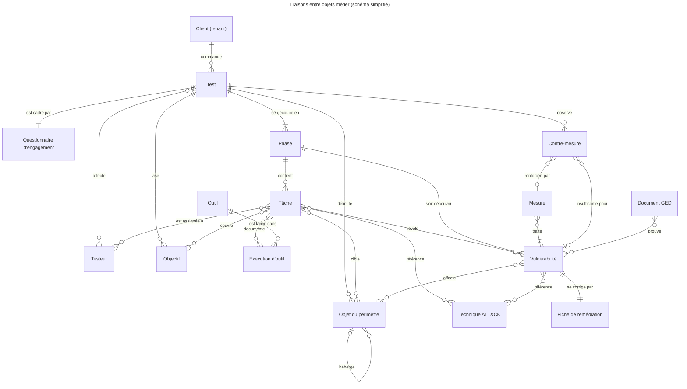

# Plan : schéma simplifié des liaisons entre objets métier (12.01 §2.4)

## Contexte

Le §2.4 du [[12.01 Rapport d'analyse du CDC]] relève que le CDC ne formalise pas les liens entre entités (objet du périmètre ↔ vulnérabilité, outil ↔ vulnérabilité, phase ↔ objets testés, tâche ↔ objectif) et suggère un schéma entité-relation, « même simplifié ». La synthèse le marque « 🟡 Partiel » (seul tâche ↔ objectif est couvert, par la section *Tâches*).

Décisions de Lionel (2026-11-09) :
- un **schéma simplifié** suffit maintenant ; le détail des liens sera développé dans une prochaine version ;
- il vit dans un **nouveau document 14.01**, nouvelle catégorie « 14 Modèle de données » ;
- il servira de base aux **modèles (MVC) et à la modélisation de la base** : à garder en mémoire (mémoire Claude + ligne dans 21.01) ;
- le §2.4 passe à **✅ Traité**.

Spécification uniquement : aucun code, aucune story modifiée.

## Modifications

### 1. Nouveau document — `docs/10-19 Conception/14 Modèle de données/14.01 Schéma des objets métier.md`

Sans frontmatter (comme 21.01 / 31.01). Titre `# 14.01 Schéma des objets métier`, puis :

**Objet** — schéma simplifié (version du 2026-11-09) des objets métier du [[11.01 Cahier des charges]], en réponse au §2.4 du [[12.01 Rapport d'analyse du CDC]]. Ni attributs ni tables techniques. Il sert de base aux modèles et aux migrations ; le détail des liens sera développé dans une prochaine version, lors de la modélisation des données.

**Schéma** — Mermaid `erDiagram`, noms d'entités et rôles entre guillemets (accents, espaces), indentation par tabulations comme dans le CDC :

Chaque cardinalité reprend une phrase du CDC (tâche dans une seule phase, zéro à plusieurs assignés, une fiche de remédiation par vulnérabilité, mesure → une ou plusieurs vulnérabilités, contre-mesure → lien éventuel, etc.).

**Lecture** — tableau des symboles : `||` exactement un, `o|` zéro ou un, `|{` un ou plusieurs, `o{` zéro, un ou plusieurs.

**Liens relevés par le 12.01 §2.4** — tableau :
| Lien | Dans le schéma |
| --- | --- |
| Objet du périmètre ↔ vulnérabilité | Direct, plusieurs à plusieurs (« Composants concernés ») |
| Outil ↔ vulnérabilité | Par la tâche : outil → exécution ↔ tâche ↔ vulnérabilité ; un lien direct dépend de la structure d'une exécution d'outil (12.01 §2.3) |
| Phase ↔ objets testés | Par la tâche, qui appartient à une phase et cible des objets du périmètre |
| Tâche ↔ objectif | Direct, plusieurs à plusieurs (CDC, *Objectifs › Tâches*) |

**Hors schéma** — documents GED : rattachement polymorphe à au moins un objet parmi test, phase, objectif, vulnérabilité, mesure, contre-mesure (seul le lien vers la vulnérabilité est dessiné) ; commentaires d'équipe et GED, mots-clés, historique, journal d'audit, ACL et groupes, trousseaux (entrées PKESK), jalons, notifications, catalogues des méthodologies et des exigences réglementaires.

**À préciser lors de la modélisation des données** :
- structure d'une exécution d'outil et lien direct avec les vulnérabilités (12.01 §2.3) ;
- phases fixes ou configurables (12.01 §2.8) : le schéma suppose les cinq phases du CDC ;
- mesures transverses : le CDC veut que chaque mesure pointe vers au moins une vulnérabilité, mais autorise des mesures « absentes des fiches » ;
- preuves de correction : rattachées à la vulnérabilité ou à sa fiche de remédiation (absente de la liste des objets GED) ;
- sous-types d'objets du périmètre (machine, service, compte, application, ressource cloud ou SaaS, site, équipement radio, cible d'ingénierie sociale) : table commune + tables par sous-module, ou table unique typée ;
- attributs, tables de liaison, liens polymorphes (documents, commentaires), rattachement explicite au tenant.

### 2. CDC — [11.01 Cahier des charges.md](docs/10-19 Conception/11 Cahier des charges/11.01 Cahier des charges.md)

Une phrase après la l. 11 (« Le projet sera le plus **modulaire** possible… ») : les liaisons entre objets métier sont résumées par le schéma simplifié de [[14.01 Schéma des objets métier]].

### 3. Rapport — [12.01 Rapport d'analyse du CDC.md](docs/10-19 Conception/12 Analyses et revues/12.01 Rapport d'analyse du CDC.md)

- **§2.4**, après la l. 115 : `**Traité** (2026-11-09) : [[14.01 Schéma des objets métier]] …` — schéma entité-relation simplifié des objets du [[11.01 Cahier des charges]] ; objet du périmètre ↔ vulnérabilité et tâche ↔ objectif y sont directs, phase ↔ objets testés et outil ↔ vulnérabilité passent par la tâche ; le détail des liens (attributs, tables de liaison, liens polymorphes) sera développé dans une prochaine version, lors de la modélisation des données.
- **Synthèse**, l. 319 : `🟡 Partiel : lien Tâche ↔ objectif ([[11.01 Cahier des charges]])` → `✅ [[14.01 Schéma des objets métier]]`, avec une **espace insécable** (U+00A0) après ✅.
- La ligne « Traité » du §2.2 (l. 95, « le reste du §2.4 demeure ouvert ») est un constat daté : elle reste telle quelle.

### 4. Classement

- [00.00 Index.md](docs/00-09 Système/00 Index/00.00 Index.md) : sous **10-19 Conception**, après 13, `**14 Modèle de données**` → `[[14.01 Schéma des objets métier]] : liaisons entre objets métier (schéma simplifié), base des modèles et des migrations`.
- [CLAUDE.md](CLAUDE.md), liste *Documents* : ligne `14.01 Schéma des objets métier` après `13.xx`.
- [README.md](README.md), tableau des domaines : `14 Modèle de données` ajouté à `10-19 Conception`, colonnes réalignées.

### 5. Garder en mémoire pour le MVC et la base

- [21.01 Organisation du code et conventions.md](docs/20-29 Développement/21 Organisation et conventions/21.01 Organisation du code et conventions.md), *Conventions* : les modèles Eloquent et les migrations partent de [[14.01 Schéma des objets métier]] ; avant la première migration métier, ce schéma est détaillé dans une nouvelle version (attributs, tables de liaison, liens polymorphes) et ses points « À préciser » sont tranchés.
- Mémoire Claude (type `project`) dans `C:\Users\ILP\.claude\projects\C--Users-ILP-Documents-GitHub-ILPlais-SuiviTestIntrusion\memory\schema-objets-metier-base-modele.md` : 14.01 est la base prévue des modèles et des migrations, et ses liens restent à détailler. **Why** : choix de Lionel du 2026-11-09. **How to apply** : avant toute story qui crée des modèles ou des migrations métier, relire 14.01 et proposer d'abord de le détailler. Créer `MEMORY.md` (absent) avec la ligne d'index.

### 6. Session et commit

- Copier la note de session ECC du jour (`~/.claude/session-data/2026-11-09-ec62f92e-session.tmp`, ou la plus récente) dans `.claude/session-data/`.
- Un commit en français sur `main`, uniquement avec les fichiers ci-dessus (exclure `.obsidian/*` et `.stories.md`). Message : `Schéma simplifié des liaisons entre objets métier : 14.01, 12.01 §2.4.` Corps : détail des choix, puis `Co-Authored-By: Claude Opus 5.5 <noreply@anthropic.com>`.
- `CHANGELOG.md` et `.stories/` non modifiés (comme les commits de spécification précédents).

## Vérification

- **Rendu Mermaid** : page HTML dans le scratchpad chargeant `mermaid@11` (jsdelivr), ouverte via le MCP chrome-devtools ; `mermaid.render` sans erreur, capture d'écran pour vérifier la lisibilité et l'affichage de « ATT&CK » (sinon renommer en « Technique MITRE ATT&CK » sans `&`). Contrôle final par Lionel en mode lecture Obsidian.
- `grep -nP '✅\x{00A0}\[\[14\.01' "…/12.01 Rapport d'analyse du CDC.md"` → une ligne ; plus aucun `🟡` dans la synthèse.
- Les liens `[[14.01 Schéma des objets métier]]` correspondent exactement au nom du fichier (grep du nom dans CDC, 12.01, 00.00, 21.01).
- `git status` / `git diff --stat` : seuls le nouveau 14.01, le CDC, le 12.01, 00.00, 21.01, `CLAUDE.md`, `README.md` et la note de session.
