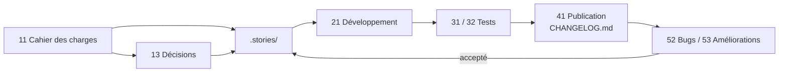

# 00.00 Index

La documentation est classée selon le système [Johnny.Decimal](https://johnnydecimal.com/) :

- **domaine** `10-19` : une grande étape du projet ;
- **catégorie** `11` : un sujet dans ce domaine (au plus dix par domaine) ;
- **identifiant** `11.01` : un document (au plus 99 par catégorie).

Chaque document porte son identifiant en tête de son nom ; on le cite par cet identifiant (« voir 12.01 §1.1 »). Un identifiant attribué n'est jamais réutilisé, même si le document est supprimé. Les identifiants `xx.00` sont réservés à l'index de leur catégorie.

## Plan de classement

- **00-09 Système**
  - **00 Index** : [[00.00 Index]] (cette note)
  - **01 Modèles** (dossier des modèles Obsidian)
    - [[01.01 Modèle ADR]]
    - [[01.02 Modèle bug]]
    - [[01.03 Modèle amélioration]]
    - [[01.04 Modèle campagne de tests]]
- **10-19 Conception**
  - **11 Cahier des charges**
    - [[11.01 Cahier des charges]] : spécification de référence, objectifs du projet et sommaire des parties
    - [[11.02 Socle technique]]
    - [[11.03 Serveur et API REST]]
    - [[11.04 Exports et modèles de rapport]]
    - [[11.05 Engagement]]
    - [[11.06 Gestion des utilisateurs]]
    - [[11.07 Périmètre]]
    - [[11.08 Déroulement du test]]
    - [[11.09 Vulnérabilités et remédiation]]
    - [[11.10 Cotation CVSS]]
    - [[11.11 Documents et chiffrement]]
    - [[11.12 Résultats]]
    - [[11.13 Annexes et références]]
  - **12 Analyses et revues**
    - [[12.01 Rapport d'analyse du CDC]] : lacunes du CDC, sections §1 à §6 citées par les stories
    - [[12.02 Revue Claude]]
    - [[12.03 Revue Cursor]]
    - [[12.04 Revue NotebookLM (cohérence)]]
    - `12.05 Anatomie d'un pentest (NotebookLM).webm` : vidéo
  - **13 Décisions d'architecture** : [[13.00 Index des ADR]], puis un ADR par identifiant `13.xx`
  - **14 Modèle de données**
    - [[14.01 Schéma des objets métier]] : liaisons entre objets métier (schéma simplifié), base des modèles et des migrations
- **20-29 Développement**
  - **21 Organisation et conventions**
    - [[21.01 Organisation du code et conventions]]
  - **22 Planification**
    - [[22.01 Planification du développement]] : Gantt prévisionnel des stories, sprints, jalons et chemin critique
- **30-39 Tests**
  - **31 Stratégie**
    - [[31.01 Stratégie de tests]]
  - **32 Campagnes** : [[32.00 Index des campagnes]], puis une campagne par identifiant `32.xx`
- **40-49 Publication**
  - **41 Livraison**
    - [[41.01 Versionnage et procédure de livraison]]
- **50-59 Retours**
  - **51 Traitement**
    - [[51.01 Traitement des retours]]
  - **52 Bugs** : [[52.00 Index des bugs]], puis un bug par identifiant `52.xx`
  - **53 Améliorations** : [[53.00 Index des améliorations]], puis une demande par identifiant `53.xx`

## Hors classement

Ces éléments restent hors de `docs/`, car des outils imposent leur emplacement :

- `.stories/` : backlog (epics, stories, sprints), géré par `ledger.js` du skill `story-lifecycle` d'ECC ;
- `CHANGELOG.md` : historique des versions, à la racine par convention ;
- `backend/` et `frontend/` : code applicatif, créés par la story `socle-1`.

## Parcours d'un besoin

