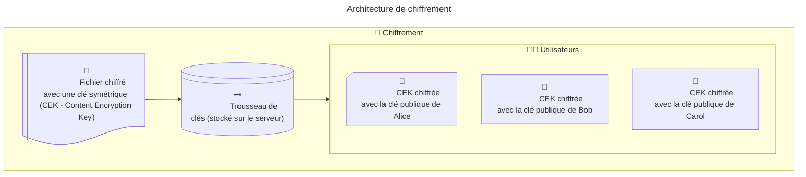
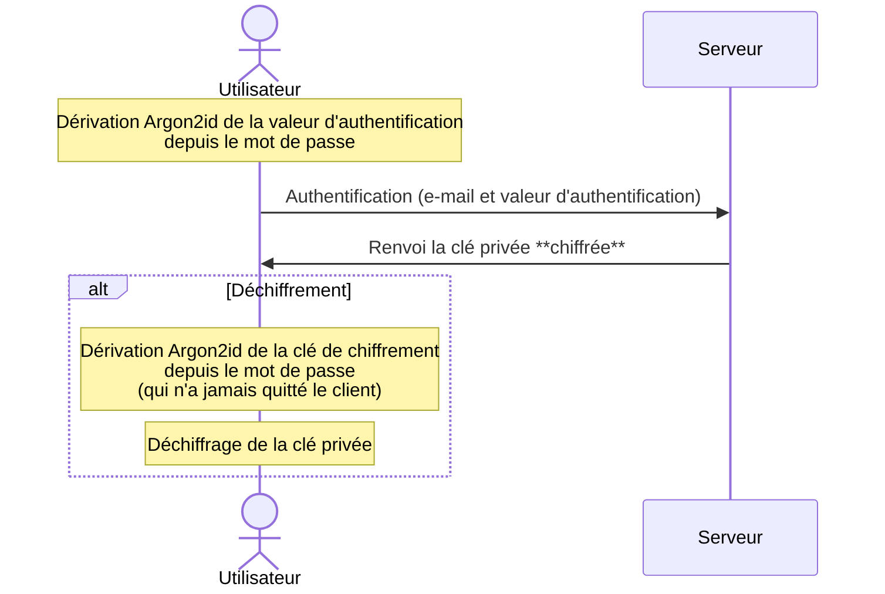

# Objectifs

Le projet consiste à effectuer des **suivis de tests d'intrusion**, afin d'y saisir toutes les étapes.

Le projet se présentera comme une **application Web** de type **SPA** (_Single Page Application_) côté client.

Le serveur Laravel ne traite **jamais** le contenu en clair des preuves chiffrées : génération des clés, chiffrement et déchiffrement s'exécutent **dans le navigateur**. Laravel expose uniquement l'API REST, le stockage des blobs chiffrés et les métadonnées.

Les utilisateurs pourront exporter les informations saisies sous forme de modèle de rapport, ou de sauvegarde.

Le projet sera le plus **modulaire** possible. Chaque module sera le plus **atomique** possible afin que les utilisateurs puissent sélectionner les informations.

Le projet sera de base prévu pour être **multilingue**.

# Technologies

## Versions

- **PHP** : [version **8.3**](https://www.php.net/downloads.php?version=8.3) ou supérieure ;
- **Laravel** : [version **11**](https://laravel.com/framework/docs/11.x/sanctum) ou supérieure (branche LTS au moment de l'implémentation) ;
- **Node.js** (outillage front / build de la SPA) : [version **20**](https://nodejs.org/docs/latest-v20.x/api/) ou supérieure.

## Serveur et API

La partie serveur sera codée en PHP à l'aide du framework **Laravel**.

Les communications entre le serveur et les applications clientes se feront **exclusivement** à l'aide d'une **API REST** versionnée (`/api/v1/…`).

### Authentification API

- Sessions navigateur et jetons personnels via **Laravel Sanctum** (jetons Bearer) ;
- **OAuth2** n'est pas requis en V1 ; une évolution Passport/OIDC pourra être ajoutée sans changer le contrat de ressources.
- Chaque jeton est révocable, scopé (lecture, écriture, export) et horodaté.

### Documentation, pagination, limites

Cette sous-section décrit **comment le navigateur ([SPA](https://fr.wikipedia.org/wiki/Single_page_application)) et le serveur se parlent**, et comment on évite trois problèmes classiques : « personne ne sait quels appels existent », « une liste de 10 000 lignes plante l'écran », « un script inonde le serveur ».

Rappel : une **API REST** est un ensemble d'adresses HTTP (comme `/api/v1/tests`) auxquelles le client envoie des demandes (lire, créer, modifier, supprimer). Le serveur répond par un **code HTTP** (succès ou erreur) et, en général, un texte **JSON** (données structurées). Le préfixe `/api/v1/` est le **numéro de contrat** : si un jour on casse la compatibilité, on ouvre `/api/v2/` sans arrêter les anciens clients.

#### Documentation OpenAPI (le « mode d'emploi » de l'API)

**OpenAPI** est un format standard (fichier JSON ou YAML) qui décrit, pour chaque appel : l'URL, le verbe HTTP (`GET` lire, `POST` créer, `PUT`/`PATCH` modifier, `DELETE` supprimer), les paramètres, le format des données envoyées et reçues, les droits nécessaires, les erreurs possibles. Ce n'est pas le programme lui-même : c'est le **catalogue** de ce que le programme accepte.

**Swagger UI** est une **page web** générée à partir de ce fichier. Elle affiche la liste des appels et permet, une fois connecté, de les tester dans le navigateur (formulaire + résultat). Elle sert aux administrateurs et aux développeurs, pas aux clients finaux du pentest.

Fonctionnement prévu :

1. Les développeurs décrivent les routes dans le code Laravel.
2. À l'installation, l'application **génère** le fichier OpenAPI 3.1 et l'interface Swagger UI.
3. Adresses par défaut (paramétrables) : `/api/documentation` (interface) et `/api/openapi.json` (fichier brut, utile aux outils).
4. Seuls les **administrateurs d'instance** y accèdent (même connexion Sanctum que l'API). En production, on peut **désactiver** l'interface tout en conservant le fichier pour l'équipe.

Chaque fiche d'appel documente au minimum : méthode, chemin, **périmètre de jeton** (lecture, écriture, export), codes HTTP, forme du JSON, exemples. Le **tenant** (organisation cliente) est déduit de l'utilisateur connecté : on ne le met pas en clair dans une URL publique si ce n'est pas nécessaire.

**Versionnage.** Un **changement cassant** (renommer un champ, supprimer un appel) impose `/api/v2/…`. La v1 reste disponible au moins jusqu'à la prochaine version majeure de l'application. Un **ajout compatible** (nouveau champ optionnel, nouvel appel) reste en v1 : les anciens clients ignorent simplement ce qu'ils ne connaissent pas.

#### Pagination (découper les listes)

Sans pagination, demander « toutes les vulnérabilités » pourrait renvoyer des milliers d'objets d'un coup : lenteur, mémoire, écran illisible. La **pagination** consiste à répondre **par tranches** : « voici les 50 suivantes, et un moyen d'obtenir la suite ».

Toutes les listes (`index`) sont paginées. Deux manières de désigner la tranche, au choix de l'instance (défaut : **curseur**) :

- **Par pages numérotées** (`page`, `limit`) — comme un livre : page 1, page 2, etc. Simple pour un tableau à l'écran (« page 3 sur 10 »). Inconvénient : si quelqu'un **ajoute une ligne** pendant que vous feuilletez, les pages **glissent** (une même ligne peut apparaître deux fois ou être sautée).
- **Par curseur** (`cursor`, `limit`) — le serveur dit : « reprends **après cet élément** » (jeton opaque, illisible pour l'humain, contenant en interne un identifiant et le tri). Si des lignes sont insérées pendant le parcours, on ne « décale » pas le reste. Mieux pour les **exports**, les **commentaires**, les **journaux d'audit**.

Paramètres communs, passés dans l'URL (query string) :

- `limit` : taille de la tranche. Défaut **50**, maximum **200**. Au-delà, refus (erreur de validation).
- `sort` / `order` : colonne de tri (liste **autorisée** par type d'objet, pour éviter de trier sur n'importe quel champ interne) et sens (`asc` croissant, `desc` décroissant). Défaut souvent : dernière modification, plus récent d'abord.
- Filtres : par exemple `filter[statut]`, `filter[phase]`, recherche texte. Seuls les filtres documentés dans OpenAPI sont acceptés.

La réponse n'est **jamais** un simple tableau. Elle a toujours deux parties :

- `data` : les objets de **cette** tranche ;
- `meta` : les indications pour afficher « suivant / précédent » et, en mode page, le total.

```json
{
	"data": [],
	"meta": {
		"limit": 50,
		"count": 50,
		"next_cursor": "…",
		"prev_cursor": null,
		"page": 1,
		"last_page": 4,
		"total": 180
	}
}
```

En mode page, `page`, `last_page` et `total` sont remplis (`total` = nombre d'éléments qui matchent les filtres, toutes pages confondues). En mode curseur, `total` est **omis** : compter toutes les lignes à chaque requête est coûteux sur une grosse base. `next_cursor` / `prev_cursor` valent `null` quand il n'y a plus de suite.

#### Limites de débit (rate limiting)

Le **rate limiting** est un **compte-gouttes** : on limite le nombre d'appels par unité de temps. Buts :

- protéger le serveur (génération PDF, gros fichiers) contre la saturation, volontaire ou accidentelle (boucle dans le navigateur) ;
- ralentir le **bourrage de mot de passe** sur la page de connexion ;
- rester équitable entre utilisateurs d'une même instance.

Fonctionnement : à chaque requête, le serveur incrémente un compteur **pour cet utilisateur** (et **pour cette adresse IP** sur les routes encore publiques, surtout la connexion). Si le plafond de la **classe** d'appel est dépassé, il refuse temporairement au lieu d'exécuter le travail.

Valeurs par défaut, **réglables** à l'installation :

| Classe          | À quoi ça correspond                                | Plafond par défaut                                                      |
| --------------- | --------------------------------------------------- | ----------------------------------------------------------------------- |
| Standard        | Lire ou modifier les données métier                 | 60 requêtes / minute                                                    |
| Écriture lourde | Téléversements GED, partage de clé de fichier (CEK) | 20 requêtes / minute, et **un** téléversement à la fois par utilisateur |
| Export          | PDF, OpenDocument, JSON/XML de migration            | 5 requêtes / minute, **deux** exports en parallèle par utilisateur      |
| Auth            | Connexion, renouvellement de session, 2FA           | 10 tentatives / minute / IP, puis attente de plus en plus longue        |

CRUD désigne les quatre opérations de base : Create, Read, Update, Delete (créer, lire, modifier, supprimer).

Si le plafond est atteint :

- le serveur répond **429** (« trop de requêtes ») ;
- il indique dans les **en-têtes HTTP** combien il autorise (`X-RateLimit-Limit`), combien il reste (`X-RateLimit-Remaining`), et **dans combien de secondes** réessayer (`Retry-After`) — le navigateur ou un script peut attendre automatiquement ;
- le JSON d'erreur utilise `code` = `rate_limited` (voir ci-dessous) ;
- l'événement est **audité** (sans mot de passe ni secret) pour repérer un abus.

**Taille des messages JSON** (hors fichiers GED) : limitée, défaut applicatif **2 Mo**, en cohérence avec la limite PHP `post_max_size`. Un fichier preuve n'emprunte pas ce plafond : il suit la taille maximale GED paramétrable.

#### Erreurs (comment le client sait ce qui n'a pas marché)

HTTP classe les réponses par **numéro** :

- **2xx** : succès ;
- **4xx** : le client a envoyé une demande que le serveur refuse (mauvais droit, donnée invalide, trop de requêtes) ;
- **5xx** : le serveur a échoué (bug, indisponibilité). Ce n'est pas de la faute de l'utilisateur.

Pour **toutes** les erreurs API, le corps est le **même type** d'objet JSON. Le client (SPA) n'affiche pas une page HTML Laravel : il lit ce JSON et montre un message dans l'interface.

```json
{
	"code": "validation_failed",
	"message": "La requête est invalide.",
	"details": {
		"limit": ["La valeur ne peut pas dépasser 200."]
	}
}
```

Rôle de chaque champ :

- `code` : mot-clé **stable**, identique en français ou en anglais. Le programme s'en sert pour décider (ex. : renvoyer vers la connexion si `unauthenticated`). Valeurs prévues : `unauthenticated`, `forbidden`, `not_found`, `conflict`, `validation_failed`, `rate_limited`, `payload_too_large`, `internal_error`.
- `message` : phrase **lisible**, traduite selon la langue du profil ou l'en-tête `Accept-Language`.
- `details` : précisions optionnelles (quel champ est faux, etc.). **Jamais** de trace technique, requête SQL, chemin sur le disque, ni secret.

Correspondance prévue avec HTTP :

| HTTP | `code` | Signification pour l'utilisateur |
| --- | --- | --- |
| 401 | `unauthenticated` | Pas (ou plus) connecté |
| 403 | `forbidden` | Connecté, mais pas le droit |
| 404 | `not_found` | Objet inexistant **ou** d'un autre client (tenant) — on ne révèle pas qu'il existe ailleurs |
| 409 | `conflict` | Quelqu'un a modifié la même fiche entre-temps (verrou optimiste) |
| 413 | `payload_too_large` | Message ou fichier trop gros |
| 422 | `validation_failed` | Donnée refusée (format, `limit` > 200, etc.) |
| 429 | `rate_limited` | Trop d'appels, attendre `Retry-After` |
| 500 | `internal_error` | Erreur serveur, sans détail interne |

## Bases de données

Les bases de données utilisées dépendront de la quantité de données à administrer. Ce sera à l'utilisateur de choisir lors de la mise en place du serveur.

Les systèmes de bases de données utilisables seront :
- SQLite ;
- MySQL / MariaDB ;
- PostgreSQL.

Le compte utilisé par Laravel pour se connecter au SGBD est un **compte technique** défini à l'installation. Il ne constitue **pas** un mode d'authentification des utilisateurs métier (voir Gestion des utilisateurs).

## Déploiement

Deux modes sont supportés, au choix de l'exploitant :

- **Docker Compose** (recommandé) : services `app`, `web` (HTTPS), `queue`, `database` optionnelle, volume des preuves chiffrées ;
- **Installation manuelle** sur un hôte PHP (documentation pas-à-pas : PHP-FPM, file d'attente, cron, permissions du stockage).

## Sauvegardes

La gestion des sauvegardes sera faite par [Portabase](https://portabase.io/).

Une sauvegarde **automatique** est paramétrable (fréquence par défaut : quotidienne) :

- Dump de la base (métadonnées, utilisateurs, trousseaux chiffrés) ;
- Copie du stockage des fichiers **déjà chiffrés** (pas de déchiffrement côté serveur) ;
- Horodatage, rétention paramétrable (défaut : 14 jours), journal du succès / échec.

Les archives de sauvegarde peuvent être chiffrées avec une clé d'exploitant distincte (GPG). La restauration est documentée et testable hors production.

## Journaux d'audit

Toute action sensible est consignée : auteur, horodatage, objet (test, vulnérabilité, document, utilisateur), action, résumé avant/après lorsque c'est pertinent. Les journaux d'audit ne contiennent **jamais** de secret en clair (mots de passe, CEK, clé privée). Conservation alignée sur la politique de rétention paramétrable.

Les événements audités incluent au minimum : connexions, changements d'ACL, partage/révocation de documents, exports, changements de statut de test ou de remédiation, validation client.

## Exports et modèles

Les données saisies par l'utilisateur pourront être exportées sous forme de rapports en **PDF**, de documents aux formats **OpenDocument** ou **HTML**, ainsi que des exports de données aux formats **JSON** et **XML**.

### Modèles de rapport par défaut

Trois modèles sont fournis, sélectionnables à l'export (et combinables : un export peut inclure plusieurs modèles) :

- **Exécutif** : contexte, risque global, graphiques, conclusions, mesures prioritaires (P1/P2), sans annexes techniques ni preuves brutes ;
- **Technique** : objectifs, phases, outils, vulnérabilités complètes (CVSS, business, remédiation), contre-mesures ;
- **Annexes preuves** : index des documents GED liés, métadonnées, extraits autorisés (le binaire chiffré n'est joint que si l'exportateur détient la CEK et a choisi l'option « inclure les fichiers »).

### Personnalisation

Par **entreprise prestataire** et, en surcharge, par **client** :

- Logo, couleurs de charte, typographie si le format le permet ;
- En-tête et pied de page (raison sociale, confidentialité, numérotation) ;
- Mentions légales et clause de non-responsabilité (préremplies depuis le questionnaire).

Les modèles restent des modules atomiques : l'utilisateur choisit les sections à inclure.

### Sauvegarde / migration applicative

L'export **JSON** (et XML équivalent) sert aussi à la **migration** entre instances :

- Schéma versionné (`schema_version`) ;
- Entités : références, engagement, périmètre, objectifs, vulnérabilités, planning, commentaires, métadonnées GED, trousseaux (toujours chiffrés) ;
- Les blobs de preuves sont un paquet à part (archive) référencé par identifiants ;
- Les clés privées utilisateurs **ne sont pas** incluses par défaut ; option explicite « export des coffres utilisateurs » réservée à une migration contrôlée.
- L'import vérifie la version du schéma et refuse un paquet incomplet.

# Fonctionnement

## Références

### Entreprise

- Nom et raison sociale ;
- Présentation.

### Testeur d'intrusion

- Identité ;
- Poste ;
- Présentation.

### Client

- Identité ;
- Présentation.

# Questionnaire d'engagement

Liste de questions posées au client, par exemple :
- **Questions relatives au test d'intrusion :**
	- Pourquoi le client a besoin d'effectuer un test d'intrusion sur son environnement ?
	- Quel est le type de test d'intrusion demandé ? (RedTeam, BlackBox, GreyBox, WhiteBox)
	- Le test d'intrusion est-il interne ou externe ?
	- Quel est le périmètre du test d'intrusion ? (Site physique + plage d'IP)
	- Quelles sont les exclusions du test d'intrusion ?
	- Y a-t-il des exclusions d'horaires à prévoir durant l'énumération ou l'exploitation ?
	- Y a-t-il des obligations de disponibilité sur certains équipements ? (précisez si oui)
	- Un prêt de matériel interne est-il prévu ? (poste utilisateur, carte à puce, etc.)
- **Questions relatives au contexte d'intrusion :**
	- Quel est le contexte prévu dans le test d'intrusion ? (exemple : stagiaire malveillant, ex-collaborateur, etc.)
	- Quelles seraient les motivations de l'attaquant ?
	- Quel est le contexte de compétences de l'attaquant ?
- **Questions systèmes et réseaux :**
	- Y a-t-il des équipements sauvegardés ou considérés fragiles ? (Systèmes avec tendances à tomber en panne, systèmes d'exploitation plus anciens ou qui ne sont pas mis à jour)
	- Présence d'équipements appartenant à un tiers ? (Nécessitant l'inclusion au contrat du test d'intrusion)
	- Y a-t-il des équipements non maitrisés ou non sauvegardés sur le périmètre ? (Incapacité de rollback, pas de sauvegarde, etc.)
	- Y a-t-il des équipements avec pertes de données inadmissibles ?
	- Des équipements de sécurité risquent-ils de bloquer ou remonter l'intrusion ?
	- Des réseaux Wi-Fi font-ils partie du périmètre ?
	- Des réseaux radio, Bluetooth, RFID font-ils partie du périmètre ?
- **Questions d'attaque physique (RedTeam) :**
	- Combien de sites inclus dans le périmètre ?
	- Cet emplacement physique est-il une installation partagée ?
		Si c'est le cas :
		- Combien d'étages sont dans la portée ?
		- Quels étages sont dans la portée ?
	- Existe-t-il des gardes de sécurité qui devront être contournés ?
		Si c'est le cas :
		- Les agents de sécurité sont-ils employés par une tierce partie ?
	- L'utilisation de « crochetage » ou hack matériel est-elle autorisée ?
	- Vol de matériel inclus dans les pratiques autorisées ?
		- Si oui, tous matériels possibles ? ou seulement une liste autorisé ?
- **Questions d'ingénierie sociale :**
	- Pratique de social engineering autorisée dans les tests ?
	- Y a-t-il une liste d'adresses de courriel autorisée dans le périmètre de la pratique ?
	- Y a-t-il une liste d'adresses de courriel interdite dans le périmètre de la pratique ?
	- Le client a-t-il une liste des numéros de téléphone à laquelle il souhaiterait qu'une attaque d'ingénierie sociale soit effectuée ?
	- L'ingénierie sociale est-elle destinée à obtenir un accès physique non autorisé ?
		Si c'est le cas :
		- Combien de personnes sont ciblées ?
- **Questions aux managers :**
	- Le ou les managers sont-ils conscients qu'un test est sur le point d'être exécuté ?
	- Quelle est la donnée principale qui créerait le plus grand risque pour l'organisation si elle était exposée, corrompue ou supprimée ?
	- Le test d'intrusion est annoncé ou secret ? (Utilisateurs du périmètre)
- **Questions concernant le rapport final :**
	- Une présentation du rapport final sera faite au client ?
	- Le rapport contiendra-t-il les fichiers de preuves récoltés lors des tests ou seulement un résumé ?
- **Clause de non-responsabilité :**
	- Information sur les risques possibles lors des tests ;
	- Avertissement sur l'exactitude et l'exhaustivité des résultats. Malgré les tests effectués, des failles pourraient ne pas être détectées (_0day_, hors périmètre, etc.).
- **Contacts d'urgence :**
	- En cas de problèmes majeurs lors des tests, quelles sont les personnes à contacter impérativement ?

# Gestion des utilisateurs

Une gestion des utilisateurs, avec des informations de connexion et différents droits, sera mise en place.

## Techniques d'authentification

En V1, le système d'authentification **applicative** (utilisateurs métier) repose sur des **comptes locaux**, stockés dans l'application et gérés par Laravel. Les fournisseurs **LDAP** et **Active Directory** sont reportés en V2 : le mot de passe d'un annuaire est vérifié par le serveur, il ne peut donc pas protéger la clé privée de l'utilisateur ([[13.03 Authentification locale et coffre de clés]]).

Le mot de passe ne quitte jamais le navigateur. Celui-ci en dérive une **valeur d'authentification** (Argon2id, sel calculé à partir de l'identifiant de l'instance et de l'adresse e-mail), seule transmise au serveur, qui la hache à son tour avec Argon2id ([[13.02 Dérivation de clé Argon2id]]). Le même mot de passe protège la clé privée de l'utilisateur (voir *Chiffrement*).

Les « droits utilisateurs sur la base de données » ne sont **pas** un fournisseur d'identité pour les testeurs ou les clients. Ils désignent uniquement le **compte technique SGBD** et les privilèges SQL accordés à Laravel à l'installation (lecture/écriture, pas de `SUPER`/`FILE` inutiles). Les utilisateurs finaux ne se connectent jamais avec un login SQL.

Une authentification à deux facteurs pourra également être paramétrée d'une des façons suivantes :
- Code à usage unique envoyé par e-mail ;
- Utilisation de Google Authenticator, ou d'un autre **TOTP** (_[Time based One Time Password](https://fr.wikipedia.org/wiki/Mot_de_passe_%C3%A0_usage_unique_bas%C3%A9_sur_le_temps)_) compatible.

## Politique de mots de passe

Valeurs par défaut, réglables à l'installation, conformes à NIST SP 800-63B-4 (détail dans [[13.03 Authentification locale et coffre de clés]]) :
- au moins **15 caractères**, au plus 128, sans troncature ; chaque point de code Unicode compte pour un caractère ;
- aucune règle de composition (types de caractères imposés) ;
- refus des mots de passe courants, compromis ou liés au service et à l'adresse de l'utilisateur, avec le motif du refus et un indicateur de robustesse ;
- aucune expiration périodique, mais un changement imposé en cas d'indice de compromission ;
- réutilisation des 5 derniers mots de passe interdite ;
- normalisation Unicode NFC avant toute dérivation.

Le serveur ne voyant jamais le mot de passe, la longueur et la liste de refus sont contrôlées dans le navigateur ; la réutilisation est contrôlée par le serveur, à partir des valeurs d'authentification.

## Verrouillage de compte

En plus de la limite de débit **Auth** par adresse IP :
- à partir de 5 échecs consécutifs sur un compte, un délai croissant précède chaque nouvelle tentative ;
- à 10 échecs consécutifs, le compte est verrouillé 15 minutes ;
- chaque verrouillage est audité et signalé à l'utilisateur par e-mail ; un administrateur peut déverrouiller le compte avant l'échéance ;
- le compteur repart à zéro après une connexion réussie.

## Clé de récupération

À l'enrôlement, le navigateur génère une **clé de récupération** (128 bits, affichée une seule fois en groupes de 4 caractères) qui chiffre une seconde copie de la clé privée. L'utilisateur doit la ressaisir avant que son compte soit activé ; elle n'est jamais envoyée au serveur.

- **Mot de passe oublié :** après un lien de réinitialisation envoyé par e-mail (et le deuxième facteur s'il est actif), le serveur fournit la copie chiffrée par la clé de récupération. Le navigateur la déverrouille, fait choisir un nouveau mot de passe et génère une nouvelle clé de récupération. Les preuves restent accessibles.
- **Mot de passe et clé de récupération perdus :** la réinitialisation du coffre, validée par un administrateur, crée une nouvelle paire de clés. Les anciennes entrées de trousseau deviennent illisibles et sont supprimées ; les autres détenteurs des fichiers concernés sont invités à les repartager. L'administrateur n'accède à aucun contenu.

## Niveaux des permissions (ACL)

Plusieurs niveaux de permissions seront paramétrables en fonction des utilisateurs et des modules. De base, il y aura un utilisateur « **root** » qui aura les droits d'administration sur tout le système.

Les autres droits dépendront des modules mis en place.
Un utilisateur pourra appartenir à plusieurs groupes tels que :
- Administrateur :
	- Administrer tout ou une partie des modules et droits utilisateurs.
- Chef de projet :
	- Remplir le questionnaire d'engagement avec le client ;
	- Planifier les tests à effectuer ;
	- Attribuer les tâches aux testeurs d'intrusion ;
	- Etc.
- Testeur d'intrusion
	- S'attribuer des tâches ;
	- Modifier le statut des tâches ;
	- Documenter les actions réalisées ;
	- Etc.
- Client final
	- Accès en lecture seule au rapport final ;
	- Accès aux détails des tests effectués **de son organisation uniquement** ;
	- Validation du rapport final ;
	- Etc.

## Isolation des données (multi-tenant)

Chaque **client** (organisation) est un tenant. Un utilisateur ne voit que les tests, documents, utilisateurs et exports de **ses tenants autorisés**.

- L'administrateur d'instance peut diriger plusieurs tenants.
- Le chef de projet et les testeurs sont rattachés à un ou plusieurs tenants (missions).
- Le client final n'appartient qu'à **son** tenant ; aucune énumération des autres clients est possible via l'API.
- Toutes les requêtes API filtrent par tenant ; un identifiant d'objet hors tenant renvoie `404`.

## Notifications et alertes

Notifications **in-app** (centre de notifications) et **e-mail** (paramétrable par utilisateur). Événements au minimum :

- Changement de statut du test (planifié → en cours → terminé → validé) ;
- Attribution ou modification d'une tâche ;
- Commentaire mentionnant un utilisateur ;
- Demande ou aboutissement d'un partage de document (CEK) ;
- Validation ou rejet du rapport par le client ;
- Passage d'une vulnérabilité en corrigé/vérifié ;
- Échec de sauvegarde (administrateurs uniquement).

Pas de SMS en V1. Les notifications ne contiennent pas de données sensibles en clair (pas d'extrait de preuve, pas de mot de passe).

# Périmètre

## Réseau

- Machines (IP, noms, etc.) ;
- Services ;
- Utilisateurs (noms, mots de passe, informations, etc.).

**Diagramme du réseau** créé avec [Mermaid](https://mermaid.js.org/).

# Objectifs

Liste des objectifs testés lors du test d'intrusion.

## Phases

Phase du test :

1. Reconnaissance ;
2. Énumération ;
3. Exploitation ;
4. Post-exploitation ;
5. Nettoyage.

## Outils

Outils utilisés lors des tests. Par exemple _Nmap_, _Metasploit_, _PowerShell_, etc.
Avec les commandes exécutées et les réponses.
Le code devra être affiché avec sa coloration syntaxique. [PrismJS](https://prismjs.com/) sera utilisé. Langages supportés **au minimum** : `bash`, `shell`, `powershell`, `python`, `php`, `javascript`, `sql`, `json`, `xml`, `yaml`, `markup`, `http`, `diff`, `ini`. Les autres grammaires PrismJS peuvent être activées par module sans changer le cœur.

## Statuts

Statuts des tests :

- Planifié ;
- En cours ;
- Terminé ;
- Validé.

## Planning (timeline / Gantt)

Chaque test, chaque **phase** et chaque **tâche** portent :

- Date et heure de début **prévues** ;
- Date et heure de fin **prévues** ;
- Date et heure de début **réelles** (saisies ou déduites du passage « En cours ») ;
- Date et heure de fin **réelles** (saisies ou déduites du passage « Terminé »).

**Jalons** prédéfinis, datables et cochables :

- Kick-off / signature de l'engagement ;
- Fin de reconnaissance ;
- Fin d'énumération ;
- Fin d'exploitation ;
- Remise du rapport ;
- Validation client.

Le **temps passé par phase** est la somme des durées réelles des tâches de la phase. Une saisie manuelle d'ajustement reste possible (commentaire obligatoire).

Une **vue Gantt** (phases et jalons) est fournie en V1 dans l'interface du test ; elle est optionnelle à l'export (case à cocher dans le modèle technique).

## Collaboration

Plusieurs **testeurs** peuvent être affectés au **même test**. Le chef de projet attribue les tâches ; un testeur peut s'attribuer une tâche encore libre.

- L'édition concurrente d'un même champ : le dernier enregistrement validé l'emporte ; un avertissement est affiché si la ressource a changé depuis le chargement (verrou optimiste).
- **Commentaires d'équipe** (fil de discussion) sur : le test, une tâche, une vulnérabilité, une mesure. Distincts des commentaires GED attachés à un fichier.
- **Historique des modifications** métier (audit lisible) : auteur, date, champ, ancienne valeur, nouvelle valeur, sur les entités principales. Pas de secret en clair.

## Vulnérabilités

- Référence ;
- Identifications [_Common Vulnerability and Exposures_](https://www.cve.org/) et/ou [_Common Weakness Enumeration_](https://cwe.mitre.org/).
- Description ;
- Phase ;
- Composants concernés ;
- Documents GED liés (preuves, extraits, captures).

#### Échelle de risque

L'échelle de risque utilisée pour évaluer les vulnérabilités identifiées est la suivante :

| **Niveau**       | **Score**      | **Description**                                                                                                                                                                                          |
| ---------------- | -------------- | -------------------------------------------------------------------------------------------------------------------------------------------------------------------------------------------------------- |
| **⚪ Aucun**      | $0.0$          |                                                                                                                                                                                                          |
| **🟢 Mineur**    | $0.1 \to 3.9$  | Le risque est **faible** et n'a qu'un **impact mineur** sur le système d'information. Il peut être **corrigé sans nuire** au fonctionnement du système.                                                  |
| **🟡 Important** | $4.0 \to 6.9$  | Le risque est **modéré** et peut avoir un **impact significatif** sur le système d'information. Il doit être **corrigé à moyen terme** pour éviter des perturbations importantes.                        |
| **🟠 Majeur**    | $7.0 \to 8.9$  | Le risque est **grave** et peut avoir un **impact catastrophique** sur le système d'information. Il doit être **corrigé à court terme** pour éviter une interruption totale du système.                  |
| **🔴 Critique**  | $9.0 \to 10.0$ | Le risque est **très grave** et peut entraîner la **destruction totale** du système d'information. Il doit être **corrigé immédiatement** pour éviter une perte totale de données et de fonctionnalités. |

Elle est établie à partir des spécifications pour les **métriques de base** du système de score [_Common Vulnerability Scoring System_](https://www.first.org/cvss/v3.1/specification-document) (CVSS).

Nous n'utiliserons pas ici ni la métrique temporelle, ni la métrique environnementale. En effet, à la différence des métriques de base, celles-ci évoluent en fonction du temps ou de l'environnement dans lequel évolue le système analysé.

**Version CVSS :** le moteur **par défaut** est **CVSS v3.1**. Les formules et coefficients de cette section (8,22, 6,42, vecteur AV/AC/PR/UI/S/C/I/A) s'appliquent **uniquement** à la v3.1. Ils ne doivent pas servir à calculer un score v4.0.

**CVSS v4.0** est un **second moteur optionnel**, au choix par vulnérabilité (ou par politique d'instance). Il utilise le vecteur et le calcul officiels FIRST v4.0 (métriques AT, VC/VI/VA, etc.), **sans** réutiliser les équations ci-dessous. L'échelle de niveaux (Aucun → Critique) reste la même pour l'affichage. Le tableau de bord agrège les scores **dans la version choisie pour chaque fiche** ; un mélange v3.1 / v4.0 sur un même test est autorisé mais signalé.

Le score du niveau de risque (v3.1) est une combinaison des métriques d'exploitabilité et d'impact. Il est compris entre **$0.0$** à **$10.0$**, la valeur **$10.0$** correspondant aux vulnérabilités les plus graves.

#### Calcul

Le calcul se fait à l'aide des valeurs des métriques avec les équations suivantes :

##### Impact

**Si $\text{Portée} = \text{Inchangée}$ :**
$$
\text{Impact} = 6.42
	\times \text{ImpactSousScore}
$$

**Si $\text{Portée} = \text{Changée}$ :**
$$
\text{Impact} = 7.52
	\times (\text{ImpactSousScore} - 0.029) - 3.25
	\times (\text{ImpactSousScore} - 0.02)^{15}
$$

**Où $\text{ImpactSousScore}$ est défini par :**
$$
\text{ImpactSousScore} = 1 - [(1 - \text{Confidentialité})
	\times (1 - \text{Intégrité})
	\times (1 - \text{Disponibilité})]
$$

##### Exploitabilité

$$
\text{Exploitabilité} = 8.22
	\times \text{VecteurAttaque}
	\times \text{ComplexitéAttaque}
	\times \text{PrivilègesRequis}
	\times \text{InteractionUtilisateur}
$$

##### Score final

$$
\begin{align}
	\text{Si} &(\text{Impact} \leq 0)\\
		& \text{ScoreBase} = 0\\
	\text{Sinon, si} &(\text{Portée} = \text{Inchangée})\\
		& \text{ScoreBase} = \text{ArrondiSupérieur}(\min[(\text{Impact} + \text{Exploitabilité}), 10])\\
	\text{Sinon, si} &(\text{Portée} = \text{Changée})\\
		& \text{ScoreBase} = \text{ArrondiSupérieur}(\min[1.08 \times (\text{Impact} + \text{Exploitabilité}), 10])
\end{align}
$$

La condition $\text{Impact} \leq 0$ est évaluée **en premier** ([spécification CVSS v3.1](https://www.first.org/cvss/v3.1/specification-document), §7.1) : une vulnérabilité sans impact sur la confidentialité, l'intégrité et la disponibilité ($C = I = A = \text{Aucune}$) obtient un score de $0.0$, quelle que soit son exploitabilité.

La fonction $\text{ArrondiSupérieur}$ arrondit au dixième supérieur (par exemple, $4.02$ devient $4.1$).

#### Métrique d'exploitabilité

##### Vecteur d'attaque (AV)

Cette mesure reflète le contexte dans lequel l'exploitation de la vulnérabilité est possible. **Cette valeur métrique sera d'autant plus grande que l'attaquant peut être éloigné (logiquement et physiquement)** pour exploiter le composant vulnérable. L'hypothèse est que le nombre d'attaquants potentiels pour une vulnérabilité qui pourrait être exploitée à partir d'Internet est plus important que le nombre d'attaquants potentiels qui pourraient exploiter une vulnérabilité nécessitant un accès physique à un appareil.

| **Vecteur d'attaque** | **Description**                                                                                                                              | **Valeur**                     |
| --------------------- | -------------------------------------------------------------------------------------------------------------------------------------------- | ------------------------------ |
| **⚫ Réseau (N)**     | La vulnérabilité peut être exploitée à partir d'un **système distant**.                                                                      | $\text{VecteurAttaque} = 0.85$ |
| **🔴 Adjacent (A)**   | La vulnérabilité peut être exploitée à partir d'un **système adjacent**, tel qu'un système sur le même réseau local ou sur un réseau voisin. | $\text{VecteurAttaque} = 0.62$ |
| **🟠 Local (L)**      | La vulnérabilité peut uniquement être exploitée à partir du **système hôte**.                                                                | $\text{VecteurAttaque} = 0.55$ |
| **🟡 Physique (P)**   | La vulnérabilité nécessite un **accès physique au système** pour être exploitée.                                                             | $\text{VecteurAttaque} = 0.2$  |

##### Complexité d'attaque (AC)

La complexité d'attaque est une métrique qui mesure la complexité de l'exploitation d'une vulnérabilité. **Elle est établie sur les connaissances, les compétences et les ressources** nécessaires à l'attaquant pour exploiter la vulnérabilité.

| **Complexité**    | **Description**                                                                                                                                                                                           | **Valeur**                        |
| ----------------- | --------------------------------------------------------------------------------------------------------------------------------------------------------------------------------------------------------- | --------------------------------- |
| **⚫ Faible (L)** | L'exploitation de la vulnérabilité **ne nécessite pas de compétences ou de ressources particulières**.                                                                                                    | $\text{ComplexitéAttaque} = 0.77$ |
| **🔴 Élevée (H)** | L'exploitation de la vulnérabilité **nécessite des compétences ou des ressources particulières**, telles que des connaissances techniques avancées ou un accès à des outils ou des logiciels spécifiques. | $\text{ComplexitéAttaque} = 0.44$ |

##### Privilèges requis (PR)

Les privilèges requis sont une métrique qui mesure le niveau de privilèges requis pour exploiter une vulnérabilité. Elle est établie sur **les privilèges ou l'accès spécial dont l'attaquant a besoin** pour exploiter la vulnérabilité.

| **Privilège**    | **Description**                                                                                         | **Valeur**                                                                                                                                                                                 |
| ---------------- | ------------------------------------------------------------------------------------------------------- | ------------------------------------------------------------------------------------------------------------------------------------------------------------------------------------------ |
| **⚫ Aucun (N)** | L'exploitation de la vulnérabilité ne nécessite **aucun privilège ou accès spécial**.                   | $\text{PrivilègesRequis} = 0.85$                                                                                                                                                           |
| **🔴 Bas (L)**   | L'attaquant nécessite des **privilèges de base**, tels que les privilèges d'utilisateur.                | $\begin{align}\text{Si} &(\text{Portée} = \text{Inchangée})\\ & \text{PrivilègesRequis} = 0.62\\ \text{Si} &(\text{Portée} = \text{Changée})\\ &\text{PrivilègesRequis} = 0.68\end{align}$ |
| **🟡 Haut (H)**  | L'attaquant nécessite des **privilèges élevés**, tels que les privilèges d'administrateur ou de _root_. | $\begin{align}\text{Si} &(\text{Portée} = \text{Inchangée})\\ & \text{PrivilègesRequis} = 0.27\\ \text{Si} &(\text{Portée} = \text{Changée})\\ &\text{PrivilègesRequis} = 0.5\end{align}$  |

##### Interaction de l'utilisateur (UI)

L'interaction de l'utilisateur est une métrique qui mesure le niveau d'**interaction de l'utilisateur requis** pour exploiter une vulnérabilité. Elle est établie sur l'action que l'utilisateur doit effectuer pour que l'attaquant puisse exploiter la vulnérabilité.

| **Interaction**    | **Description**                                                                                                                                        | **Valeur**                             |
| ------------------ | ------------------------------------------------------------------------------------------------------------------------------------------------------ | -------------------------------------- |
| **⚫ Aucune (N)**   | L'exploitation de la vulnérabilité ne nécessite **aucune interaction de la part de l'utilisateur**.                                                    | $\text{InteractionUtilisateur} = 0.85$ |
| **🔴 Requise (R)** | L'exploitation de la vulnérabilité nécessite **une interaction de la part de l'utilisateur**, telle qu'une saisie de données ou un clique sur un lien. | $\text{InteractionUtilisateur} = 0.62$ |

##### Portée (S)

La portée est une métrique qui mesure l'**étendue potentielle de l'impact** d'une vulnérabilité. Elle est établie sur les données ou les systèmes qui peuvent être affectés par l'exploitation de la vulnérabilité.

| **Portée**           | **Description**                                                                                                                                                                  | **Valeur** |
| -------------------- | -------------------------------------------------------------------------------------------------------------------------------------------------------------------------------- | ---------- |
| **⚫ Changée (C)**    | La vulnérabilité affecte **les données ou les systèmes qui sont indirectement accessibles** à l'attaquant, tels que les données partagées ou les systèmes connectés à un réseau. | _Pas de valeur propre_ : $\text{PrivilègesRequis}$ (L = $0.68$, H = $0.5$), formule d'$\text{Impact}$ « Changée », facteur $1.08$ sur le $\text{ScoreBase}$ |
| **🔴 Inchangée (U)** | La vulnérabilité affecte uniquement **les données ou les systèmes qui sont directement accessibles** à l'attaquant.                                                              | _Pas de valeur propre_ : $\text{PrivilègesRequis}$ (L = $0.62$, H = $0.27$), $\text{Impact} = 6.42 \times \text{ImpactSousScore}$, pas de facteur |

Conformément à la [spécification CVSS v3.1](https://www.first.org/cvss/v3.1/specification-document) (§7.4), la portée **n'a pas de coefficient numérique** : elle n'entre pas dans les équations comme un multiplicateur, mais **sélectionne** les valeurs de $\text{PrivilègesRequis}$, la formule d'$\text{Impact}$ et le calcul du $\text{ScoreBase}$ décrits ci-dessus.

#### Métrique d'impact

Les métriques d'impact mesurent l'impact potentiel d'une vulnérabilité si elle est exploitée avec succès. Elles sont divisées en trois catégories : confidentialité, intégrité et disponibilité.

##### Confidentialité (C)

Une vulnérabilité qui affecte la confidentialité des données peut permettre à un attaquant d'**accéder à des données sensibles**, telles que des informations personnelles, des données financières ou des secrets commerciaux.

| **Confidentialité** | **Description**                                                                                                                                                                                                                                                                                                                                                                                                   | **Valeur**                      |
| ------------------- | ----------------------------------------------------------------------------------------------------------------------------------------------------------------------------------------------------------------------------------------------------------------------------------------------------------------------------------------------------------------------------------------------------------------- | ------------------------------- |
| **🔴 Grave (H)**    | Il y a une **perte totale de confidentialité**, ce qui fait que toutes les ressources du système touché sont divulguées à l'attaquant. Il est également possible de n'avoir accès qu'à certaines informations restreintes, mais les informations divulguées ont un impact direct et sérieux. Par exemple, un pirate vole le mot de passe de l'administrateur ou les clés de chiffrement privées d'un serveur Web. | $\text{Confidentialité} = 0.56$ |
| **🟠 Faible (L)**   | Il y a une **certaine perte de confidentialité**. L'accès à certaines informations restreintes est obtenu, mais l'attaquant n'a pas le contrôle sur les informations obtenues, ou le montant ou le type de perte est limité. La divulgation d'informations n'entraîne pas de pertes directes et graves pour le système concerné.                                                                                  | $\text{Confidentialité} = 0.22$ |
| **🟢 Aucune (N)**   | Il n'y a **pas de perte de confidentialité** au sein du système concerné.                                                                                                                                                                                                                                                                                                                                         | $\text{Confidentialité} = 0$    |

##### Intégrité (I)

Une vulnérabilité qui affecte l'intégrité des données peut permettre à un attaquant de **modifier ou de corrompre des données**.

| **Intégrité**     | **Description**                                                                                                                                                                                                                                                                                                                                       | **Valeur**                |
| ----------------- | ----------------------------------------------------------------------------------------------------------------------------------------------------------------------------------------------------------------------------------------------------------------------------------------------------------------------------------------------------- | ------------------------- |
| **🔴 Élevé (H)**  | Il y a une **perte totale d'intégrité** ou une **perte totale de protection**. Par exemple, l'attaquant est en mesure de modifier tous les fichiers protégés par le système concerné. Ou bien, seuls certains fichiers peuvent être modifiés, mais une modification malveillante aurait des conséquences directes et graves pour le système concerné. | $\text{Intégrité} = 0.56$ |
| **🟠 Faible (L)** | La **modification des données est possible**, mais l'attaquant n'a pas de contrôle sur les conséquences d'une modification, ou la quantité de modification est limitée. La modification des données n'a pas d'impact direct et sérieux sur le système concerné.                                                                                       | $\text{Intégrité} = 0.22$ |
| **🟢 Aucune (N)** | Il n'y a **pas de perte d'intégrité** dans le système touché.                                                                                                                                                                                                                                                                                         | $\text{Intégrité} = 0$    |

##### Disponibilité (A)

Une vulnérabilité qui affecte la disponibilité des données peut **rendre les données inaccessibles** aux utilisateurs légitimes.

| **Disponibilité** | **Description**                                                                                                                                                                                                                                                                                                                                                                                     | **Valeur**                    |
| ----------------- | --------------------------------------------------------------------------------------------------------------------------------------------------------------------------------------------------------------------------------------------------------------------------------------------------------------------------------------------------------------------------------------------------- | ----------------------------- |
| **🔴 Élevé (H)**  | L'attaquant peut **bloquer l'accès total** au système (perte totale, soutenue ou persistante) ou **partielle** (exemple : empêcher de nouvelles connexions). La perte de disponibilité a un **impact grave** (exemple : service indisponible).<br/><br/>Exemple : L'attaquant exploite une vulnérabilité pour monopoliser la mémoire, rendant le service indisponible après plusieurs utilisations. | $\text{Disponibilité} = 0.56$ |
| **🟠 Faible (L)** | L'attaque **réduit les performances** ou **interrompt** la disponibilité des ressources, mais ne bloque pas totalement l'accès. L'impact est **modéré** et n'a pas de conséquence grave pour le système.<br/><br/>Exemple : L'attaque ralentit le service, mais ne le rend pas indisponible.                                                                                                        | $\text{Disponibilité} = 0.22$ |
| **🟢 Aucune (N)** | Il n'y a **pas d'impact** sur la disponibilité du système concerné.                                                                                                                                                                                                                                                                                                                                 | $\text{Disponibilité} = 0$    |

### Impact sur le business

#### Opérationnel

| **Niveau** | **Description**                        |
| ---------- | -------------------------------------- |
| **⚪ 0**   | Non applicable                         |
| **🟡 1**   | Dégâts limités sur la production       |
| **🟠 2**   | Dégâts significatifs sur la production |
| **🔴 3**   | Dégâts majeurs sur la production       |
| **⚫ 4**   | Arrêt de production sur le long terme  |

#### Légal

| **Niveau** | **Description**                                                                                                                                                                                                                                                         |
| ---------- | ----------------------------------------------------------------------------------------------------------------------------------------------------------------------------------------------------------------------------------------------------------------------- |
| **⚪ 0**   | Non applicable                                                                                                                                                                                                                                                          |
| **🟡 1**   | Non respect des engagements et [_SLA_](https://fr.wikipedia.org/wiki/Service-level_agreement)                                                                                                                                                                           |
| **🟠 2**   | Non respect d'une norme obligatoire ([_PCI DSS_](https://fr.wikipedia.org/wiki/Norme_de_s%C3%A9curit%C3%A9_de_l%27industrie_des_cartes_de_paiement), [_RGPD_](https://fr.wikipedia.org/wiki/R%C3%A8glement_g%C3%A9n%C3%A9ral_sur_la_protection_des_donn%C3%A9es), etc.) |
| **🔴 3**   | Perte d'une certification ([_ISO_](https://fr.wikipedia.org/wiki/Organisation_internationale_de_normalisation), _PCI DSS_, etc.)                                                                                                                                        |
| **⚫ 4**   | Poursuite judiciaire possible                                                                                                                                                                                                                                           |

#### Financier

| **Niveau** | **Description**                                                  |
| ---------- | ---------------------------------------------------------------- |
| **⚪ 0**   | Non applicable                                                   |
| **🟡 1**   | Les coûts de dommages sont moins élevés que résoudre le problème |
| **🟠 2**   | Effet mineur sur le bénéfice annuel                              |
| **🔴 3**   | Effet significatif sur le bénéfice annuel                        |
| **⚫ 4**   | Pouvant amener au dépôt de bilan                                 |

#### Image

| **Niveau** | **Description**          |
| ---------- | ------------------------ |
| **⚪ 0** | Non applicable           |
| **🟡 1** | Dégâts minimes           |
| **🟠 2** | Perte de confiance       |
| **🔴 3** | Perte de grands comptes  |
| **⚫ 4** | Dégradation de la marque |

### Remédiation

Chaque vulnérabilité dispose d'une **fiche de remédiation**, distincte de la description du constat. Elle contient :

- **Recommandations techniques détaillées** : actions concrètes (configuration, correctif, architecture, compensation). Champ texte riche, éventuellement structuré en étapes.
- **Priorité de correction** : saisie par le chef de projet, **indépendante** du score CVSS (celui-ci reste un indicateur de gravité technique). Valeurs :
	- **P1** — immédiat (blocage ou exposition critique) ;
	- **P2** — court terme ;
	- **P3** — moyen terme ;
	- **P4** — opportunité / durcissement.
	Par défaut, une suggestion automatique est proposée à partir du niveau CVSS (Critique → P1, Majeur → P2, Important → P3, Mineur/Aucun → P4) et **peut être surchargée** en tenant compte de l'impact business.
- **Ressources** : liens vers patches, avis vendeur, documentation, bulletins CVE/CWE, procédures internes.
- **Statut de remédiation** :
	- À faire ;
	- En cours ;
	- Corrigé (déclaré par le client ou l'équipe) ;
	- Vérifié (retest par un testeur, avec date et résultat).
- **Preuves de correction** : documents GED liés (captures après patch, tickets, extraits de config).

Les mesures agrégées du rapport (section Résultats) sont dérivées de ces fiches, avec un texte de synthèse éditable.

## Documents

Il sera possible de stocker les preuves récoltées lors des tests dans un système de gestion des documents (GED). Les fichiers qui pourront être stockés seront :
- Les captures d'écran ;
- Les logs et captures réseaux ;
- Etc.

Chaque document est **lié** à au moins un objet métier : test, phase, objectif, vulnérabilité, mesure ou contre-mesure. Un même fichier peut être rattaché à plusieurs objets.

### Organisation du stockage

- Les **blobs** (fichiers chiffrés) sont stockés **hors base de données**, sur un disque local (volume Docker ou répertoire configuré) ou un stockage objet **S3-compatible**, au choix à l'installation.
- La base ne conserve que les **métadonnées** (nom, MIME, taille, hash du ciphertext, liens, ACL, identifiant de trousseau).
- Convention de clés / chemins : `{tenant_id}/{test_id}/{yyyy}/{mm}/{document_uuid}.bin` (pas de nom original dans le chemin, pour limiter les fuites).
- **Types MIME** acceptés par défaut (liste paramétrable) : images (`image/png`, `image/jpeg`, `image/webp`, `image/gif`), `application/pdf`, `text/plain`, `text/csv`, archives (`application/zip`, `application/gzip`), captures réseau (`application/vnd.tcpdump.pcap`, `application/octet-stream` pour `.pcap`/`.pcapng`), extraits de logs. Les exécutables (`.exe`, `.dll`, `.msi`, ELF) sont **refusés** par défaut.
- Un **scan antivirus** à l'upload (ClamAV ou équivalent) est recommandé et activable ; en cas de détection, le fichier est rejeté et l'événement est audité.
- **Rétention et purge** : durée paramétrable par tenant (défaut : durée de vie du test + 24 mois). La purge efface blob, métadonnées et trousseau. Une purge anticipée est possible pour le propriétaire ou l'administrateur, avec audit.

### Gestion

Pour chaque document, des commentaires, ainsi que des mots-clés, pourront être ajoutés par les différents intervenants.

L'accès à ces documents sera soumis à des **ACL** (qui *peut* demander l'accès) **et** au **trousseau cryptographique** (qui *peut* déchiffrer). Les deux conditions sont nécessaires (ET logique).

Si un administrateur ou un chef de projet **accorde** une ACL :

1. Le serveur enregistre le droit et crée une **demande de partage CEK** ;
2. Une notification est envoyée aux détenteurs actuels de la CEK (propriétaire en priorité) ;
3. Un détenteur, **côté client**, chiffre la CEK avec la clé publique du bénéficiaire et met à jour le trousseau ;
4. Tant que l'étape 3 n'est pas faite, le bénéficiaire voit le document dans la liste mais **ne peut pas** le déchiffrer.

Un administrateur **ne peut pas** contourner le chiffrement. Il peut seulement gérer les ACL, révoquer, et (s'il est déjà dans le trousseau) participer au partage.

La taille maximale des fichiers sera paramétrable.

### Chiffrement

Compte tenu de la sensibilité des documents, ceux-ci seront stockés chiffrés au format OpenPGP (RFC 9580, v6), avec la bibliothèque openpgp.js, selon [[13.01 Format de chiffrement des preuves]].

Les fichiers seront chiffrés avec une clé symétrique AES-256 (_Content Encryption Key_, la *session key* d'OpenPGP), en mode authentifié GCM (paquet SEIPD v2, découpé en blocs pour traiter les gros fichiers en flux).

Chaque utilisateur disposera d'une paire de clés OpenPGP v6 (Ed25519 / X25519). La clé privée sera stockée sur le serveur de façon chiffrée (mécanisme S2K d'OpenPGP avec Argon2id, paramètres selon [[13.02 Dérivation de clé Argon2id]]), afin que seul l'utilisateur puisse y accéder à l'aide de son mot de passe.

Pour chaque fichier sur le serveur, un trousseau de clés sera créé pour y stocker la clé symétrique permettant d'accéder au fichier pour chaque utilisateur. Chaque entrée est un paquet PKESK détaché : le fichier chiffré ne contient aucun destinataire. Le format est identifié par le champ `schema_crypto` du document (`openpgp-v6/seipd2-aes256-gcm`).



Pour autoriser un utilisateur à accéder à un fichier, il faudra que la clé d'accès au fichier soit chiffrée avec la clé publique de l'utilisateur, et ajoutée au trousseau.

Le flux de connexion d'un utilisateur sera :



La valeur d'authentification et la clé de chiffrement sont dérivées avec des sels différents : connaître l'une ne donne pas l'autre ([[13.03 Authentification locale et coffre de clés]]).

### Téléversement d'un fichier

1. Client génère une CEK aléatoire
2. Client chiffre le fichier avec la CEK (paquet SEIPD v2, AES-256-GCM)
3. Client chiffre la CEK avec sa propre clé publique (paquet PKESK)
4. Client envoie au serveur :
	- Le fichier chiffré
	- Le trousseau initial (CEK chiffrée pour lui-même)

### Ajout d'un utilisateur autorisé (par le propriétaire)

1. Client télécharge le trousseau du fichier ;
2. Client déchiffre la CEK avec sa clé privée (en local) ;
3. Client récupère la clé publique du nouvel utilisateur (depuis le serveur) ;
4. Client chiffre la CEK avec cette clé publique, en reprenant l'algorithme indiqué par `schema_crypto` (un PKESK v6 ne le contient pas) ;
5. Client envoie la nouvelle entrée au serveur ;
	- Le fichier chiffré n'est pas retouché.

### Téléchargement et déchiffrement

1. Client télécharge le fichier chiffré + son entrée du trousseau
2. Client déchiffre la CEK avec sa clé privée (en local)
3. Client déchiffre le fichier avec la CEK (en local)

### Révocation d'un utilisateur

La révocation **par défaut** pour un départ d'équipe, un changement de tenant ou un incident est la **révocation forte** :

1. Le propriétaire (ou un détenteur encore autorisé) génère une **nouvelle CEK**, rechiffre le fichier côté client, reconstruit le trousseau **sans** l'utilisateur révoqué, et remplace le blob sur le serveur ;
2. L'ancienne entrée de trousseau et l'ancienne ACL sont supprimées ; l'événement est audité.

La révocation **douce** (simple suppression de l'entrée de trousseau, sans rechiffrement) reste disponible pour un retrait temporaire. Elle **n'empêche pas** un utilisateur qui aurait déjà téléchargé le fichier et la CEK de conserver une copie hors ligne. Cette limite doit être affichée à l'opérateur avant confirmation.

### Points de vigilance

**Architecture SPA :** le déchiffrement 100 % client impose une SPA (ou un composant JavaScript équivalent). Le serveur PHP ne lit jamais le contenu des preuves. Les exports « avec fichiers » se construisent dans le navigateur de l'utilisateur qui possède les CEK.

**Confiance dans le serveur :** le serveur distribue les clés publiques. Un serveur compromis pourrait substituer une clé publique malveillante lors de l'ajout d'un destinataire, permettant à un attaquant de récupérer la CEK. Une mitigation est de permettre aux utilisateurs de vérifier les empreintes (_fingerprints_) de leurs clés hors bande.

**Rotation du mot de passe :** si un utilisateur change son mot de passe, le navigateur déchiffre sa clé privée avec l'ancien, la rechiffre avec le nouveau (nouveau sel Argon2id), vérifie que l'empreinte est inchangée, puis la renvoie au serveur avec la nouvelle valeur d'authentification ; le serveur remplace les deux de façon atomique, révoque les autres sessions et audite l'opération. Ni la clé publique, ni la copie de récupération, ni les trousseaux, ni les fichiers ne sont modifiés. Procédures détaillées dans [[13.02 Dérivation de clé Argon2id]] et [[13.03 Authentification locale et coffre de clés]].

**Mémoire côté client :** la clé privée déchiffrée vit en mémoire JavaScript. Il faut explicitement la détruire après usage et encadrer les délais de session.

# Résultats

Cette section alimente le **tableau de bord** du test et les chapitres de synthèse des rapports exportés. Les indicateurs sont calculés à partir des vulnérabilités **non clôturées** (statut de remédiation différent de **Vérifié**), sauf mention contraire.

## Risque global

Le risque global d'un test est présenté sous trois formes complémentaires, toutes visibles sur le tableau de bord :

1. **Score de gravité technique (titre)** : le **maximum** des scores CVSS de base des vulnérabilités ouvertes, affiché avec le niveau associé (Aucun → Critique). C'est l'indicateur principal du bandeau d'en-tête.
2. **Score agrégé optionnel** : moyenne arithmétique des scores CVSS de base, **pondérée** par la priorité de correction
	1. $P1 = 4$
	2. $P2 = 3$
	3. $P3 = 2$
	4. $P4 = 1$
	- Affiché à titre informatif, jamais à la place du maximum.
3. **Profil d'impact business** : pour chaque axe (opérationnel, légal, financier, image), le **maximum** des niveaux saisis sur les vulnérabilités ouvertes.

Le tableau de bord affiche également :

- Compteurs par **niveau de sévérité** (Aucun, Mineur, Important, Majeur, Critique) ;
- Compteurs par **phase** et par **statut de remédiation** ;
- Compteurs par **priorité** P1–P4.

### Graphiques

Les graphiques suivants sont générés automatiquement (exportables dans les rapports PDF/HTML/OpenDocument) :

- Répartition des vulnérabilités par niveau de sévérité (camembert ou barres) ;
- Répartition par phase du test ;
- Évolution du stock ouvert vs corrigé/vérifié dans le temps (si l'historique de remédiation est renseigné) ;
- Matrice sévérité × impact business (vue synthèse).

## Conclusions

Champ de **synthèse narrative** rédigé par le chef de projet ou le testeur désigné. Il doit couvrir :

- Le contexte et le périmètre réellement testé ;
- Les constats majeurs (en renvoyant aux vulnérabilités P1/P2) ;
- Les limites du test (exclusions, indisponibilités, 0-day hors périmètre) ;
- L'appréciation globale du niveau de maîtrise.

Un brouillon peut être prérempli à partir des compteurs et du score de gravité technique, puis **obligatoirement relu et validé** avant export du rapport.

### Mesures à apporter

Liste ordonnée des actions recommandées, **agrégée** depuis les fiches de remédiation (libellé, priorité, vulnérabilités liées). Le rédacteur peut :

- Réordonner, fusionner ou scinder des mesures ;
- Ajouter des mesures transverses absentes des fiches (gouvernance, sensibilisation, supervision).

Chaque mesure du rapport pointe vers une ou plusieurs vulnérabilités. Le catalogue n'est pas figé : pas de liste unique imposée, afin de rester atomique et contextualisé.

### Contre-mesures

Inventaire des **contrôles déjà en place** observés pendant le test (pare-feu, MFA, durcissement, supervision, sauvegardes, procédures). Pour chaque contre-mesure :

- Description ;
- Composants concernés ;
- Efficacité constatée (empêche, détecte, limite, contourné) ;
- Lien éventuel vers une vulnérabilité (contrôle insuffisant) ou vers une mesure (renforcement).

Ces éléments nourrissent le rapport pour distinguer ce qui existe déjà de ce qui reste à faire.

# Annexes et références

## Méthodologies

Le test peut déclarer une ou plusieurs méthodologies **parmi un catalogue** (modules atomiques, activables par engagement). Chaque entrée du catalogue porte un **nom**, une **version**, une **date de publication**, un **lien** et un **état de maintenance**. À la sélection, l'outil signale une méthodologie qui n'est plus maintenue.

Catalogue initial (état vérifié le 26/10/2026) :

| Méthodologie | Portée | Version | Maintenance | Remarque |
| --- | --- | --- | --- | --- |
| [PTES](http://www.pentest-standard.org/) | Test d'intrusion générique, du pré-engagement au rapport | v1.1 | ❌ Non maintenue (v2.0 jamais publiée) | Référence de fait pour le découpage en phases |
| [OWASP WSTG](https://owasp.org/www-project-web-security-testing-guide/) | Applications Web | v4.2 (décembre 2020) | ✅ Active (v5.0 en cours) | Identifiants de test `WSTG-xxxx-nn` réutilisables comme tâches |
| [OWASP MASTG](https://mas.owasp.org/MASTG/) | Applications mobiles (Android, iOS) | Publication continue | ✅ Active | Pendant mobile du WSTG, associé au standard MASVS |
| [Référentiel PASSI (ANSSI)](https://cyber.gouv.fr/sites/default/files/document/PASSI_Referentiel-exigences_v2.2.pdf) | Exigences des prestataires d'audit qualifiés, dont l'activité « test d'intrusion » | v2.2 | ✅ En vigueur | Référence attendue par les clients français, notamment publics |
| [NIST SP 800-115](https://csrc.nist.gov/pubs/sp/800/115/final) | Évaluation et test de sécurité (planification, découverte, attaque, rapport) | Septembre 2008 | ⚠️ Jamais révisée, toujours en vigueur | Souvent demandée en contexte de conformité |
| [OSSTMM](https://www.isecom.org/OSSTMM.3.pdf) | Sécurité opérationnelle et métriques | v3 (2010) | ⚠️ v4 en développement, non publiée | Optionnelle |
| Autre | Libellé libre | Libre | — | Version et date saisies par l'utilisateur |

ISSAF (abandonnée depuis 2006) n'est pas proposée. Un cadre de test « red team » réglementé (TIBER-EU, TLPT au sens de DORA) pourra être ajouté au catalogue si le besoin apparaît.

Aucune méthodologie n'est exigée à tous les tests. Les phases internes (Reconnaissance → Nettoyage) restent le fil conducteur de l'outil, mappées, de préférence, sur la méthodologie choisie :

| Phase interne | PTES | NIST SP 800-115 |
| --- | --- | --- |
| (questionnaire d'engagement) | Pre-engagement Interactions | Planning |
| Reconnaissance | Intelligence Gathering, Threat Modeling | Discovery |
| Énumération | Vulnerability Analysis | Discovery |
| Exploitation | Exploitation | Attack |
| Post-exploitation | Post Exploitation | Attack |
| Nettoyage | (non décrite) | (non décrite) |
| (rapport) | Reporting | Reporting |

### Référentiel de techniques : MITRE ATT&CK

[MITRE ATT&CK](https://attack.mitre.org/) n'est pas une méthodologie de test mais un référentiel de tactiques et de techniques adverses. Il n'apparaît donc pas dans le catalogue ci-dessus. Les **tâches** et les **vulnérabilités** peuvent référencer un ou plusieurs identifiants de technique (`Txxxx` ou `Txxxx.yyy`). Ces liens alimentent le rapport technique et la description des contre-mesures. La version d'ATT&CK utilisée est enregistrée avec le test.

## Références réglementaires

Catalogue paramétrable par instance (exemples : RGPD, NIS2, PCI DSS, ISO/IEC 27001, HDS, directives sectorielles). Un test peut lier des **exigences** à des vulnérabilités ou à l'impact légal. Ce catalogue est distinct des niveaux d'impact business (qui restent une grille 0–4).

## Glossaire

Termes à documenter dans l'interface (aide contextuelle) et dans l'annexe du rapport :

- **CEK** — clé symétrique de contenu d'un fichier GED (*session key* OpenPGP) ;
- **PKESK** — paquet OpenPGP contenant une CEK chiffrée pour un utilisateur (entrée de trousseau) ;
- **KDF** — fonction de dérivation de clé : transforme un secret mémorisable en clé de chiffrement, de façon volontairement coûteuse ;
- **Argon2id** — KDF retenue (RFC 9106), coûteuse en mémoire, utilisée pour la clé privée et pour le hachage des mots de passe ;
- **Valeur d'authentification** — valeur dérivée du mot de passe dans le navigateur, seule transmise au serveur pour se connecter ;
- **Clé de récupération** — code généré à l'enrôlement, qui permet de retrouver l'accès à sa clé privée après l'oubli du mot de passe ;
- **CVSS** — système de score de gravité des vulnérabilités (FIRST) ;
- **CVE / CWE** — identifiants publics de faille / de faiblesse ;
- **GED** — gestion électronique des documents (preuves) ;
- **SPA** — application Web dont la logique s'exécute principalement dans le navigateur ;
- **Tenant** — organisation cliente isolée des autres sur la même instance ;
- **ACL** — liste de contrôle d'accès applicative ;
- **TOTP** — mot de passe à usage unique basé sur le temps ;
- **BlackBox / GreyBox / WhiteBox / RedTeam** — types d'engagement du questionnaire.

Le glossaire est extensible par module linguistique.
