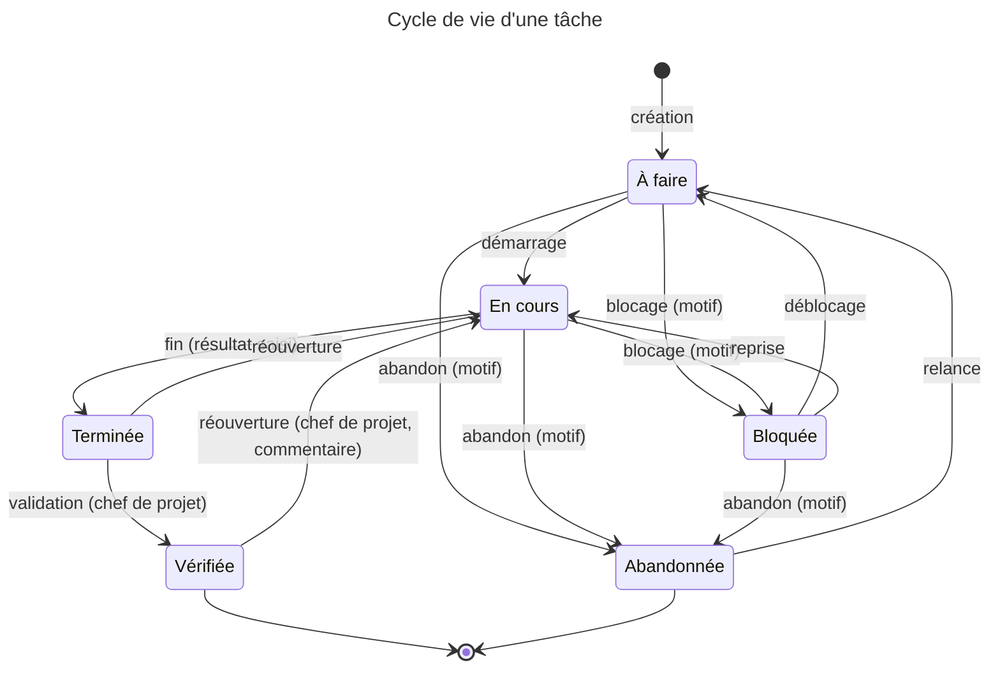

# 11.08 Déroulement du test

## Objectifs

Liste des objectifs testés lors du test d'intrusion.

## Phases

Phase du test :

1. Reconnaissance ;
2. Énumération ;
3. Exploitation ;
4. Post-exploitation ;
5. Nettoyage.

## Tâches

Une **tâche** est une unité de travail d'une phase : un test à mener, une vérification, une action de nettoyage. Elle appartient à une seule phase du test.

Une tâche porte :

- Référence, unique dans le test ;
- Titre et description ;
- Phase ;
- Assignés : zéro, un ou plusieurs testeurs affectés au test. Une tâche sans assigné est **libre** ;
- Statut, avec un motif pour *Bloquée* et *Abandonnée* ;
- Résultat ;
- Dates prévues et réelles (voir *Planning*) ;
- Temps passé ;
- Liens vers les objectifs, les objets du périmètre, les vulnérabilités, les exécutions d'outils et les techniques MITRE ATT&CK (voir [[11.13 Annexes et références#Méthodologies|Annexes et références › Méthodologies]]).

La description et les commentaires d'une tâche ne contiennent aucun secret : les identifiants découverts vont dans les secrets du périmètre ou dans la GED, chiffrés dans le navigateur ([[13.01 Format de chiffrement des preuves]]).

### Statuts d'une tâche

| Statut | Signification | Transitions possibles |
| --- | --- | --- |
| À faire | Tâche prévue, pas encore commencée | En cours, Bloquée, Abandonnée |
| En cours | Un assigné y travaille | Bloquée, Terminée, Abandonnée |
| Bloquée | En attente d'un accès, d'une réponse du client, etc. ; motif obligatoire | À faire, En cours, Abandonnée |
| Terminée | Travail achevé, résultat saisi | Vérifiée, En cours (réouverture) |
| Vérifiée | Relue et validée par le chef de projet | En cours (réouverture, commentaire obligatoire) |
| Abandonnée | Test non mené : hors périmètre, refus du client, manque de temps, etc. ; motif obligatoire | À faire |

Le passage à *En cours* fixe la date de début réelle, celui à *Terminée* la date de fin réelle, si elles ne sont pas déjà saisies. Seul le chef de projet passe une tâche à *Vérifiée* ou rouvre une tâche vérifiée.

### Résultat

Distinct du statut, le résultat indique ce que le test a montré :

- **Vulnérable** : au moins une vulnérabilité liée est exigée ;
- **Non vulnérable** ;
- **Non applicable** : le test a été mené, mais l'élément visé est absent (par exemple, aucun formulaire d'authentification) ;
- **Non concluant** : le test a été mené sans permettre de conclure.

Le résultat est obligatoire pour passer à *Terminée*. *Non applicable* ne remplace pas *Abandonnée* : une tâche abandonnée n'a pas été menée et n'a pas de résultat. Le rapport technique liste les tâches avec leur résultat ; les tâches abandonnées y figurent comme non testées, avec leur motif.

### Temps passé

Le temps passé est une durée, pré-remplie par l'écart entre les dates de début et de fin réelles, et modifiable par un assigné ou par le chef de projet. Il mesure l'effort total de l'équipe sur la tâche, et non sa durée calendaire.

## Outils

Outils utilisés lors des tests, par exemple _Nmap_, _Metasploit_ ou _PowerShell_, avec les commandes exécutées et leurs sorties.

### Catalogue d'outils

Le catalogue est commun au tenant. Il est pré-rempli (Nmap, Metasploit, Burp Suite, sqlmap, Impacket, Hashcat, PowerShell, Terminal, etc.) et tout testeur peut le compléter. Une entrée porte :

- Nom et lien ;
- Langages PrismJS par défaut de la commande et de la sortie, ou texte brut.

La version ne figure pas au catalogue : elle se saisit à chaque exécution, pré-remplie par la dernière version saisie pour cet outil dans le test.

### Exécution d'outil

Une **exécution d'outil** est une commande et sa sortie. La commande est facultative : une session interactive (shell, Meterpreter, enregistrement asciinema) forme une seule exécution, dont la sortie est la transcription.

Une exécution porte :

- Référence, unique dans le test ;
- Outil et version ;
- Auteur ;
- Date et heure de début et de fin ;
- Phase, obligatoire, pré-remplie par celle de la tâche depuis laquelle l'exécution est créée ;
- Commande et sortie, chacune avec son langage ;
- Origine : saisie, ou import (format et nom du fichier) ;
- Liens, plusieurs à plusieurs, vers les tâches, les vulnérabilités qu'elle révèle et les objets du périmètre visés (cibles).

### Confidentialité

Les sorties d'outils contiennent couramment des secrets : condensats, mots de passe, jetons. La commande et la sortie, ou le fichier importé, forment donc un contenu unique, chiffré dans le navigateur comme les preuves ([[13.01 Format de chiffrement des preuves]]) et stocké hors base comme les blobs de la GED.

- **Trousseau initial** : l'auteur, le chef de projet et les testeurs affectés au test. Le client final n'y figure pas. Un testeur affecté plus tard reçoit la CEK par le flux de partage de la GED ([[11.11 Documents et chiffrement]]).
- **Rétention, purge et révocation** : règles de la GED.
- **En clair** : les métadonnées seulement (outil, version, auteur, dates, phase, origine, liens). La recherche porte sur elles.
- **Historique** : il trace les métadonnées, jamais le contenu.

### Affichage

Le code devra être affiché avec sa coloration syntaxique. [PrismJS](https://prismjs.com/) sera utilisé. Langages supportés **au minimum** : `bash`, `shell`, `powershell`, `python`, `php`, `javascript`, `sql`, `json`, `xml`, `yaml`, `markup`, `http`, `diff`, `ini`. Les autres grammaires PrismJS peuvent être activées par module sans changer le cœur.

Le texte déchiffré est coloré par `Prism.highlight`, puis inséré par le module de rendu ([[13.04 Protection de la clé privée contre le XSS]]). Au-delà d'une taille paramétrable (défaut : 1 Mio), la sortie s'affiche tronquée ; le texte complet reste téléchargeable.

### Import de sorties natives

L'import évite de recopier la sortie d'un outil. Règles communes :

- Le fichier est lu et analysé dans le navigateur. Il devient le contenu chiffré de l'exécution et reste téléchargeable ; le serveur ne voit jamais le clair.
- Le fichier est hostile par nature : taille maximale paramétrable, analyse sans résolution d'entités externes, valeurs extraites traitées comme du texte.
- Le contenu d'une exécution importée n'est pas modifiable ; ses métadonnées et ses liens le restent.

#### Nmap XML (V1)

Fichier produit par `nmap -oX`.

- Métadonnées : version (`nmaprun@version`), commande (`nmaprun@args`), début (`nmaprun@start`) et fin (`runstats/finished@time`).
- Chaque hôte actif est rapproché des machines du périmètre par son adresse IP ; ses ports ouverts sont proposés comme services de la machine. Le testeur valide.
- Les machines rapprochées deviennent les cibles de l'exécution.
- Un hôte qui correspond à une machine **exclue** du périmètre est signalé au chef de projet : le balayage a touché une cible interdite.
- Un hôte inconnu est listé ; son ajout au périmètre revient au chef de projet.

#### asciinema (V1)

Enregistrement de terminal [asciinema](https://asciinema.org/), au format asciicast v2 ou v3 (`.cast`).

- Métadonnées : commande (`command` de l'en-tête), début (`timestamp`), fin (début + durée de l'enregistrement).
- Outil : choisi par le testeur, pré-rempli par « Terminal ».
- Le lecteur asciinema intégré rejoue l'enregistrement (pause, vitesse, marqueurs). Il le reçoit en mémoire et fonctionne sous la CSP de [[13.04 Protection de la clé privée contre le XSS]].
- Une transcription texte (événements de sortie, séquences de contrôle retirées) s'affiche et alimente les annexes de preuves. Elle est fidèle pour une session en ligne de commande, approximative pour un programme plein écran.
- Les événements d'entrée (`i`) peuvent contenir des mots de passe tapés sans écho. Ils restent dans le fichier chiffré, mais sont exclus de la transcription, et le lecteur ne les affiche pas.

#### Scanners de vulnérabilités (V2)

`.nessus` (Nessus), export XML de Burp Suite et rapport XML ou JSON d'OWASP ZAP. L'import produit des vulnérabilités brouillon (titre, CVE/CWE, description, composants concernés), dédoublonnées et à valider par un testeur.

## Statuts

Statuts des tests :

- Planifié ;
- En cours ;
- Terminé ;
- Validé.

## Planning (timeline / Gantt)

Chaque test, chaque **phase** et chaque **tâche** portent :

- Date et heure de début **prévues** ;
- Date et heure de fin **prévues** ;
- Date et heure de début **réelles** (saisies ou déduites du passage « En cours ») ;
- Date et heure de fin **réelles** (saisies ou déduites du passage « Terminé »).

**Jalons** prédéfinis, datables et cochables :

- Kick-off / signature de l'engagement ;
- Fin de reconnaissance ;
- Fin d'énumération ;
- Fin d'exploitation ;
- Remise du rapport ;
- Validation client.

Le **temps passé par phase** est la somme des temps passés des tâches de la phase (voir *Tâches*). Une saisie manuelle d'ajustement reste possible (commentaire obligatoire).

Une **vue Gantt** (phases et jalons) est fournie en V1 dans l'interface du test ; elle est optionnelle à l'export (case à cocher dans le modèle technique).

## Collaboration

Plusieurs **testeurs** peuvent être affectés au **même test**. Le chef de projet attribue les tâches, à un ou plusieurs testeurs ; un testeur peut s'attribuer une tâche encore libre.

- L'édition concurrente d'un même champ : le dernier enregistrement validé l'emporte ; un avertissement est affiché si la ressource a changé depuis le chargement (verrou optimiste).
- **Commentaires d'équipe** (fil de discussion) sur : le test, une tâche, une vulnérabilité, une mesure. Distincts des commentaires GED attachés à un fichier.
- **Historique des modifications** métier (audit lisible) : auteur, date, champ, ancienne valeur, nouvelle valeur, sur les entités principales. Pas de secret en clair.
