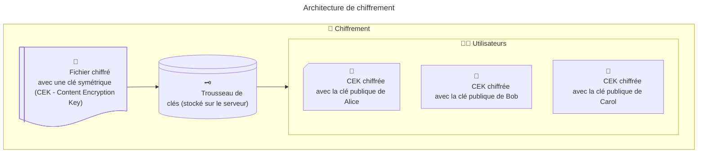
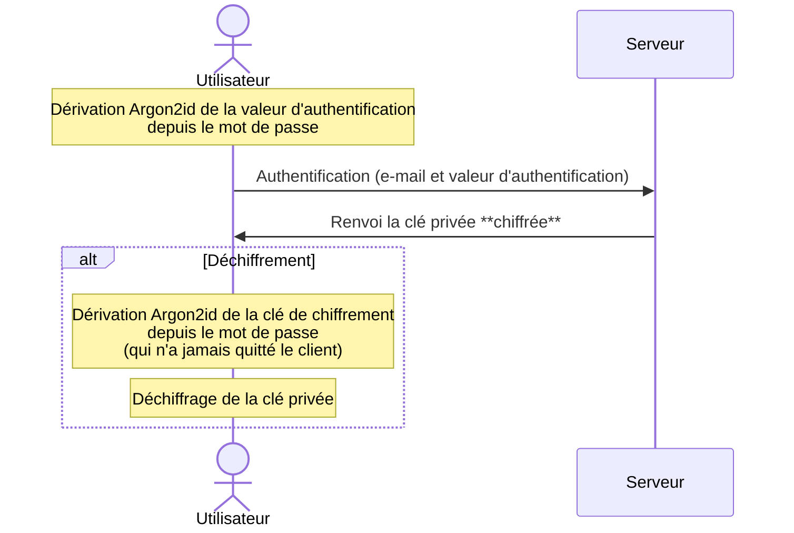

# 11.11 Documents et chiffrement

Il sera possible de stocker les preuves récoltées lors des tests dans un système de gestion des documents (GED). Les fichiers qui pourront être stockés seront :
- Les captures d'écran ;
- Les logs et captures réseaux ;
- Etc.

Chaque document est **lié** à au moins un objet métier : test, phase, objectif, vulnérabilité, mesure ou contre-mesure. Un même fichier peut être rattaché à plusieurs objets.

## Organisation du stockage

- Les **blobs** (fichiers chiffrés) sont stockés **hors base de données**, sur un disque local (volume Docker ou répertoire configuré) ou un stockage objet **S3-compatible**, au choix à l'installation.
- La base ne conserve que les **métadonnées** (nom, MIME, taille, hash du ciphertext, liens, ACL, identifiant de trousseau).
- Convention de clés / chemins : `{tenant_id}/{test_id}/{yyyy}/{mm}/{document_uuid}.bin` (pas de nom original dans le chemin, pour limiter les fuites).
- **Types MIME** acceptés par défaut (liste paramétrable) : images (`image/png`, `image/jpeg`, `image/webp`, `image/gif`), `application/pdf`, `text/plain`, `text/csv`, archives (`application/zip`, `application/gzip`), captures réseau (`application/vnd.tcpdump.pcap`, `application/octet-stream` pour `.pcap`/`.pcapng`), extraits de logs. Les exécutables (`.exe`, `.dll`, `.msi`, ELF) sont **refusés** par défaut.
- Un **scan antivirus** à l'upload (ClamAV ou équivalent) est recommandé et activable ; en cas de détection, le fichier est rejeté et l'événement est audité.
- **Rétention et purge** : durée paramétrable par tenant (défaut : durée de vie du test + 24 mois). La purge efface blob, métadonnées et trousseau. Une purge anticipée est possible pour le propriétaire ou l'administrateur, avec audit.

## Gestion

Pour chaque document, des commentaires, ainsi que des mots-clés, pourront être ajoutés par les différents intervenants.

L'accès à ces documents sera soumis à des **ACL** (qui *peut* demander l'accès) **et** au **trousseau cryptographique** (qui *peut* déchiffrer). Les deux conditions sont nécessaires (ET logique).

Si un administrateur ou un chef de projet **accorde** une ACL :

1. Le serveur enregistre le droit et crée une **demande de partage CEK** ;
2. Une notification est envoyée aux détenteurs actuels de la CEK (propriétaire en priorité) ;
3. Un détenteur, **côté client**, chiffre la CEK avec la clé publique du bénéficiaire et met à jour le trousseau ;
4. Tant que l'étape 3 n'est pas faite, le bénéficiaire voit le document dans la liste mais **ne peut pas** le déchiffrer.

Un administrateur **ne peut pas** contourner le chiffrement. Il peut seulement gérer les ACL, révoquer, et (s'il est déjà dans le trousseau) participer au partage.

La taille maximale des fichiers sera paramétrable.

## Chiffrement

Compte tenu de la sensibilité des documents, ceux-ci seront stockés chiffrés au format OpenPGP (RFC 9580, v6), avec la bibliothèque openpgp.js, selon [[13.01 Format de chiffrement des preuves]].

Les fichiers seront chiffrés avec une clé symétrique AES-256 (_Content Encryption Key_, la *session key* d'OpenPGP), en mode authentifié GCM (paquet SEIPD v2, découpé en blocs pour traiter les gros fichiers en flux).

Chaque utilisateur disposera d'une paire de clés OpenPGP v6 (Ed25519 / X25519). La clé privée sera stockée sur le serveur de façon chiffrée (mécanisme S2K d'OpenPGP avec Argon2id, paramètres selon [[13.02 Dérivation de clé Argon2id]]), afin que seul l'utilisateur puisse y accéder à l'aide de son mot de passe.

Pour chaque fichier sur le serveur, un trousseau de clés sera créé pour y stocker la clé symétrique permettant d'accéder au fichier pour chaque utilisateur. Chaque entrée est un paquet PKESK détaché : le fichier chiffré ne contient aucun destinataire. Le format est identifié par le champ `schema_crypto` du document (`openpgp-v6/seipd2-aes256-gcm`).

Pour autoriser un utilisateur à accéder à un fichier, il faudra que la clé d'accès au fichier soit chiffrée avec la clé publique de l'utilisateur, et ajoutée au trousseau.

Le flux de connexion d'un utilisateur sera :

La valeur d'authentification et la clé de chiffrement sont dérivées avec des sels différents : connaître l'une ne donne pas l'autre ([[13.03 Authentification locale et coffre de clés]]).

## Téléversement d'un fichier

1. Client génère une CEK aléatoire
2. Client chiffre le fichier avec la CEK (paquet SEIPD v2, AES-256-GCM)
3. Client chiffre la CEK avec sa propre clé publique (paquet PKESK)
4. Client envoie au serveur :
	- Le fichier chiffré
	- Le trousseau initial (CEK chiffrée pour lui-même)

## Ajout d'un utilisateur autorisé (par le propriétaire)

1. Client télécharge le trousseau du fichier ;
2. Client déchiffre la CEK avec sa clé privée (en local) ;
3. Client récupère la clé publique du nouvel utilisateur (depuis le serveur) ;
4. Client chiffre la CEK avec cette clé publique, en reprenant l'algorithme indiqué par `schema_crypto` (un PKESK v6 ne le contient pas) ;
5. Client envoie la nouvelle entrée au serveur ;
	- Le fichier chiffré n'est pas retouché.

## Téléchargement et déchiffrement

1. Client télécharge le fichier chiffré + son entrée du trousseau
2. Client déchiffre la CEK avec sa clé privée (en local)
3. Client déchiffre le fichier avec la CEK (en local)

## Révocation d'un utilisateur

La révocation **par défaut** pour un départ d'équipe, un changement de tenant ou un incident est la **révocation forte** :

1. Le propriétaire (ou un détenteur encore autorisé) génère une **nouvelle CEK**, rechiffre le fichier côté client, reconstruit le trousseau **sans** l'utilisateur révoqué, et remplace le blob sur le serveur ;
2. L'ancienne entrée de trousseau et l'ancienne ACL sont supprimées ; l'événement est audité.

La révocation **douce** (simple suppression de l'entrée de trousseau, sans rechiffrement) reste disponible pour un retrait temporaire. Elle **n'empêche pas** un utilisateur qui aurait déjà téléchargé le fichier et la CEK de conserver une copie hors ligne. Cette limite doit être affichée à l'opérateur avant confirmation.

## Points de vigilance

**Architecture SPA :** le déchiffrement 100 % client impose une SPA (ou un composant JavaScript équivalent). Le serveur PHP ne lit jamais le contenu des preuves. Les exports « avec fichiers » se construisent dans le navigateur de l'utilisateur qui possède les CEK.

**Confiance dans le serveur :** le serveur distribue les clés publiques. Un serveur compromis pourrait substituer une clé publique malveillante lors de l'ajout d'un destinataire, permettant à un attaquant de récupérer la CEK. Une mitigation est de permettre aux utilisateurs de vérifier les empreintes (_fingerprints_) de leurs clés hors bande.

**Rotation du mot de passe :** si un utilisateur change son mot de passe, le navigateur déchiffre sa clé privée avec l'ancien, la rechiffre avec le nouveau (nouveau sel Argon2id), vérifie que l'empreinte est inchangée, puis la renvoie au serveur avec la nouvelle valeur d'authentification ; le serveur remplace les deux de façon atomique, révoque les autres sessions et audite l'opération. Ni la clé publique, ni la copie de récupération, ni les trousseaux, ni les fichiers ne sont modifiés. Procédures détaillées dans [[13.02 Dérivation de clé Argon2id]] et [[13.03 Authentification locale et coffre de clés]].

**Mémoire côté client :** la clé privée déchiffrée vit en mémoire JavaScript. Il faut explicitement la détruire après usage et encadrer les délais de session.
