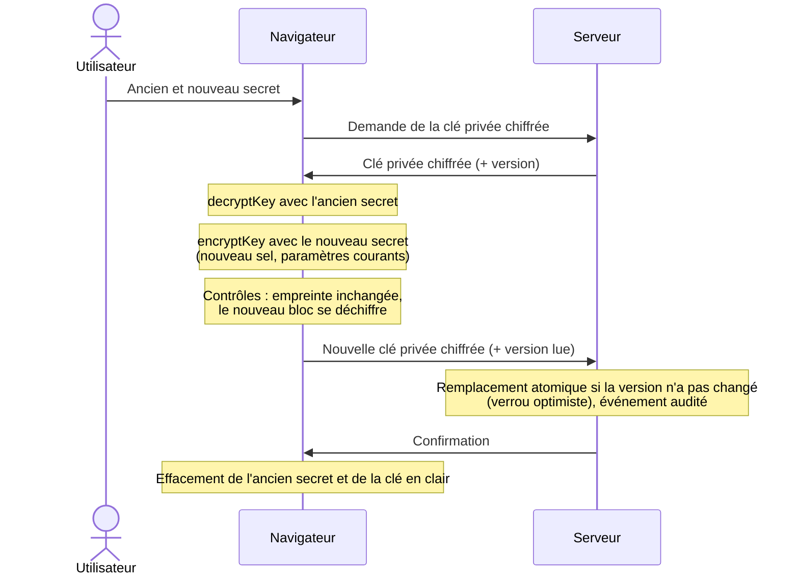

# 13.02 Dérivation de clé Argon2id

## Contexte

La clé privée OpenPGP de chaque utilisateur est stockée sur le serveur, chiffrée par une clé dérivée d'un secret que seul l'utilisateur connaît ([[13.01 Format de chiffrement des preuves]]). Le [[11.01 Cahier des charges]] ne précise ni la fonction de dérivation (KDF) ni ses paramètres ; le [[12.01 Rapport d'analyse du CDC]] (§1.3) le signale comme un point critique.

Contraintes :

- la dérivation s'exécute dans le navigateur, avec openpgp.js 6.x (mécanisme S2K d'OpenPGP, RFC 9580) ;
- un serveur compromis livre la clé privée chiffrée à l'attaquant : seul le coût de la dérivation freine alors une attaque hors ligne sur le secret ;
- le déverrouillage doit rester supportable à chaque connexion : environ 1 s sur un PC portable récent, environ 3 s tolérées sur mobile ;
- changer de secret ne doit pas imposer de rechiffrer les fichiers.

La même question se pose côté serveur pour le hachage des mots de passe de connexion des comptes locaux : on la tranche ici, avec le même algorithme.

Le secret saisi pour déverrouiller la clé est appelé ici **secret de déverrouillage**. Savoir s'il s'agit du mot de passe de connexion ou d'une passphrase de coffre distincte relève de `decisions-3` (LDAP/AD et coffre de clés).

## Options

1. **PBKDF2-HMAC-SHA256** (NIST SP 800-132) : natif dans WebCrypto, sans dépendance. Il n'utilise pas de mémoire, donc il s'accélère très bien sur GPU ou ASIC ; il est absent du S2K OpenPGP, ce qui imposerait un chiffrement maison de la clé privée.
2. **S2K « itéré et salé »** (SHA-256, défaut d'openpgp.js) : déjà intégré. Même faiblesse face aux GPU que PBKDF2 ; la RFC 9580 lui préfère Argon2.
3. **scrypt** : résistant en mémoire, mais absent du S2K OpenPGP et de WebCrypto.
4. **Argon2id** (RFC 9106) : S2K de type 4 de la RFC 9580 (§3.7.1.4), coûteux en mémoire, recommandé par l'OWASP. Intégré à openpgp.js 6 en WebAssembly, et disponible côté serveur dans PHP (`PASSWORD_ARGON2ID`) et Laravel.

## Décision

**Option 4 : Argon2id**, pour la clé privée (navigateur) comme pour les mots de passe de connexion locaux (serveur).

### Clé privée (navigateur)

Configuration openpgp.js :

| **Réglage** | **Valeur** | **Remarque** |
| --- | --- | --- |
| `s2kType` | `enums.s2k.argon2` | À fixer **explicitement** : le défaut d'openpgp.js est `iterated` |
| `s2kArgon2Params.passes` (t) | `2` | |
| `s2kArgon2Params.parallelism` (p) | `4` | Valeur de la RFC 9106 ; le WASM d'openpgp.js calcule les 4 voies en séquence |
| `s2kArgon2Params.memoryExponent` | `17` | m = 2^17 Kio = **128 Mio** |
| `aeadProtect` | `true` | Obligatoire : la RFC 9580 interdit Argon2 sans protection AEAD (usage S2K 253) ; openpgp.js le refuse |
| `preferredAEADAlgorithm` | `enums.aead.gcm` | Cohérent avec [[13.01 Format de chiffrement des preuves]] |

Ces paramètres dépassent la deuxième recommandation de la RFC 9106 (t=3, p=4, 64 Mio), qui sert de **plancher** : à durée égale, ils doublent la mémoire, ce qui est le facteur le plus coûteux pour un attaquant.

**Sel et format de stockage.** openpgp.js tire un sel aléatoire de **16 octets** à chaque chiffrement de la clé. Il est écrit, avec t, p et l'exposant de m, dans le spécificateur S2K du paquet de clé secrète (1 octet de type, 16 octets de sel, 3 octets de paramètres). La clé primaire et la sous-clé X25519 ont chacune leur sel. Aucune colonne dédiée n'est nécessaire : le serveur stocke la clé privée chiffrée comme un bloc opaque.

**Évolution des paramètres.** Les paramètres sont relus dans la clé elle-même. Au déverrouillage, si une clé est protégée par des paramètres inférieurs aux paramètres courants, le client la rechiffre avec ces derniers et la renvoie, par la procédure de rotation ci-dessous.

**Plafond de lecture.** Le client refuse de déverrouiller une clé dont le S2K dépasse m = 2^21 Kio (2 Gio) ou t = 8. Un serveur malveillant ne peut ainsi pas bloquer le navigateur avec des paramètres démesurés.

### Mots de passe de connexion (serveur)

Les comptes locaux sont hachés avec le pilote `argon2id` de Laravel :

| **Réglage** | **Valeur** |
| --- | --- |
| `HASH_DRIVER` | `argon2id` |
| `hashing.argon.memory` | `65536` (64 Mio, défaut Laravel) |
| `hashing.argon.time` | `4` (défaut Laravel) |
| `hashing.argon.threads` | `1` (défaut Laravel ; seule valeur possible avec le moteur libsodium de PHP) |
| `hashing.rehash_on_login` | `true` : un hachage aux paramètres anciens est refait à la connexion suivante |

Le sel est géré par PHP (`password_hash`) et stocké dans la chaîne `$argon2id$v=19$m=…,t=…,p=…$sel$hachage`.

### Rotation du secret de déverrouillage

Seule la clé privée est rechiffrée ; ni la clé publique, ni les trousseaux, ni les fichiers ne changent.

Si le serveur refuse le remplacement parce que la version a changé (rotation concurrente sur un autre poste), le client recommence au début. Une copie de la clé chiffrée par une clé de récupération, si `decisions-3` en prévoit une, n'est pas concernée.

### Preuve de faisabilité

Validée le 2026-11-02 avec openpgp 6.1.1 :

- une clé v6 chiffrée a l'usage S2K 253 (AEAD, GCM), un S2K de type 4 (Argon2), un sel de 16 octets et les paramètres t, p et m relus depuis le bloc stocké ; la sous-clé X25519 est protégée de la même façon ;
- après rotation, l'empreinte est inchangée, un nouveau sel est tiré, une entrée de trousseau (PKESK) créée avant la rotation se déchiffre toujours, et l'ancien secret est refusé (« unable to authenticate data ») ;
- Argon2 sans AEAD est refusé (« Using Argon2 S2K without AEAD is not allowed »).

Temps d'un déverrouillage complet (deux dérivations : clé primaire et sous-clé), p = 4, sur un PC portable à 8 cœurs, meilleur de deux essais :

| **m** | **Firefox 159, t=1** | **t=2** | **t=3** | **Node 26, t=1** | **t=2** | **t=3** |
| --- | --- | --- | --- | --- | --- | --- |
| 64 Mio | 393 ms | 747 ms | 831 ms | 200 ms | 303 ms | 516 ms |
| 128 Mio | 475 ms | **796 ms** | 1 108 ms | 311 ms | **628 ms** | 956 ms |
| 256 Mio | 1 079 ms | 1 530 ms | 2 143 ms | 652 ms | 1 363 ms | 2 020 ms |
| 512 Mio | 1 996 ms | 3 855 ms | 4 458 ms | 1 463 ms | 2 753 ms | 4 035 ms |

Côté serveur, un hachage Argon2id aux paramètres par défaut de Laravel (64 Mio, t=4, 1 thread) prend 228 ms (médiane de 5, libargon2 de Node 26, en remplacement de PHP absent du poste).

## Conséquences

- **CDC** : la section Chiffrement de [[11.11 Documents et chiffrement]] nomme Argon2id et renvoie à cet ADR ; la section Techniques d'authentification de [[11.06 Gestion des utilisateurs]] précise le hachage des comptes locaux ; le glossaire de [[11.13 Annexes et références]] définit KDF et Argon2id.
- **Front-end** : configuration S2K centralisée (un seul module crypto), plafond de lecture appliqué avant tout déverrouillage. Une erreur `Argon2OutOfMemoryError` (mémoire WASM insuffisante, surtout sur mobile) est présentée comme telle, et non comme un secret erroné. Le déverrouillage s'exécute hors du fil principal (Web Worker) pour ne pas figer l'interface.
- **Back-end** : PHP doit être compilé avec Argon2 (libargon2 ou libsodium), vérifié par l'installateur. Chaque vérification de mot de passe mobilise 64 Mio pendant environ 0,25 s : la limite de débit Auth (10 tentatives / minute / IP) borne la charge. La route de rotation remplace la clé privée chiffrée avec un verrou optimiste et l'audite, sans jamais l'interpréter.
- **Mobile** : non mesuré à ce stade. Si 128 Mio échoue ou dépasse 3 s sur les appareils cibles, on revient au plancher (64 Mio, t=3) par un nouvel ADR ; les clés existantes restent lisibles, puisque leurs paramètres sont stockés avec elles.
- **Sécurité** : Argon2id ralentit une attaque hors ligne sans la rendre impossible sur un secret faible. La politique de secret (longueur, liste de refus) relève de `decisions-3`. Les mesures serveur seront refaites avec PHP lors de `socle-1`.
