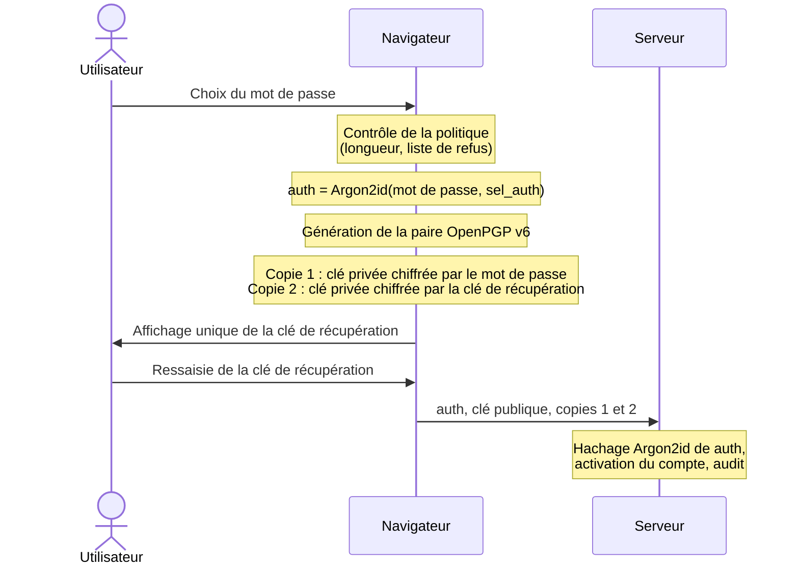
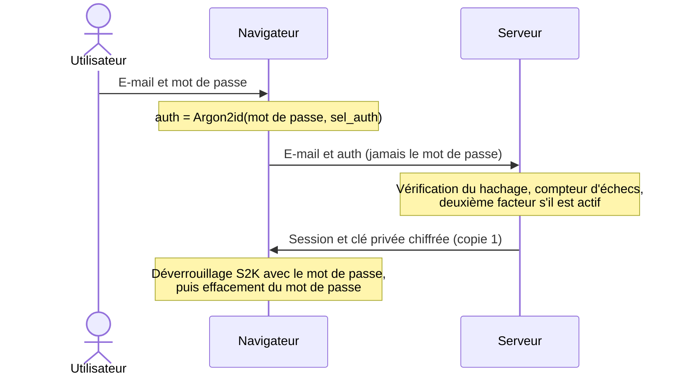
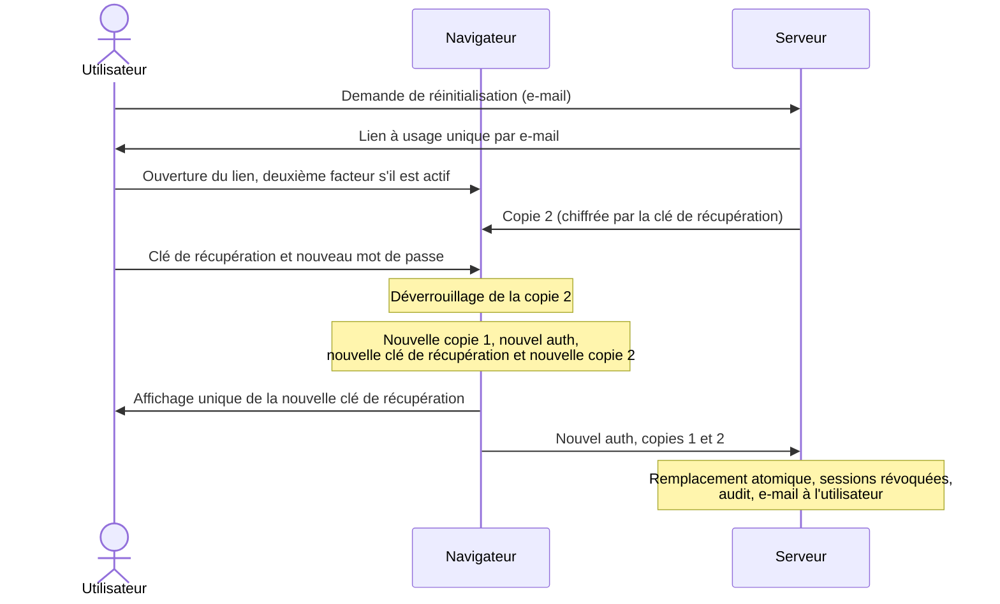

# 13.03 Authentification locale et coffre de clés

## Contexte

Le [[11.01 Cahier des charges]] prévoit trois fournisseurs d'identité (local, LDAP, Active Directory) et une clé privée OpenPGP protégée par le mot de passe de l'utilisateur, dérivé dans le navigateur ([[13.01 Format de chiffrement des preuves]], [[13.02 Dérivation de clé Argon2id]]). Le [[12.01 Rapport d'analyse du CDC]] (§1.2) relève qu'avec LDAP/AD, le mot de passe est vérifié par l'annuaire et transite par le serveur : il ne peut plus protéger une clé que le serveur ne doit pas pouvoir ouvrir. Le même rapport demande une politique de mots de passe (§4.1) et un verrouillage de compte (§4.2).

**LDAP et Active Directory sont reportés en V2.** Le conflit d'origine disparaît, mais un problème subsiste avec les comptes locaux : une connexion classique envoie le mot de passe au serveur. S'il protège aussi la clé privée, un serveur compromis peut capturer le mot de passe à la connexion suivante et déchiffrer la clé. Le diagramme de connexion du CDC affirme pourtant que ce mot de passe « n'a jamais quitté le client ».

Contraintes :

- le serveur ne doit jamais disposer de quoi déchiffrer une clé privée ;
- un seul mot de passe à retenir pour l'utilisateur ;
- un oubli de mot de passe ne doit pas faire perdre l'accès aux preuves, sans pour autant donner à un administrateur le moyen de les lire ([[11.11 Documents et chiffrement]] : « un administrateur ne peut pas contourner le chiffrement ») ;
- [[13.02 Dérivation de clé Argon2id]] reste valable tel quel.

## Options

1. **Passphrase de coffre distincte** : le mot de passe de connexion part au serveur, une seconde passphrase protège la clé. Simple, et compatible avec LDAP/AD ; mais deux secrets à retenir.
2. **Mot de passe unique, dérivé côté client** : le navigateur calcule à partir du mot de passe une *valeur d'authentification*, seule transmise au serveur ; le mot de passe protège la clé. Un seul secret ; la connexion coûte une dérivation Argon2id de plus, et LDAP/AD imposera plus tard une passphrase distincte.
3. **Mot de passe unique envoyé au serveur** : le plus simple, mais le serveur reçoit en clair le secret qui protège la clé.

Pour la récupération : clé de récupération générée à l'enrôlement, ou réinitialisation seule (nouvelle paire de clés à chaque oubli) ; le séquestre par un administrateur est exclu par le CDC.

## Décision

**Option 2**, avec une **clé de récupération**, et **LDAP/AD en V2**.

### Valeur d'authentification

Le mot de passe est normalisé en NFC, puis le navigateur calcule :

| **Élément** | **Définition** |
| --- | --- |
| `sel_auth` | 16 premiers octets de `SHA-256("sti-auth-v1" ‖ 0x00 ‖ id_instance ‖ 0x00 ‖ e-mail)`, e-mail sans espaces de bord, en minuscules, NFC |
| `id_instance` | UUID public tiré à l'installation |
| `auth` | `Argon2id(mot de passe, sel_auth)`, t=2, p=4, 128 Mio (paramètres de 13.02), 32 octets |
| Bibliothèque | `argon2id` 1.0.1 (openpgpjs, MIT), déjà embarquée par openpgp.js |

- Le serveur reçoit `auth` (Base64) à la place du mot de passe et le hache avec le pilote `argon2id` de Laravel ([[13.02 Dérivation de clé Argon2id]]). Il ne voit jamais le mot de passe.
- `sel_auth` est déterministe : le navigateur le calcule sans interroger le serveur, ce qui évite une requête préalable révélant l'existence d'un compte.
- La clé privée reste chiffrée par le S2K Argon2id d'OpenPGP sur le mot de passe, avec ses propres sels. Celui qui détient `auth` (serveur compromis) ne peut ouvrir la clé qu'en retrouvant le mot de passe par force brute, au coût Argon2id complet de chaque essai.
- La clé privée chiffrée n'est livrée qu'après une authentification complète, deuxième facteur compris s'il est actif.

### Clé de récupération

- 128 bits aléatoires, affichés en Base32 Crockford par groupes de 4 (`N1FT-KEJK-P460-…`, 26 caractères) ; à la saisie, casse et tirets sont ignorés.
- Elle chiffre une **seconde copie** de la clé privée, avec le même S2K que 13.02. Le serveur stocke cette copie à côté de la copie protégée par le mot de passe.
- Elle n'est jamais envoyée au serveur. Elle est affichée une seule fois, proposée au téléchargement (`.txt`), et l'utilisateur doit la ressaisir avant que son compte soit activé.
- Elle est remplacée à chaque usage.

### Parcours

**Enrôlement** (à la suite d'une invitation) :

**Connexion** :

**Changement de mot de passe** (connecté) : le navigateur vérifie l'ancien mot de passe, rechiffre la copie 1 selon la procédure de rotation de [[13.02 Dérivation de clé Argon2id]] et calcule le nouvel `auth`. Le serveur contrôle l'ancien `auth`, remplace hachage et copie 1 de façon atomique, révoque les autres sessions, audite et prévient l'utilisateur par e-mail. La copie 2 est inchangée.

**Mot de passe oublié** :

Le lien e-mail seul ne donne accès qu'à la copie 2, inutilisable sans la clé de récupération.

**Réinitialisation du coffre** (mot de passe et clé de récupération perdus) : même lien e-mail, mais l'opération doit être **validée par un administrateur**. Le navigateur génère une nouvelle paire, un nouveau mot de passe et une nouvelle clé de récupération. Les entrées de trousseau de l'ancienne clé, devenues illisibles, sont supprimées ; les détenteurs encore autorisés des fichiers concernés sont notifiés pour repartager. L'événement est audité. L'administrateur valide une procédure, il n'accède à aucun contenu.

**Changement d'adresse e-mail** : `sel_auth` dépend de l'e-mail. Le navigateur redemande le mot de passe, calcule `auth` avec la nouvelle adresse et l'envoie avec l'ancien ; le serveur remplace l'adresse et le hachage de façon atomique.

### Politique de mots de passe

Valeurs par défaut, réglables à l'installation, conformes à NIST SP 800-63B-4 (§3.1.1.2) :

| **Règle** | **Valeur** |
| --- | --- |
| Longueur minimale | 15 caractères (un point de code Unicode = un caractère), car le mot de passe protège la clé privée contre une attaque hors ligne que le deuxième facteur n'empêche pas |
| Longueur maximale | 128 caractères ; le mot de passe est utilisé en entier, jamais tronqué |
| Composition | Aucune règle imposée (types de caractères) |
| Liste de refus | Mots de passe courants et compromis, termes liés au service et à l'adresse de l'utilisateur ; comparaison du mot de passe entier, motif du refus affiché |
| Aide au choix | Indicateur de robustesse affiché pendant la saisie |
| Expiration | Aucune expiration périodique ; changement imposé en cas d'indice de compromission |
| Réutilisation | Interdite pour les 5 derniers mots de passe |
| Normalisation | NFC avant toute dérivation |

Le serveur ne voit pas le mot de passe : longueur, liste de refus et robustesse sont contrôlées **dans le navigateur**. C'est un écart assumé avec NIST, qui place la liste de refus chez le vérificateur ; un client modifié ne peut affaiblir que son propre compte. La réutilisation, elle, est contrôlée **par le serveur** : `auth` étant déterministe pour un même mot de passe, le serveur compare le nouvel `auth` aux hachages des 5 précédents.

### Verrouillage de compte

En complément de la limite de débit Auth par adresse IP déjà prévue par le CDC :

| **Règle** | **Valeur par défaut** |
| --- | --- |
| Compteur | Échecs consécutifs par compte, remis à zéro après une connexion réussie |
| Ralentissement | À partir de 5 échecs : délai croissant avant la tentative suivante |
| Verrouillage | 10 échecs consécutifs : compte verrouillé 15 minutes |
| Notification | E-mail à l'utilisateur à chaque verrouillage ; événement audité |
| Déverrouillage | Automatique à l'échéance, ou anticipé par un administrateur |

NIST SP 800-63B-4 (§3.2.2) plafonne à 100 les échecs consécutifs et autorise des limites plus basses. Le verrouillage protège la connexion, pas la clé chiffrée : contre une attaque hors ligne sur une copie volée, seul le coût Argon2id joue.

### Preuve de faisabilité

Validée le 2026-11-02 avec openpgp 6.1.1 et argon2id 1.0.1 :

- `auth` fait 32 octets, est identique pour une même adresse saisie avec une autre casse ou des espaces, et change avec l'adresse, l'instance ou le mot de passe ;
- la bibliothèque WASM `argon2id` donne exactement le même résultat que la libargon2 de Node 26 ;
- un mot de passe avec « é » composé ou décomposé donne le même `auth` après NFC ;
- à l'enrôlement, la copie mot de passe et la copie récupération portent la même empreinte ;
- après un oubli traité par la clé de récupération (saisie en minuscules, avec tirets) : empreinte inchangée, entrée de trousseau antérieure lisible, ancien mot de passe et ancienne clé de récupération refusés, nouvelle clé acceptée ;
- un ancien mot de passe est reconnu dans l'historique des hachages serveur ; un mot de passe inédit ne l'est pas ;
- après réinitialisation du coffre, la nouvelle paire ne lit plus les anciennes entrées de trousseau.

Temps sur le PC de référence (8 cœurs), meilleur de 3 :

| **Mesure** | **Firefox 159** | **Node 26** |
| --- | --- | --- |
| Calcul de `auth` | 436 ms | 306 ms |
| Connexion complète (`auth` + déverrouillage) | 1 186 ms | 956 ms |

## Conséquences

- **CDC** : [[11.06 Gestion des utilisateurs]] limite la V1 à l'authentification locale, décrit la valeur d'authentification, la politique de mots de passe, le verrouillage et la clé de récupération ; [[11.11 Documents et chiffrement]] corrige le diagramme de connexion.
- **API** : la connexion, l'enrôlement, la réinitialisation et le changement de mot de passe reçoivent `auth`, jamais un mot de passe. L'API expose `id_instance` publiquement. Les remplacements de copies et de hachage sont atomiques et audités.
- **Front-end** : un module crypto unique calcule `auth`, contrôle la politique, gère les deux copies de la clé et la clé de récupération ; la liste de refus est embarquée dans la SPA. La connexion dure environ 1,2 s sur PC.
- **Back-end** : stocke le hachage de `auth`, l'historique des 5 derniers hachages, la clé publique, les copies 1 et 2 ; compteur d'échecs par compte.
- **Stories** : `identite-1` (connexion), `identite-7` (invitation, réinitialisations) appliquent cet ADR ; `identite-2` (LDAP/AD) est reportée en V2.
- **V2, LDAP/AD** : le mot de passe de l'annuaire est vérifié par le serveur ; il ne pourra pas protéger la clé privée. Ces comptes auront besoin d'une passphrase de coffre distincte, à décider dans un nouvel ADR.
- **Sécurité** : la sûreté de la clé privée face à un serveur compromis repose sur la robustesse du mot de passe et le coût Argon2id. Une boîte e-mail compromise ne suffit ni à lire les preuves, ni à réinitialiser le coffre sans validation d'un administrateur.
