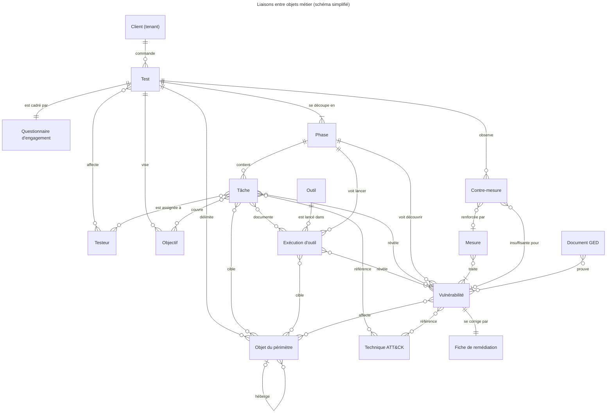

# 14.01 Schéma des objets métier

## Objet

Ce document donne un **schéma simplifié** (version du 2026-11-11) des liaisons entre les objets métier décrits dans le [[11.01 Cahier des charges]]. Il répond au §2.4 du [[12.01 Rapport d'analyse du CDC]].

Le schéma ne montre ni attributs ni tables techniques. Il sert de base aux modèles et aux migrations de la base de données. La section *Modèle détaillé (version du 2026-11-21)* précise les tables, les attributs et les liens des objets livrés en premier (chemin de la première version testable : organisations, tests, périmètre réseau, vulnérabilités, remédiation) ; les autres objets seront détaillés par les stories qui les livrent.

## Schéma

Chaque cardinalité reprend le CDC : une tâche appartient à une seule phase et a zéro, un ou plusieurs assignés ; une exécution d'outil appartient à une seule phase ; chaque vulnérabilité dispose d'une fiche de remédiation ; chaque mesure pointe vers une ou plusieurs vulnérabilités ; une contre-mesure a un lien éventuel vers une vulnérabilité ou vers une mesure ; une application est hébergée par une machine ou une ressource cloud du périmètre.

## Lecture

Chaque extrémité d'un lien porte un symbole, lu du côté de l'entité qu'il touche :

- `||` : exactement un ;
- `o|` : zéro ou un ;
- `|{` : un ou plusieurs ;
- `o{` : zéro, un ou plusieurs.

Par exemple, `"Phase" ||--o{ "Tâche"` : une phase contient zéro, une ou plusieurs tâches ; une tâche appartient à exactement une phase.

## Liens relevés par le 12.01 §2.4

| Lien | Dans le schéma |
| --- | --- |
| Objet du périmètre ↔ vulnérabilité | Direct, plusieurs à plusieurs (« Composants concernés » de la vulnérabilité) |
| Outil ↔ vulnérabilité | Direct par l'exécution d'outil, plusieurs à plusieurs : outil → exécution d'outil ↔ vulnérabilité ([[11.08 Déroulement du test#Exécution d'outil\|11.08, Exécution d'outil]]) |
| Phase ↔ objets testés | Par la tâche, qui appartient à une phase et cible des objets du périmètre, et par l'exécution d'outil, qui fait de même |
| Tâche ↔ objectif | Direct, plusieurs à plusieurs ([[11.08 Déroulement du test#Tâches|11.08, Tâches]]) |

## Hors schéma

- **Documents GED** : chaque document est rattaché à au moins un objet parmi le test, une phase, un objectif, une vulnérabilité, une mesure ou une contre-mesure (rattachement polymorphe). Seul le lien vers la vulnérabilité est dessiné, pour la lisibilité.
- **Objets transverses** : commentaires d'équipe, commentaires et mots-clés GED, historique des modifications, journal d'audit, ACL et groupes, trousseaux (entrées PKESK par contenu chiffré et par utilisateur), propriétaire de chaque contenu chiffré, invitations, demandes de partage et de rechiffrement, jalons, notifications.
- **Catalogues** : méthodologies et exigences réglementaires.

## Modèle détaillé (version du 2026-11-21)

### Règles communes

- **Identifiants** : les objets métier ont une clé primaire **ULID** (`HasUlids` de Laravel), non devinable et triée par date, exposée telle quelle par l'API. La table `users` garde son identifiant entier, sur lequel reposent déjà les jetons Sanctum ; elle n'est jamais énumérable par un client.
- **Organisation (tenant)** : chaque table métier porte une colonne `tenant_id`, même quand elle se déduit du test. Un filtre global appliqué par le modèle restreint chaque requête aux organisations autorisées de l'utilisateur ; un objet hors de ses organisations renvoie `404` ([[11.06 Gestion des utilisateurs#Isolation des données (multi-tenant)|11.06]]). La cohérence `tenant_id` de l'enfant = `tenant_id` du test est vérifiée à l'écriture.
- **Valeurs fermées** (statuts, rôles, phases, types, priorités) : colonnes texte contrôlées par une énumération PHP (`enum` adossé à `string`), pas de type `ENUM` propre au SGBD, pour rester portable sur SQLite, MySQL, MariaDB et PostgreSQL.
- **Texte riche** (présentations, recommandations, descriptions) : Markdown stocké tel quel dans une colonne texte (20 000 caractères au plus), rendu dans le navigateur par le module de rendu et assaini par DOMPurify avec une liste blanche stricte ([[13.04 Protection de la clé privée contre le XSS]]) ; les exports le convertiront à leur tour (décidé avec engagement-1).
- **Dates** : `created_at` et `updated_at` sur chaque table, en UTC ([[13.07 Licence, langues et accessibilité]]). Pas de suppression logique en V1 : une suppression est définitive et journalisée (identite-6).
- **Clés étrangères** : déclarées en base, suppression en cascade des enfants d'un test (phases, objets du périmètre, vulnérabilités, fiches de remédiation, tables de liaison).

### Organisations, utilisateurs et rôles

| Table | Colonnes | Remarques |
| --- | --- | --- |
| `tenants` | `id` (ULID), `name`, `legal_name`, `presentation` (texte) | Organisation cliente ; références « Client » de [[11.05 Engagement#Client|11.05]] |
| `company_profile` | `id`, `name`, `legal_name`, `presentation` | Une seule ligne : le prestataire qui exploite l'instance (« Entreprise » de 11.05) |
| `users` (existante) | + `job_title`, `presentation`, `is_instance_admin` (booléen) | Profil du testeur (« Testeur d'intrusion » de 11.05) ; l'administrateur d'instance voit toutes les organisations. Le compte « root » est le premier administrateur créé par la commande d'installation |
| `tenant_user` | `tenant_id`, `user_id`, `role` | Rôle **par organisation** : `project_manager`, `tester` ou `client` ; unique par couple (`tenant_id`, `user_id`). Un client final n'a qu'une organisation |

### Test et phases

| Table | Colonnes | Remarques |
| --- | --- | --- |
| `tests` | `id` (ULID), `tenant_id`, `reference`, `title`, `status`, `planned_start`, `planned_end`, `created_by` | `status` : `planned`, `in_progress`, `done`, `validated` ([[11.08 Déroulement du test#Statuts|11.08]]) ; `reference` unique par organisation |
| `test_user` | `test_id`, `user_id`, `role` | Équipe affectée au test : `project_manager` ou `tester` ; l'utilisateur doit avoir un rôle dans l'organisation du test |
| `phases` | `id` (ULID), `tenant_id`, `test_id`, `code`, `position` | **Cinq phases fixes** créées avec chaque test : `reconnaissance`, `enumeration`, `exploitation`, `post_exploitation`, `cleanup`. La table permet de rendre les phases configurables plus tard sans reprendre les liens |

Le catalogue de méthodologies (engagement-6) n'est pas référencé par clé : le test **copie** le nom, la version et la date de chaque méthodologie déclarée, pour qu'une mise à jour du catalogue ne réécrive pas les rapports déjà livrés.

### Périmètre

Une table commune et une table par type d'objet (héritage par tables liées) :

| Table | Colonnes | Remarques |
| --- | --- | --- |
| `scope_objects` | `id` (ULID), `tenant_id`, `test_id`, `type`, `parent_id`, `label`, `included` (booléen), `comment`, `constraints` (texte : plages interdites, disponibilité) | `type` : `host`, `service`, `account` en V1 avec engagement-4 ; `application`, `cloud_resource` avec engagement-7 ; les types des sous-modules V2 s'ajoutent de même. `parent_id` : objet hôte (service d'une machine, application hébergée) |
| `scope_hosts` | `scope_object_id` (clé primaire et étrangère), `address` (IP ou CIDR), `hostname`, `operating_system` | Machine |
| `scope_services` | `scope_object_id`, `protocol` (`tcp`, `udp`), `port`, `name`, `version` | Service ; son parent est une machine |
| `scope_accounts` | `scope_object_id`, `username`, `role_description` | Compte de test ; son secret est chiffré dans le navigateur et stocké avec la GED chiffrée (ged-chiffree), jamais en clair dans cette table |

### Vulnérabilités et remédiation

| Table | Colonnes | Remarques |
| --- | --- | --- |
| `vulnerabilities` | `id` (ULID), `tenant_id`, `test_id`, `phase_id`, `reference`, `title`, `description`, `cve_ids` (JSON), `cwe_ids` (JSON), `cvss_version`, `cvss_vector`, `cvss_score` (décimal 3,1), `severity`, `created_by` | `reference` unique par test (`V-001`…). `cvss_version` : `3.1` en V1 (`4.0` avec le test mixte de [[11.12 Résultats]]) ; `cvss_score` et `severity` sont calculés à partir du vecteur par le moteur CVSS (vulnerabilites-1) ; `severity` : `none`, `minor`, `important`, `major`, `critical` ([[11.10 Cotation CVSS#Échelle de risque|11.10]]). L'impact business (vulnerabilites-4) ajoutera ses colonnes |
| `scope_object_vulnerability` | `scope_object_id`, `vulnerability_id` | Composants concernés ; même test pour les deux |
| `remediations` | `id` (ULID), `tenant_id`, `vulnerability_id` (unique), `recommendations` (texte), `priority`, `priority_overridden` (booléen), `resources` (JSON : liens), `status`, `verified_at`, `verified_by`, `retest_result` | Fiche de remédiation, une par vulnérabilité, créée avec elle. `priority` : `P1` à `P4`, suggérée depuis le niveau CVSS tant que `priority_overridden` est faux ; `status` : `todo`, `in_progress`, `fixed`, `verified` ([[11.09 Vulnérabilités et remédiation#Remédiation|11.09]]) |

Le risque global (resultats-1) est **calculé** à la lecture à partir des vulnérabilités ouvertes (statut de remédiation autre que `verified`) : aucune table.

## À préciser lors de la modélisation des données

Décidé le 2026-11-21 (voir *Modèle détaillé*) : phases fixes, une table commune et une table par type pour le périmètre, ULID, rôle par organisation, rattachement explicite de chaque objet au tenant. Restent ouverts, pour les stories qui les livrent :

- Mesures transverses (gouvernance, sensibilisation) : le CDC veut que chaque mesure pointe vers au moins une vulnérabilité, mais autorise des mesures « absentes des fiches » (resultats-3).
- Preuves de correction : rattachées à la vulnérabilité ou à sa fiche de remédiation, qui ne figure pas dans la liste des objets liés à un document GED (ged-chiffree-3).
- Liens polymorphes des documents et des commentaires (ged-chiffree-3, deroulement-4).
- Tâches, exécutions d'outils, objectifs, mesures et contre-mesures : attributs à détailler avec deroulement-1, deroulement-6, engagement-6 et resultats-3.
