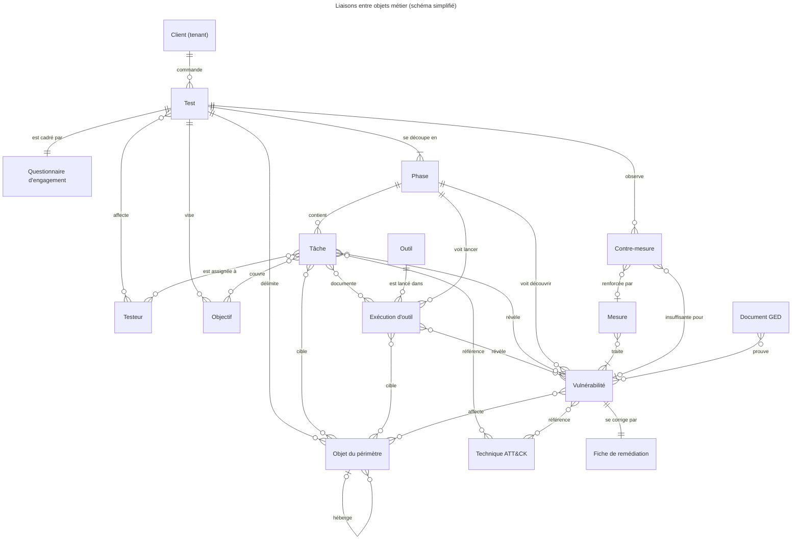

# 14.01 Schéma des objets métier

## Objet

Ce document donne un **schéma simplifié** (version du 2026-11-11) des liaisons entre les objets métier décrits dans le [[11.01 Cahier des charges]]. Il répond au §2.4 du [[12.01 Rapport d'analyse du CDC]].

Le schéma ne montre ni attributs ni tables techniques. Il sert de base aux modèles et aux migrations de la base de données ; le détail des liens sera développé dans une prochaine version, lors de la modélisation des données (voir *À préciser* ci-dessous).

## Schéma

Chaque cardinalité reprend le CDC : une tâche appartient à une seule phase et a zéro, un ou plusieurs assignés ; une exécution d'outil appartient à une seule phase ; chaque vulnérabilité dispose d'une fiche de remédiation ; chaque mesure pointe vers une ou plusieurs vulnérabilités ; une contre-mesure a un lien éventuel vers une vulnérabilité ou vers une mesure ; une application est hébergée par une machine ou une ressource cloud du périmètre.

## Lecture

Chaque extrémité d'un lien porte un symbole, lu du côté de l'entité qu'il touche :

- `||` : exactement un ;
- `o|` : zéro ou un ;
- `|{` : un ou plusieurs ;
- `o{` : zéro, un ou plusieurs.

Par exemple, `"Phase" ||--o{ "Tâche"` : une phase contient zéro, une ou plusieurs tâches ; une tâche appartient à exactement une phase.

## Liens relevés par le 12.01 §2.4

| Lien | Dans le schéma |
| --- | --- |
| Objet du périmètre ↔ vulnérabilité | Direct, plusieurs à plusieurs (« Composants concernés » de la vulnérabilité) |
| Outil ↔ vulnérabilité | Direct par l'exécution d'outil, plusieurs à plusieurs : outil → exécution d'outil ↔ vulnérabilité ([[11.08 Déroulement du test#Exécution d'outil\|11.08, Exécution d'outil]]) |
| Phase ↔ objets testés | Par la tâche, qui appartient à une phase et cible des objets du périmètre, et par l'exécution d'outil, qui fait de même |
| Tâche ↔ objectif | Direct, plusieurs à plusieurs ([[11.08 Déroulement du test#Tâches|11.08, Tâches]]) |

## Hors schéma

- **Documents GED** : chaque document est rattaché à au moins un objet parmi le test, une phase, un objectif, une vulnérabilité, une mesure ou une contre-mesure (rattachement polymorphe). Seul le lien vers la vulnérabilité est dessiné, pour la lisibilité.
- **Objets transverses** : commentaires d'équipe, commentaires et mots-clés GED, historique des modifications, journal d'audit, ACL et groupes, trousseaux (entrées PKESK par contenu chiffré et par utilisateur), propriétaire de chaque contenu chiffré, invitations, demandes de partage et de rechiffrement, jalons, notifications.
- **Catalogues** : méthodologies et exigences réglementaires.

## À préciser lors de la modélisation des données

- Phases fixes ou configurables (12.01 §2.8) : le schéma suppose les cinq phases du CDC pour chaque test.
- Mesures transverses (gouvernance, sensibilisation) : le CDC veut que chaque mesure pointe vers au moins une vulnérabilité, mais autorise des mesures « absentes des fiches ».
- Preuves de correction : rattachées à la vulnérabilité ou à sa fiche de remédiation, qui ne figure pas dans la liste des objets liés à un document GED.
- Sous-types d'objets du périmètre (machine, service, compte, application, ressource cloud ou SaaS, site physique, équipement radio, cible d'ingénierie sociale) : une table commune et une table par sous-module, ou une table unique typée.
- Attributs, tables de liaison, liens polymorphes (documents, commentaires) et rattachement explicite de chaque objet au tenant.
