# 22.01 Planification du développement

Planification du développement, établie à partir du backlog `.stories/`. Le projet est mené sur du temps libre : la planification ne fixe **aucune date**. Elle donne l'ordre de réalisation, le découpage en sprints et le chemin critique, mesurés en points ; seul le **temps réellement passé** est relevé (par Claude depuis socle-1, de la prise en charge de la story à son passage à `done`). Ce document ne remplace pas le ledger : les sprints et les statuts officiels restent ceux de `.stories/`, gérés par `ledger.js`.

## Hypothèses

- **Sprint** : un lot d'environ 15 points, sans durée fixée ; le sprint suivant commence quand le précédent est terminé.
- **Flux unique** : les stories sont réalisées l'une après l'autre. Sur les diagrammes, l'axe horizontal compte les **points cumulés**, pas des jours ; une story y occupe une longueur égale à ses points.
- **Ordre** : tri topologique des dépendances écrites dans chaque story (« Dépend de … ») ; à égalité, les stories du sprint en cours d'abord, puis l'ordre des epics : décisions, socle, identité, GED chiffrée, engagement, vulnérabilités, déroulement, résultats, exports, exploitation.
- **Périmètre** (fin du sprint 4) : 54 stories ouvertes (190 points). La V1 en compte 34 (124 points). Les 20 stories reportées en V2 (66 points, voir *Décision de périmètre* ; deroulement-3 y a rejoint deroulement-10) sont placées après le jalon V1. Les 21 stories terminées ne figurent pas dans les diagrammes : decisions-1, 2, 3, 7 et 8 (sprint 1), decisions-4, 5 et 6, socle-1, socle-3 et socle-4 (sprint 2), socle-2, socle-5, identite-1, identite-3 et socle-6 (sprint 3), identite-5, engagement-1, engagement-2, engagement-4 et socle-8 (sprint 4).

## Décision de périmètre (2026-11-21)

Le premier calcul comptait 198 points pour la V1, soit plus de 13 sprints de 15 points, estimés à partir d'un seul sprint, consacré aux ADR. Un conseil à quatre voix (architecte, sceptique, pragmatique, critique) a recommandé de réduire la V1 sans toucher au chiffrement ni à la sécurité. Sont reportées en V2 :

| **Story**                                                | **Points** | **En V1**                                                            |
| -------------------------------------------------------- | ---------- | -------------------------------------------------------------------- |
| [[vulnerabilites-2]] Moteur CVSS v4.0                    | 5          | Moteur v3.1 seul ; version et vecteur enregistrés (vulnerabilites-3) |
| [[vulnerabilites-6]] Règle du test mixte                 | 1          | Sans objet sans moteur v4.0 ; resultats-1 n'en dépend plus           |
| [[vulnerabilites-7]] Références MITRE ATT&CK             | 3          | —                                                                    |
| [[deroulement-8]] Import asciinema                       | 3          | Sortie de session collée dans une exécution                          |
| [[deroulement-10]] Vue Gantt (détachée de deroulement-3) | 2          | Dates et jalons sur le test, les phases et les tâches                |
| [[engagement-5]] Périmètre étendu                        | 3          | Réseau, applications, ressources cloud et SaaS                       |
| [[exports-3]] Personnalisation des modèles               | 3          | Modèles par défaut                                                   |
| [[identite-4]] Jetons API personnels                     | 2          | Sessions Sanctum de la SPA                                           |
| [[resultats-4]] Vue multi-tests                          | 3          | —                                                                    |
| [[resultats-5]] Comparaison entre deux tests             | 2          | —                                                                    |
| [[exploitation-4]] Glossaire dans l'interface            | 1          | Glossaire de [[11.13 Annexes et références]]                         |

Soit 28 points, qui s'ajoutent aux 19 points déjà reportés ([[identite-2]], [[engagement-8]], [[deroulement-9]]). Les parties concernées du CDC (11.03, 11.04, 11.07, 11.08, 11.10, 11.11, 11.12, 11.13) signalent chaque report.

Ensuite, [[13.06 Infrastructure, e-mail et sécurité HTTP]] ([[decisions-4]]) a reporté en V2 l'envoi d'e-mails ([[exploitation-6]], 5 points) et le service web HTTPS intégré ([[socle-7]], 3 points) ; [[identite-3]] (TOTP seul) et [[exploitation-1]] (notifications dans l'application) passent de 3 à 2 points. Enfin, [[13.07 Licence, langues et accessibilité]] ([[decisions-5]]) a reporté en V2 l'anglais ([[exploitation-3]], 2 points), la conformité WCAG 2.2 AA ([[exploitation-7]], 3 points) et l'affichage sur smartphone ([[exploitation-8]], 3 points).

Restent en V1, malgré les propositions de report : la révocation, le départ d'un utilisateur, le journal d'audit et la validation des fichiers (confiance des clients) ; l'export JSON/XML (porte de sortie des données) ; engagement-6 (les tâches se lient aux objectifs) ; [[deroulement-6]] (l'import Nmap en dépend).

Suites données :

- Jalon interne « premier test réel » (version `0.x`) dès que socle, identité, cœur de la GED, engagement minimal, CVSS v3.1, tâches et rapport PDF sont livrés ;
- Prototype du chiffrement en flux dans le navigateur au plus tôt, la preuve de [[13.05 Trousseau d'équipe et départ d'un utilisateur]] n'ayant mesuré que Node ;
- ADR sur l'antivirus face au chiffrement de bout en bout (12.01 §4.5) avant ged-chiffree-7 ;
- Rapport entre heures et points mesuré sur les premières stories de code (voir *Temps réellement passé*) ;
- Feuille de route V1/V2 formalisée dans [[11.01 Cahier des charges]] (decisions-6, fait).

## Feuille de route par epic

Une barre par epic, de sa première à sa dernière story ouverte ; l'axe compte les points cumulés depuis la fin du sprint 4. Les barres se chevauchent quand une story d'un epic attend une dépendance d'un autre epic.

```mermaid
gantt
    title SuiviTestIntrusion – feuille de route par epic
    dateFormat X
    axisFormat %s
    section V1
    Identité, droits et isolation (8 pts) :ep_identite, 14, 27
    GED chiffrée de bout en bout (36 pts) :ep_ged_chiffree, 17, 58
    Engagement et périmètre (13 pts) :ep_engagement, 58, 71
    Vulnérabilités et remédiation (11 pts) :ep_vulnerabilites, 0, 11
    Déroulement du test (21 pts) :ep_deroulement, 71, 92
    Résultats et tableaux de bord (9 pts) :ep_resultats, 11, 98
    Rapports et exports (18 pts) :ep_exports, 98, 116
    Exploitation et transverse (8 pts) :ep_exploitation, 116, 124
    V1 (1.0.0) :milestone, v1, 124, 0d
    section V2
    Stories reportées (66 pts) :ep_v2, 124, 190
    Fin des stories V2 :milestone, v2, 190, 0d
```

## Gantt détaillé

Une section par epic, une barre par story ouverte (identifiant, titre, points). Les stories du sprint 5 (en cours) sont marquées `active`.

```mermaid
gantt
    title SuiviTestIntrusion – stories par epic
    dateFormat X
    axisFormat %s
    section Identité, droits et isolation
    identite-6 Journal d'audit (3) :identite_6, 14, 17
    identite-7 Cycle de vie des utilisateurs (5) :identite_7, 22, 27
    Fin Identité, droits et isolation :milestone, m_identite, 27, 0d
    section GED chiffrée de bout en bout
    ged-chiffree-1 Paire de clés utilisateur et coffre (5) :ged_chiffree_1, 17, 22
    ged-chiffree-2 Cycle de vie de la clé en mémoire (2) :ged_chiffree_2, 27, 29
    ged-chiffree-3 Téléversement chiffré (5) :ged_chiffree_3, 29, 34
    ged-chiffree-4 Téléchargement et déchiffrement (3) :ged_chiffree_4, 34, 37
    ged-chiffree-5 Partage de CEK piloté par ACL (5) :ged_chiffree_5, 37, 42
    ged-chiffree-6 Révocation forte et douce (5) :ged_chiffree_6, 42, 47
    ged-chiffree-7 Validation des fichiers et antivirus (3) :ged_chiffree_7, 47, 50
    ged-chiffree-8 Métadonnées, recherche, versions et rétention (3) :ged_chiffree_8, 50, 53
    ged-chiffree-9 Départ d'un utilisateur  – trousseaux et propriété (5) :ged_chiffree_9, 53, 58
    Fin GED chiffrée de bout en bout :milestone, m_ged_chiffree, 58, 0d
    section Engagement et périmètre
    engagement-3 Questionnaire d'engagement (5) :engagement_3, 58, 63
    engagement-6 Diagramme réseau Mermaid, objectifs et méthodologies (3) :engagement_6, 63, 66
    engagement-7 Périmètre applicatif et ressources (5) :engagement_7, 66, 71
    Fin Engagement et périmètre :milestone, m_engagement, 71, 0d
    section Vulnérabilités et remédiation
    vulnerabilites-1 Moteur CVSS v3.1 (3) :active, vulnerabilites_1, 0, 3
    vulnerabilites-3 Fiche vulnérabilité (3) :active, vulnerabilites_3, 3, 6
    vulnerabilites-4 Impact business (2) :active, vulnerabilites_4, 6, 8
    vulnerabilites-5 Fiche de remédiation et priorités (3) :active, vulnerabilites_5, 8, 11
    Fin Vulnérabilités et remédiation :milestone, m_vulnerabilites, 11, 0d
    section Déroulement du test
    deroulement-1 Phases et modèle de tâche (5) :deroulement_1, 71, 76
    deroulement-2 Attribution des tâches et verrou optimiste (2) :deroulement_2, 76, 78
    deroulement-4 Commentaires d'équipe et mentions (2) :deroulement_4, 78, 80
    deroulement-5 Historique des modifications (2) :deroulement_5, 80, 82
    deroulement-6 Catalogue d'outils et exécutions (5) :deroulement_6, 82, 87
    deroulement-7 Import Nmap XML (5) :deroulement_7, 87, 92
    Fin Déroulement du test :milestone, m_deroulement, 92, 0d
    section Résultats et tableaux de bord
    resultats-1 Risque global d'un test (3) :active, resultats_1, 11, 14
    resultats-2 Graphiques du tableau de bord (3) :resultats_2, 92, 95
    resultats-3 Conclusions, mesures et contre-mesures (3) :resultats_3, 95, 98
    Fin Résultats et tableaux de bord :milestone, m_resultats, 98, 0d
    section Rapports et exports
    exports-1 Moteur de rapport et modèles par défaut (5) :exports_1, 98, 103
    exports-2 Formats PDF, OpenDocument et HTML (5) :exports_2, 103, 108
    exports-4 Annexes de preuves construites dans le navigateur (3) :exports_4, 108, 111
    exports-5 Export et import JSON/XML de migration (5) :exports_5, 111, 116
    Fin Rapports et exports :milestone, m_exports, 116, 0d
    section Exploitation et transverse
    exploitation-1 Notifications dans l'application (2) :exploitation_1, 116, 118
    exploitation-2 Sauvegardes avec Portabase (3) :exploitation_2, 118, 121
    exploitation-5 Durcissement, RGPD et audit de sécurité de l'outil (3) :exploitation_5, 121, 124
    Fin Exploitation et transverse :milestone, m_exploitation, 124, 0d
    section Version
    V1 (1.0.0) :milestone, v1d, 124, 0d
    section V2 (reportées)
    socle-7 Service web HTTPS intégré à Docker Compose (3) :socle_7, 124, 127
    identite-2 Authentification LDAP et Active Directory (3) :identite_2, 127, 130
    identite-4 Jetons API personnels scopés (2) :identite_4, 130, 132
    engagement-5 Périmètre étendu (physique, radio, ingénierie sociale) (3) :engagement_5, 132, 135
    engagement-8 Validation formelle de l'engagement (8) :engagement_8, 135, 143
    vulnerabilites-2 Moteur CVSS v4.0 (5) :vulnerabilites_2, 143, 148
    vulnerabilites-6 Règle d'agrégation pour un test mixte v3.1 / v4.0 (1) :vulnerabilites_6, 148, 149
    vulnerabilites-7 Références MITRE ATT&CK sur tâches et vulnérabilités (3) :vulnerabilites_7, 149, 152
    deroulement-3 Planning et jalons (3) :deroulement_3, 152, 155
    deroulement-8 Import d'enregistrements asciinema (3) :deroulement_8, 155, 158
    deroulement-9 Import Nessus, Burp Suite et OWASP ZAP (8) :deroulement_9, 158, 166
    deroulement-10 Vue Gantt des phases et jalons (2) :deroulement_10, 166, 168
    resultats-4 Tableau de bord multi-tests (3) :resultats_4, 168, 171
    resultats-5 Comparaison entre deux tests d'un même client (2) :resultats_5, 171, 173
    exports-3 Personnalisation des modèles (3) :exports_3, 173, 176
    exploitation-3 Interface et messages en anglais (2) :exploitation_3, 176, 178
    exploitation-4 Glossaire et aide contextuelle (1) :exploitation_4, 178, 179
    exploitation-6 Envoi d'e-mails (5) :exploitation_6, 179, 184
    exploitation-7 Conformité WCAG 2.2 AA (3) :exploitation_7, 184, 187
    exploitation-8 Affichage sur smartphone (3) :exploitation_8, 187, 190
    Fin des stories V2 :milestone, v2d, 190, 0d
```

## Sprints prévus

`↳` : story commencée au sprint précédent ; `→` : story qui se poursuit au sprint suivant. Le sprint 5 est celui du ledger (14 points) ; les suivants sont des lots de 15 points pour un flux continu. Les sprints 1 à 4 sont terminés (voir *Temps réellement passé*).

| **Sprint** | **Stories**                                                                                                                                                         | **Points** | **Cumul** |
| ---------- | ------------------------------------------------------------------------------------------------------------------------------------------------------------------- | ---------- | --------- |
| 5          | [[vulnerabilites-1]], [[vulnerabilites-3]], [[vulnerabilites-4]], [[vulnerabilites-5]], [[resultats-1]]                                                             | 14         | 14        |
| 6          | [[identite-6]], [[ged-chiffree-1]], [[identite-7]], [[ged-chiffree-2]]                                                                                              | 15         | 29        |
| 7          | [[ged-chiffree-3]], [[ged-chiffree-4]], [[ged-chiffree-5]], [[ged-chiffree-6]] →                                                                                    | 15         | 44        |
| 8          | ↳ [[ged-chiffree-6]], [[ged-chiffree-7]], [[ged-chiffree-8]], [[ged-chiffree-9]], [[engagement-3]] →                                                                | 15         | 59        |
| 9          | ↳ [[engagement-3]], [[engagement-6]], [[engagement-7]], [[deroulement-1]] →                                                                                         | 15         | 74        |
| 10         | ↳ [[deroulement-1]], [[deroulement-2]], [[deroulement-4]], [[deroulement-5]], [[deroulement-6]], [[deroulement-7]] →                                                | 15         | 89        |
| 11         | ↳ [[deroulement-7]], [[resultats-2]], [[resultats-3]], [[exports-1]], [[exports-2]] →                                                                               | 15         | 104       |
| 12         | ↳ [[exports-2]], [[exports-4]], [[exports-5]], [[exploitation-1]], [[exploitation-2]] →                                                                             | 15         | 119       |
| 13         | ↳ [[exploitation-2]], [[exploitation-5]], [[socle-7]] (V2), [[identite-2]] (V2), [[identite-4]] (V2), [[engagement-5]] (V2) →                                       | 15         | 134       |
| 14         | ↳ [[engagement-5]] (V2), [[engagement-8]] (V2), [[vulnerabilites-2]] (V2), [[vulnerabilites-6]] (V2)                                                                | 15         | 149       |
| 15         | [[vulnerabilites-7]] (V2), [[deroulement-3]] (V2), [[deroulement-8]] (V2), [[deroulement-9]] (V2) →                                                                 | 15         | 164       |
| 16         | ↳ [[deroulement-9]] (V2), [[deroulement-10]] (V2), [[resultats-4]] (V2), [[resultats-5]] (V2), [[exports-3]] (V2), [[exploitation-3]] (V2), [[exploitation-4]] (V2) | 15         | 179       |
| 17         | [[exploitation-6]] (V2), [[exploitation-7]] (V2), [[exploitation-8]] (V2)                                                                                           | 11         | 190       |

## Jalons

Points comptés depuis la fin du sprint 4.

| **Jalon**                                | **Atteint après**          |
| ---------------------------------------- | -------------------------- |
| ADR tranchés                             | atteint (sprint 2)         |
| Socle prêt (API v1, CI, Docker, OpenAPI) | atteint (sprint 3)         |
| Vulnérabilités et remédiation            | 11 points (sprint 5)       |
| Identité, droits et isolation            | 27 points (sprint 6)       |
| GED chiffrée de bout en bout             | 58 points (sprint 8)       |
| Engagement et périmètre                  | 71 points (sprint 9)       |
| Déroulement du test                      | 92 points (sprint 11)      |
| Résultats et tableaux de bord            | 98 points (sprint 11)      |
| Rapports et exports                      | 116 points (sprint 12)     |
| Exploitation et transverse               | 124 points (sprint 13)     |
| **V1 (1.0.0)**                           | **124 points (sprint 13)** |
| Stories V2 reportées                     | 190 points (sprint 17)     |

Avant la V1, les versions restent en `0.x.y` ([[41.01 Versionnage et procédure de livraison]]).

## Chemin critique

La plus longue chaîne de dépendances entre stories ouvertes de la V1 compte 28 points, soit environ 1,9 sprints :

[[ged-chiffree-1]] → [[ged-chiffree-3]] → [[ged-chiffree-4]] → [[ged-chiffree-5]] → [[ged-chiffree-6]] → [[ged-chiffree-9]].

Avec un seul flux, la fin de la V1 dépend du total des points, pas du chemin critique. Le chemin critique indique en revanche l'ordre à ne pas perturber : un retard sur l'une de ses stories retarde tout ce qui suit.

## Temps réellement passé

Seul le temps réellement passé est relevé, à la fin de chaque story (passage à `done`). Il permet de connaître, après quelques stories de code, le nombre d'heures que représente un point, et donc le travail restant.

| **Story**        | **Sprint** | **Points** | **Temps passé** | **Remarques**                                                                                                                                                                                                                                                    |
| ---------------- | ---------- | ---------- | --------------- | ---------------------------------------------------------------------------------------------------------------------------------------------------------------------------------------------------------------------------------------------------------------- |
| [[decisions-1]]  | 1          | 3          | non relevé      | ADR, avant la mise en place du relevé                                                                                                                                                                                                                            |
| [[decisions-2]]  | 1          | 2          | non relevé      | idem                                                                                                                                                                                                                                                             |
| [[decisions-3]]  | 1          | 3          | non relevé      | idem                                                                                                                                                                                                                                                             |
| [[decisions-7]]  | 1          | 3          | non relevé      | idem                                                                                                                                                                                                                                                             |
| [[decisions-8]]  | 1          | 2          | non relevé      | idem                                                                                                                                                                                                                                                             |
| [[decisions-4]]  | 2          | 2          | 0 h 30          | ADR [[13.06 Infrastructure, e-mail et sécurité HTTP]]                                                                                                                                                                                                            |
| [[decisions-5]]  | 2          | 1          | 0 h 15          | ADR [[13.07 Licence, langues et accessibilité]]                                                                                                                                                                                                                  |
| [[decisions-6]]  | 2          | 2          | 0 h 15          | Feuille de route V1 / V2 de [[11.01 Cahier des charges]]                                                                                                                                                                                                         |
| [[socle-1]]      | 2          | 3          | 0 h 25          | Première story de code (Laravel 13, Vue 3) ; relevé par Claude, installation de WSL non comptée                                                                                                                                                                  |
| [[socle-3]]      | 2          | 3          | 0 h 45          | CI (4 SGBD, Playwright, axe, licences) ; inclut la mise à jour des conventions de style ; attente du résultat de la CI non comptée                                                                                                                               |
| [[socle-4]]      | 2          | 3          | 0 h 20          | Enveloppe d'erreurs, pagination, tri et filtres en liste blanche                                                                                                                                                                                                 |
| [[socle-2]]      | 3          | 3          | 0 h 40          | Pile Docker Compose, proxy d'exemple, `TRUSTED_PROXIES`, docs 42.01 et 42.02 ; Docker absent du poste, pile validée par un test de fumée en CI (trois passages, attente non comptée)                                                                             |
| [[socle-5]]      | 3          | 2          | 0 h 20          | Limites de débit par classe, requêtes simultanées, corps JSON de 2 Mo ; revue de code intégrée, attente de la CI non comptée                                                                                                                                     |
| [[identite-1]]   | 3          | 3          | 0 h 45          | Connexion par valeur d'authentification (Argon2id dans un Worker), verrouillage, activation par lien et commande du premier administrateur, Vue Router ; revue de sécurité intégrée ; plus large que ses 3 points                                                |
| [[identite-3]]   | 3          | 2          | 0 h 20          | TOTP (google2fa), codes de secours, connexion en deux temps, politique d'instance, écran Sécurité ; revue de sécurité intégrée, attente de la CI non comptée                                                                                                     |
| [[socle-6]]      | 3          | 2          | 0 h 50          | CSP de 13.04 et Trusted Types, en-têtes HTTP, rapports CSP, CORS, cookies, OpenAPI 3.1 (Scramble) et Swagger UI, tests du build de production sous Chromium et Firefox ; sur deux séances, estimation ; revue de sécurité intégrée ; plus large que ses 2 points |
| [[identite-5]]   | 4          | 5          | 0 h 30          | Organisations (ULID) et rôles par organisation, filtre global échouant fermé, trait BelongsToTenant, API des organisations (404 hors organisation) ; revue de sécurité intégrée, points reportés à [[engagement-1]] ; attente de la CI non comptée               |
| [[engagement-1]] | 4          | 2          | 0 h 40          | Fiches des organisations (droits par rôle), de l'entreprise et du testeur, texte riche en Markdown (rendu assaini, liste blanche stricte), premiers styles de base ; revue de sécurité intégrée ; deux passages de CI (licences, axe), attente non comptée       |
| [[engagement-2]] | 4          | 3          | 0 h 50          | Test typé (type, exposition), cinq phases fixes, statuts à transitions libres tracées dans un historique, écrans Tests et fiche ; revues PHP, Vue et sécurité intégrées ; deux passages de CI (e2e), attente non comptée ; jugé peu utilisable en l’état         |
| [[socle-8]]      | 4          | 3          | 2 h 30          | WebTUI et thème Catppuccin (Latte, Mocha), throbbers, icônes Nerd Fonts (police réduite), Cascadia Code ; contrastes corrigés ; captures dans 43.01 ; deux séances, estimation ; quatre passages de CI, attente non comptée                                      |
| [[engagement-4]] | 4          | 3          | 0 h 50          | Machines, services et comptes (sans secret), exclusions avec commentaire et plages interdites, écran Périmètre ; liens vers tâches et vulnérabilités laissés à deroulement-1 et vulnerabilites-3 ; estimation ; quatre passages de CI, attente non comptée       |

**Sprint 4** (terminé) : 16 points en 5 h 20 (identite-5, engagement-1, engagement-2, engagement-4 et socle-8) ; socle-8, ajoutée en cours de sprint à la demande de l'utilisateur, compte pour près de la moitié du temps.

**Sprint 3** (terminé) : 12 points en 2 h 55 (identite-1 et socle-6 nettement plus larges que leurs points).

**Sprint 2** (terminé) : 14 points en 2 h 30.

Rapport heures par point, sur les stories de code relevées (de socle-1 à engagement-4 : 37 points en 9 h 45) : environ **16 minutes par point** (10 minutes après le sprint 2) ; hors socle-8, story d'ergonomie itérée à l'écran, environ 13 minutes. Les 124 points restants de la V1 représenteraient ainsi de 27 à 33 heures. Le rapport est recalculé à chaque fin de sprint ; les stories de chiffrement risquent d'être plus lentes.

## Risques

- **ADR** : les ADR du sprint 2 sont tranchés (13.06, 13.07, feuille de route). Reste l'ADR sur l'antivirus face au chiffrement de bout en bout, à rédiger avant ged-chiffree-7.
- **GED chiffrée** : epic le plus lourd (36 points) et le plus risqué techniquement (chiffrement dans le navigateur, [[13.01 Format de chiffrement des preuves]], [[13.05 Trousseau d'équipe et départ d'un utilisateur]]). Le rechiffrement en flux n'a été mesuré que sous Node.
- **Estimations** : les points sont relatifs et n'ont été éprouvés que sur des ADR ; les stories de crypto (partage, révocation, départ) risquent d'être sous-estimées. Le relevé du temps passé le dira.
- **Points de 12.01 encore ouverts** (§2.5, §2.7 à §2.9, §2.11, §2.12, §3, §4.3, §4.5, §4.6, §5 et §6) : leur traitement peut ajouter des stories ou en réestimer.

## Mise à jour

À la fin de chaque story :

1. Passer la story à `done` dans le ledger (`story-lifecycle`) ;
2. Noter son temps passé dans le tableau ci-dessus.

À la fin de chaque sprint : régénérer les diagrammes à partir de `.stories/` avec la même méthode et recalculer le rapport heures par point.
