# 22.01 Planification du développement

Planification du développement, établie à partir du backlog `.stories/`. Le projet est mené sur du temps libre : la planification ne fixe **aucune date**. Elle donne l'ordre de réalisation, le découpage en sprints et le chemin critique, mesurés en points ; seul le **temps réellement passé** est relevé. Ce document ne remplace pas le ledger : les sprints et les statuts officiels restent ceux de `.stories/`, gérés par `ledger.js`.

## Hypothèses

- **Sprint** : un lot d'environ 15 points, sans durée fixée ; le sprint suivant commence quand le précédent est terminé.
- **Flux unique** : les stories sont réalisées l'une après l'autre. Sur les diagrammes, l'axe horizontal compte les **points cumulés**, pas des jours ; une story y occupe une longueur égale à ses points.
- **Ordre** : tri topologique des dépendances écrites dans chaque story (« Dépend de … ») ; à égalité, les stories du sprint 2 d'abord, puis l'ordre des epics : décisions, socle, identité, GED chiffrée, engagement, vulnérabilités, déroulement, résultats, exports, exploitation.
- **Périmètre** : 66 stories ouvertes (221 points). La V1 en compte 50 (166 points). Les 16 stories reportées en V2 (55 points, voir *Décision de périmètre*) sont placées après le jalon V1. Les stories terminées ne figurent pas dans les diagrammes : decisions-1, 2, 3, 7 et 8 (sprint 1), decisions-4 (sprint 2).

## Décision de périmètre (2026-11-21)

Le premier calcul comptait 198 points pour la V1, soit plus de 13 sprints de 15 points, estimés à partir d'un seul sprint, consacré aux ADR. Un conseil à quatre voix (architecte, sceptique, pragmatique, critique) a recommandé de réduire la V1 sans toucher au chiffrement ni à la sécurité. Sont reportées en V2 :

| **Story** | **Points** | **En V1** |
| --- | --- | --- |
| vulnerabilites-2 Moteur CVSS v4.0 | 5 | Moteur v3.1 seul ; version et vecteur enregistrés (vulnerabilites-3) |
| vulnerabilites-6 Règle du test mixte | 1 | Sans objet sans moteur v4.0 ; resultats-1 n'en dépend plus |
| vulnerabilites-7 Références MITRE ATT&CK | 3 | — |
| deroulement-8 Import asciinema | 3 | Sortie de session collée dans une exécution |
| deroulement-10 Vue Gantt (détachée de deroulement-3) | 2 | Dates et jalons sur le test, les phases et les tâches |
| engagement-5 Périmètre étendu | 3 | Réseau, applications, ressources cloud et SaaS |
| exports-3 Personnalisation des modèles | 3 | Modèles par défaut |
| identite-4 Jetons API personnels | 2 | Sessions Sanctum de la SPA |
| resultats-4 Vue multi-tests | 3 | — |
| resultats-5 Comparaison entre deux tests | 2 | — |
| exploitation-4 Glossaire dans l'interface | 1 | Glossaire de [[11.13 Annexes et références]] |

Soit 28 points, qui s'ajoutent aux 19 points déjà reportés (identite-2, engagement-8, deroulement-9). Les parties concernées du CDC (11.03, 11.04, 11.07, 11.08, 11.10, 11.11, 11.12, 11.13) signalent chaque report.

Ensuite, [[13.06 Infrastructure, e-mail et sécurité HTTP]] (decisions-4) a reporté en V2 l'envoi d'e-mails (exploitation-6, 5 points) et le service web HTTPS intégré (socle-7, 3 points) ; identite-3 (TOTP seul) et exploitation-1 (notifications dans l'application) passent de 3 à 2 points.

Restent en V1, malgré les propositions de report : la révocation, le départ d'un utilisateur, le journal d'audit et la validation des fichiers (confiance des clients) ; l'export JSON/XML (porte de sortie des données) ; engagement-6 (les tâches se lient aux objectifs) ; deroulement-6 (l'import Nmap en dépend).

Suites données :

- Jalon interne « premier test réel » (version `0.x`) dès que socle, identité, cœur de la GED, engagement minimal, CVSS v3.1, tâches et rapport PDF sont livrés ;
- Prototype du chiffrement en flux dans le navigateur au plus tôt, la preuve de [[13.05 Trousseau d'équipe et départ d'un utilisateur]] n'ayant mesuré que Node ;
- ADR sur l'antivirus face au chiffrement de bout en bout (12.01 §4.5) avant ged-chiffree-7 ;
- Rapport entre heures et points mesuré sur les premières stories de code (voir *Temps réellement passé*) ;
- Feuille de route V1/V2 formalisée dans le CDC par decisions-6.

## Feuille de route par epic

Une barre par epic, de sa première à sa dernière story ; l'axe compte les points cumulés. Les barres se chevauchent quand une story d'un epic attend une dépendance d'un autre epic.

```mermaid
gantt
    title SuiviTestIntrusion – feuille de route par epic
    dateFormat X
    axisFormat %s
    section V1
    Décisions d'architecture (ADR) (3 pts) :active, ep_decisions, 0, 3
    Socle technique (16 pts) :active, ep_socle, 3, 19
    Identité, droits et isolation (18 pts) :ep_identite, 19, 42
    GED chiffrée de bout en bout (36 pts) :ep_ged_chiffree, 32, 73
    Engagement et périmètre (21 pts) :ep_engagement, 73, 94
    Vulnérabilités et remédiation (11 pts) :ep_vulnerabilites, 94, 105
    Déroulement du test (24 pts) :ep_deroulement, 105, 129
    Résultats et tableaux de bord (9 pts) :ep_resultats, 129, 138
    Rapports et exports (18 pts) :ep_exports, 138, 156
    Exploitation et transverse (10 pts) :ep_exploitation, 156, 166
    V1 (1.0.0) :milestone, v1, 166, 0d
    section V2
    Stories reportées (55 pts) :ep_v2, 166, 221
    Fin des stories V2 :milestone, v2, 221, 0d
```

## Gantt détaillé

Une section par epic, une barre par story (identifiant, titre, points). Les stories du sprint 2 (en cours) sont marquées `active`.

```mermaid
gantt
    title SuiviTestIntrusion – stories par epic
    dateFormat X
    axisFormat %s
    section Décisions d'architecture (ADR)
    decisions-5 ADR – licence, langues V1 et accessibilité (1) :active, decisions_5, 0, 1
    decisions-6 Mise à jour du cahier des charges et Roadmap V1/V2 (2) :active, decisions_6, 1, 3
    Fin Décisions d'architecture (ADR) :milestone, m_decisions, 3, 0d
    section Socle technique
    socle-1 Squelette Laravel API + SPA Vue 3 (3) :active, socle_1, 3, 6
    socle-3 CI et outillage de tests (3) :active, socle_3, 6, 9
    socle-4 Enveloppe d'erreurs et pagination API v1 (3) :active, socle_4, 9, 12
    socle-2 Docker Compose et installation manuelle (3) :socle_2, 12, 15
    socle-5 Rate limiting par classe et limite de taille (2) :socle_5, 15, 17
    socle-6 OpenAPI 3.1, Swagger UI et en-têtes de sécurité (2) :socle_6, 17, 19
    Fin Socle technique :milestone, m_socle, 19, 0d
    section Identité, droits et isolation
    identite-1 Authentification locale et sessions Sanctum (3) :identite_1, 19, 22
    identite-3 Double authentification TOTP (2) :identite_3, 22, 24
    identite-5 Rôles, ACL et isolation multi-tenant (5) :identite_5, 24, 29
    identite-6 Journal d'audit (3) :identite_6, 29, 32
    identite-7 Cycle de vie des utilisateurs (5) :identite_7, 37, 42
    Fin Identité, droits et isolation :milestone, m_identite, 42, 0d
    section GED chiffrée de bout en bout
    ged-chiffree-1 Paire de clés utilisateur et coffre (5) :ged_chiffree_1, 32, 37
    ged-chiffree-2 Cycle de vie de la clé en mémoire (2) :ged_chiffree_2, 42, 44
    ged-chiffree-3 Téléversement chiffré (5) :ged_chiffree_3, 44, 49
    ged-chiffree-4 Téléchargement et déchiffrement (3) :ged_chiffree_4, 49, 52
    ged-chiffree-5 Partage de CEK piloté par ACL (5) :ged_chiffree_5, 52, 57
    ged-chiffree-6 Révocation forte et douce (5) :ged_chiffree_6, 57, 62
    ged-chiffree-7 Validation des fichiers et antivirus (3) :ged_chiffree_7, 62, 65
    ged-chiffree-8 Métadonnées, recherche, versions et rétention (3) :ged_chiffree_8, 65, 68
    ged-chiffree-9 Départ d'un utilisateur – trousseaux et propriété (5) :ged_chiffree_9, 68, 73
    Fin GED chiffrée de bout en bout :milestone, m_ged_chiffree, 73, 0d
    section Engagement et périmètre
    engagement-1 Références entreprise, testeurs et clients (2) :engagement_1, 73, 75
    engagement-2 Création d'un test et statuts (3) :engagement_2, 75, 78
    engagement-3 Questionnaire d'engagement (5) :engagement_3, 78, 83
    engagement-4 Périmètre réseau (3) :engagement_4, 83, 86
    engagement-6 Diagramme réseau Mermaid, objectifs et méthodologies (3) :engagement_6, 86, 89
    engagement-7 Périmètre applicatif et ressources (5) :engagement_7, 89, 94
    Fin Engagement et périmètre :milestone, m_engagement, 94, 0d
    section Vulnérabilités et remédiation
    vulnerabilites-1 Moteur CVSS v3.1 (3) :vulnerabilites_1, 94, 97
    vulnerabilites-3 Fiche vulnérabilité (3) :vulnerabilites_3, 97, 100
    vulnerabilites-4 Impact business (2) :vulnerabilites_4, 100, 102
    vulnerabilites-5 Fiche de remédiation et priorités (3) :vulnerabilites_5, 102, 105
    Fin Vulnérabilités et remédiation :milestone, m_vulnerabilites, 105, 0d
    section Déroulement du test
    deroulement-1 Phases et modèle de tâche (5) :deroulement_1, 105, 110
    deroulement-2 Attribution des tâches et verrou optimiste (2) :deroulement_2, 110, 112
    deroulement-3 Planning et jalons (3) :deroulement_3, 112, 115
    deroulement-4 Commentaires d'équipe et mentions (2) :deroulement_4, 115, 117
    deroulement-5 Historique des modifications (2) :deroulement_5, 117, 119
    deroulement-6 Catalogue d'outils et exécutions (5) :deroulement_6, 119, 124
    deroulement-7 Import Nmap XML (5) :deroulement_7, 124, 129
    Fin Déroulement du test :milestone, m_deroulement, 129, 0d
    section Résultats et tableaux de bord
    resultats-1 Risque global d'un test (3) :resultats_1, 129, 132
    resultats-2 Graphiques du tableau de bord (3) :resultats_2, 132, 135
    resultats-3 Conclusions, mesures et contre-mesures (3) :resultats_3, 135, 138
    Fin Résultats et tableaux de bord :milestone, m_resultats, 138, 0d
    section Rapports et exports
    exports-1 Moteur de rapport et modèles par défaut (5) :exports_1, 138, 143
    exports-2 Formats PDF, OpenDocument et HTML (5) :exports_2, 143, 148
    exports-4 Annexes de preuves construites dans le navigateur (3) :exports_4, 148, 151
    exports-5 Export et import JSON/XML de migration (5) :exports_5, 151, 156
    Fin Rapports et exports :milestone, m_exports, 156, 0d
    section Exploitation et transverse
    exploitation-1 Notifications dans l'application (2) :exploitation_1, 156, 158
    exploitation-2 Sauvegardes avec Portabase (3) :exploitation_2, 158, 161
    exploitation-3 Internationalisation FR/EN (2) :exploitation_3, 161, 163
    exploitation-5 Durcissement, RGPD et audit de sécurité de l'outil (3) :exploitation_5, 163, 166
    Fin Exploitation et transverse :milestone, m_exploitation, 166, 0d
    section Version
    V1 (1.0.0) :milestone, v1d, 166, 0d
    section V2 (reportées)
    socle-7 Service web HTTPS intégré à Docker Compose (3) :socle_7, 166, 169
    identite-2 Authentification LDAP et Active Directory (3) :identite_2, 169, 172
    identite-4 Jetons API personnels scopés (2) :identite_4, 172, 174
    engagement-5 Périmètre étendu (physique, radio, ingénierie sociale) (3) :engagement_5, 174, 177
    engagement-8 Validation formelle de l'engagement (8) :engagement_8, 177, 185
    vulnerabilites-2 Moteur CVSS v4.0 (5) :vulnerabilites_2, 185, 190
    vulnerabilites-6 Règle d'agrégation pour un test mixte v3.1 / v4.0 (1) :vulnerabilites_6, 190, 191
    vulnerabilites-7 Références MITRE ATT&CK sur tâches et vulnérabilités (3) :vulnerabilites_7, 191, 194
    deroulement-8 Import d'enregistrements asciinema (3) :deroulement_8, 194, 197
    deroulement-9 Import Nessus, Burp Suite et OWASP ZAP (8) :deroulement_9, 197, 205
    deroulement-10 Vue Gantt des phases et jalons (2) :deroulement_10, 205, 207
    resultats-4 Tableau de bord multi-tests (3) :resultats_4, 207, 210
    resultats-5 Comparaison entre deux tests d'un même client (2) :resultats_5, 210, 212
    exports-3 Personnalisation des modèles (3) :exports_3, 212, 215
    exploitation-4 Glossaire et aide contextuelle (1) :exploitation_4, 215, 216
    exploitation-6 Envoi d'e-mails (5) :exploitation_6, 216, 221
    Fin des stories V2 :milestone, v2d, 221, 0d
```

## Sprints prévus

`↳` : story commencée au sprint précédent ; `→` : story qui se poursuit au sprint suivant. Les points sont ceux qui tombent dans le sprint pour un flux continu de 15 points ; le sprint 2 du ledger se limite aux 6 stories reportées du sprint 1 (14 points), socle-2 attendant decisions-4.

| **Sprint** | **Stories** | **Points** | **Cumul** |
| --- | --- | --- | --- |
| 2 | decisions-5, decisions-6, socle-1, socle-3, socle-4, socle-2 | 15 | 15 |
| 3 | socle-5, socle-6, identite-1, identite-3, identite-5, identite-6 → | 15 | 30 |
| 4 | ↳ identite-6, ged-chiffree-1, identite-7, ged-chiffree-2, ged-chiffree-3 → | 15 | 45 |
| 5 | ↳ ged-chiffree-3, ged-chiffree-4, ged-chiffree-5, ged-chiffree-6 → | 15 | 60 |
| 6 | ↳ ged-chiffree-6, ged-chiffree-7, ged-chiffree-8, ged-chiffree-9, engagement-1 | 15 | 75 |
| 7 | engagement-2, engagement-3, engagement-4, engagement-6, engagement-7 → | 15 | 90 |
| 8 | ↳ engagement-7, vulnerabilites-1, vulnerabilites-3, vulnerabilites-4, vulnerabilites-5 | 15 | 105 |
| 9 | deroulement-1, deroulement-2, deroulement-3, deroulement-4, deroulement-5, deroulement-6 → | 15 | 120 |
| 10 | ↳ deroulement-6, deroulement-7, resultats-1, resultats-2 | 15 | 135 |
| 11 | resultats-3, exports-1, exports-2, exports-4 → | 15 | 150 |
| 12 | ↳ exports-4, exports-5, exploitation-1, exploitation-2, exploitation-3, exploitation-5 → | 15 | 165 |
| 13 | ↳ exploitation-5, socle-7 (V2), identite-2 (V2), identite-4 (V2), engagement-5 (V2), engagement-8 (V2) → | 15 | 180 |
| 14 | ↳ engagement-8 (V2), vulnerabilites-2 (V2), vulnerabilites-6 (V2), vulnerabilites-7 (V2), deroulement-8 (V2) → | 15 | 195 |
| 15 | ↳ deroulement-8 (V2), deroulement-9 (V2), deroulement-10 (V2), resultats-4 (V2) | 15 | 210 |
| 16 | resultats-5 (V2), exports-3 (V2), exploitation-4 (V2), exploitation-6 (V2) | 11 | 221 |

## Jalons

| **Jalon** | **Atteint après** |
| --- | --- |
| ADR tranchés (decisions-4, 5 et 6) | 3 points (sprint 2) |
| Socle prêt (API v1, CI, Docker, OpenAPI) | 19 points (sprint 3) |
| Identité et droits | 42 points (sprint 4) |
| GED chiffrée | 73 points (sprint 6) |
| Engagement et périmètre | 94 points (sprint 8) |
| Vulnérabilités et remédiation | 105 points (sprint 8) |
| Déroulement du test | 129 points (sprint 10) |
| Résultats et tableaux de bord | 138 points (sprint 11) |
| Rapports et exports | 156 points (sprint 12) |
| **V1 (1.0.0)** | **166 points (sprint 13)** |
| Stories V2 reportées | 221 points (sprint 16) |

Avant la V1, les versions restent en `0.x.y` ([[41.01 Versionnage et procédure de livraison]]).

## Chemin critique

La plus longue chaîne de dépendances entre stories ouvertes compte 46 points, soit environ 3,1 sprints :

socle-1 → socle-4 → socle-5 → identite-1 → identite-5 → engagement-1 → engagement-2 → engagement-4 → vulnerabilites-3 → vulnerabilites-5 → resultats-1 → resultats-3 → exports-1 → exports-2.

Avec un seul flux, la fin de la V1 dépend du total des points, pas du chemin critique. Le chemin critique indique en revanche l'ordre à ne pas perturber : un retard sur l'une de ses stories retarde tout ce qui suit.

## Temps réellement passé

Seul le temps réellement passé est relevé, à la fin de chaque story (passage à `done`). Il permet de connaître, après quelques stories de code, le nombre d'heures que représente un point, et donc le travail restant.

| **Story** | **Sprint** | **Points** | **Temps passé** | **Remarques** |
| --- | --- | --- | --- | --- |
| decisions-1 | 1 | 3 | non relevé | ADR, avant la mise en place du relevé |
| decisions-2 | 1 | 2 | non relevé | idem |
| decisions-3 | 1 | 3 | non relevé | idem |
| decisions-7 | 1 | 3 | non relevé | idem |
| decisions-8 | 1 | 2 | non relevé | idem |
| decisions-4 | 2 | 2 | 0 h 30 | ADR [[13.06 Infrastructure, e-mail et sécurité HTTP]] |

Rapport heures par point : à calculer quand trois stories de code au moins auront été relevées.

## Risques

- **ADR encore ouverts** : decisions-4 (infrastructure) bloque socle-2, socle-6 et exploitation-1 ; decisions-5 (licence, langues) bloque exploitation-3 ; decisions-6 (mise à jour du CDC, Roadmap) suppose les deux. Rien du socle ne s'installe avant eux.
- **GED chiffrée** : epic le plus lourd (36 points) et le plus risqué techniquement (chiffrement dans le navigateur, [[13.01 Format de chiffrement des preuves]], [[13.05 Trousseau d'équipe et départ d'un utilisateur]]). Le rechiffrement en flux n'a été mesuré que sous Node.
- **Estimations** : les points sont relatifs et n'ont été éprouvés que sur des ADR ; les stories de crypto (partage, révocation, départ) risquent d'être sous-estimées. Le relevé du temps passé le dira.
- **Points de 12.01 encore ouverts** (§2.5, §2.7 à §2.9, §2.11, §2.12, §3, §4.3, §4.5, §4.6, §5 et §6) : leur traitement peut ajouter des stories ou en réestimer.

## Mise à jour

À la fin de chaque story :

1. Passer la story à `done` dans le ledger (`story-lifecycle`) ;
2. Noter son temps passé dans le tableau ci-dessus.

À la fin de chaque sprint : régénérer les diagrammes à partir de `.stories/` avec la même méthode et recalculer le rapport heures par point.
