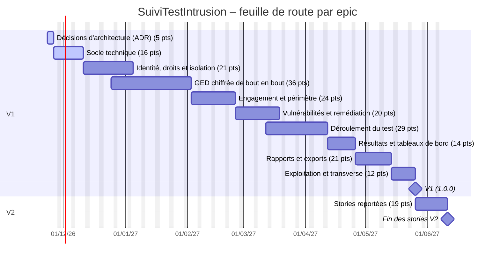

# 22.01 Planification du développement

Planification prévisionnelle du développement de la V1, établie à partir du backlog `.stories/` le 2026-11-21. Ce document ne remplace pas le ledger : les sprints et les statuts officiels restent ceux de `.stories/`, gérés par `ledger.js`. Il donne l'ordre de réalisation, une date de fin estimée et le chemin critique.

## Hypothèses

- **Capacité** : 15 points par sprint de deux semaines (10 jours ouvrés), proche de la vélocité constatée au sprint 1 (13 points livrés sur 27 prévus).
- **Départ** : sprint 2, lundi 2026-11-23 ; les sprints s'enchaînent tous les 14 jours.
- **Flux unique** : les stories sont réalisées l'une après l'autre ; la capacité de 15 points couvre toute l'équipe. Une story occupe une part de sprint proportionnelle à ses points (1 point ≈ 2/3 de jour ouvré, au minimum 1 jour). Les jours fériés et les congés ne sont pas déduits.
- **Ordre** : tri topologique des dépendances écrites dans chaque story (« Dépend de … ») ; à égalité, les stories reportées du sprint 1 d'abord, puis l'ordre des epics : décisions, socle, identité, GED chiffrée, engagement, vulnérabilités, déroulement, résultats, exports, exploitation.
- **Périmètre** : 64 stories ouvertes (217 points). La V1 en compte 61 (198 points). Les 3 stories reportées en V2 (19 points : identite-2, engagement-8, deroulement-9) sont placées après le jalon V1. Les 5 stories terminées au sprint 1 (decisions-1, 2, 3, 7 et 8) ne figurent pas dans les diagrammes.

## Feuille de route par epic

Une barre par epic, de sa première à sa dernière story. Les barres se chevauchent quand une story d'un epic attend une dépendance d'un autre epic.

## Gantt détaillé

Une section par epic, une barre par story (identifiant, titre, points). Les stories du sprint 1 encore ouvertes sont marquées `active`.

```mermaid
gantt
    title SuiviTestIntrusion – stories par epic
    dateFormat YYYY-MM-DD
    axisFormat %d/%m/%y
    excludes weekends
    section Décisions d'architecture (ADR)
    decisions-4 ADR – infrastructure (file d'attente, e-mail, sécurité HTTP) (2) :active, decisions_4, 2026-11-23, 2026-11-24
    decisions-5 ADR – licence, langues V1 et accessibilité (1) :active, decisions_5, 2026-11-24, 2026-11-25
    decisions-6 Mise à jour du cahier des charges et Roadmap V1/V2 (2) :active, decisions_6, 2026-11-25, 2026-11-26
    Fin Décisions d'architecture (ADR) :milestone, m_decisions, 2026-11-26, 0d
    section Socle technique
    socle-1 Squelette Laravel API + SPA Vue 3 (3) :active, socle_1, 2026-11-26, 2026-11-30
    socle-3 CI et outillage de tests (3) :active, socle_3, 2026-11-30, 2026-12-02
    socle-4 Enveloppe d'erreurs et pagination API v1 (3) :active, socle_4, 2026-12-02, 2026-12-04
    socle-2 Docker Compose et installation manuelle (3) :socle_2, 2026-12-04, 2026-12-08
    socle-5 Rate limiting par classe et limite de taille (2) :socle_5, 2026-12-08, 2026-12-09
    socle-6 OpenAPI 3.1, Swagger UI et en-têtes de sécurité (2) :socle_6, 2026-12-09, 2026-12-11
    Fin Socle technique :milestone, m_socle, 2026-12-11, 0d
    section Identité, droits et isolation
    identite-1 Authentification locale et sessions Sanctum (3) :identite_1, 2026-12-11, 2026-12-15
    identite-3 Double authentification e-mail et TOTP (3) :identite_3, 2026-12-15, 2026-12-17
    identite-4 Jetons API personnels scopés (2) :identite_4, 2026-12-17, 2026-12-18
    identite-5 Rôles, ACL et isolation multi-tenant (5) :identite_5, 2026-12-18, 2026-12-23
    identite-6 Journal d'audit (3) :identite_6, 2026-12-23, 2026-12-25
    identite-7 Cycle de vie des utilisateurs (5) :identite_7, 2026-12-31, 2027-01-05
    Fin Identité, droits et isolation :milestone, m_identite, 2027-01-05, 0d
    section GED chiffrée de bout en bout
    ged-chiffree-1 Paire de clés utilisateur et coffre (5) :ged_chiffree_1, 2026-12-25, 2026-12-31
    ged-chiffree-2 Cycle de vie de la clé en mémoire (2) :ged_chiffree_2, 2027-01-05, 2027-01-06
    ged-chiffree-3 Téléversement chiffré (5) :ged_chiffree_3, 2027-01-06, 2027-01-12
    ged-chiffree-4 Téléchargement et déchiffrement (3) :ged_chiffree_4, 2027-01-12, 2027-01-14
    ged-chiffree-5 Partage de CEK piloté par ACL (5) :ged_chiffree_5, 2027-01-14, 2027-01-19
    ged-chiffree-6 Révocation forte et douce (5) :ged_chiffree_6, 2027-01-19, 2027-01-22
    ged-chiffree-7 Validation des fichiers et antivirus (3) :ged_chiffree_7, 2027-01-22, 2027-01-26
    ged-chiffree-8 Métadonnées, recherche, versions et rétention (3) :ged_chiffree_8, 2027-01-26, 2027-01-28
    ged-chiffree-9 Départ d'un utilisateur – trousseaux et propriété (5) :ged_chiffree_9, 2027-01-28, 2027-02-03
    Fin GED chiffrée de bout en bout :milestone, m_ged_chiffree, 2027-02-03, 0d
    section Engagement et périmètre
    engagement-1 Références entreprise, testeurs et clients (2) :engagement_1, 2027-02-03, 2027-02-04
    engagement-2 Création d'un test et statuts (3) :engagement_2, 2027-02-04, 2027-02-08
    engagement-3 Questionnaire d'engagement (5) :engagement_3, 2027-02-08, 2027-02-11
    engagement-4 Périmètre réseau (3) :engagement_4, 2027-02-11, 2027-02-15
    engagement-5 Périmètre étendu (physique, radio, ingénierie sociale) (3) :engagement_5, 2027-02-15, 2027-02-17
    engagement-6 Diagramme réseau Mermaid, objectifs et méthodologies (3) :engagement_6, 2027-02-17, 2027-02-19
    engagement-7 Périmètre applicatif et ressources (5) :engagement_7, 2027-02-19, 2027-02-25
    Fin Engagement et périmètre :milestone, m_engagement, 2027-02-25, 0d
    section Vulnérabilités et remédiation
    vulnerabilites-1 Moteur CVSS v3.1 (3) :vulnerabilites_1, 2027-02-25, 2027-03-01
    vulnerabilites-2 Moteur CVSS v4.0 (5) :vulnerabilites_2, 2027-03-01, 2027-03-04
    vulnerabilites-3 Fiche vulnérabilité (3) :vulnerabilites_3, 2027-03-04, 2027-03-08
    vulnerabilites-4 Impact business (2) :vulnerabilites_4, 2027-03-08, 2027-03-09
    vulnerabilites-5 Fiche de remédiation et priorités (3) :vulnerabilites_5, 2027-03-09, 2027-03-11
    vulnerabilites-6 Règle d'agrégation pour un test mixte v3.1 / v4.0 (1) :vulnerabilites_6, 2027-03-11, 2027-03-12
    vulnerabilites-7 Références MITRE ATT&CK sur tâches et vulnérabilités (3) :vulnerabilites_7, 2027-03-17, 2027-03-19
    Fin Vulnérabilités et remédiation :milestone, m_vulnerabilites, 2027-03-19, 0d
    section Déroulement du test
    deroulement-1 Phases et modèle de tâche (5) :deroulement_1, 2027-03-12, 2027-03-17
    deroulement-2 Attribution des tâches et verrou optimiste (2) :deroulement_2, 2027-03-19, 2027-03-23
    deroulement-3 Planning, jalons et vue Gantt (5) :deroulement_3, 2027-03-23, 2027-03-26
    deroulement-4 Commentaires d'équipe et mentions (2) :deroulement_4, 2027-03-26, 2027-03-29
    deroulement-5 Historique des modifications (2) :deroulement_5, 2027-03-29, 2027-03-31
    deroulement-6 Catalogue d'outils et exécutions (5) :deroulement_6, 2027-03-31, 2027-04-05
    deroulement-7 Import Nmap XML (5) :deroulement_7, 2027-04-05, 2027-04-08
    deroulement-8 Import d'enregistrements asciinema (3) :deroulement_8, 2027-04-08, 2027-04-12
    Fin Déroulement du test :milestone, m_deroulement, 2027-04-12, 0d
    section Résultats et tableaux de bord
    resultats-1 Risque global d'un test (3) :resultats_1, 2027-04-12, 2027-04-14
    resultats-2 Graphiques du tableau de bord (3) :resultats_2, 2027-04-14, 2027-04-16
    resultats-3 Conclusions, mesures et contre-mesures (3) :resultats_3, 2027-04-16, 2027-04-20
    resultats-4 Tableau de bord multi-tests (3) :resultats_4, 2027-04-20, 2027-04-22
    resultats-5 Comparaison entre deux tests d'un même client (2) :resultats_5, 2027-04-22, 2027-04-26
    Fin Résultats et tableaux de bord :milestone, m_resultats, 2027-04-26, 0d
    section Rapports et exports
    exports-1 Moteur de rapport et modèles par défaut (5) :exports_1, 2027-04-26, 2027-04-29
    exports-2 Formats PDF, OpenDocument et HTML (5) :exports_2, 2027-04-29, 2027-05-04
    exports-3 Personnalisation des modèles (3) :exports_3, 2027-05-04, 2027-05-06
    exports-4 Annexes de preuves construites dans le navigateur (3) :exports_4, 2027-05-06, 2027-05-10
    exports-5 Export et import JSON/XML de migration (5) :exports_5, 2027-05-10, 2027-05-14
    Fin Rapports et exports :milestone, m_exports, 2027-05-14, 0d
    section Exploitation et transverse
    exploitation-1 Notifications in-app et e-mail (3) :exploitation_1, 2027-05-14, 2027-05-18
    exploitation-2 Sauvegardes avec Portabase (3) :exploitation_2, 2027-05-18, 2027-05-20
    exploitation-3 Internationalisation FR/EN (2) :exploitation_3, 2027-05-20, 2027-05-21
    exploitation-4 Glossaire et aide contextuelle (1) :exploitation_4, 2027-05-21, 2027-05-24
    exploitation-5 Durcissement, RGPD et audit de sécurité de l'outil (3) :exploitation_5, 2027-05-24, 2027-05-26
    Fin Exploitation et transverse :milestone, m_exploitation, 2027-05-26, 0d
    section Version
    V1 (1.0.0) :milestone, v1d, 2027-05-26, 0d
    section V2 (reportées)
    identite-2 Authentification LDAP et Active Directory (3) :identite_2, 2027-05-26, 2027-05-28
    engagement-8 Validation formelle de l'engagement (8) :engagement_8, 2027-05-28, 2027-06-04
    deroulement-9 Import Nessus, Burp Suite et OWASP ZAP (8) :deroulement_9, 2027-06-04, 2027-06-11
    Fin des stories V2 :milestone, v2d, 2027-06-11, 0d
```

## Sprints prévus

`↳` : story commencée au sprint précédent ; `→` : story qui se poursuit au sprint suivant. Les points sont ceux consommés dans le sprint.

| **Sprint** | **Début** | **Fin** | **Stories** | **Points** |
| --- | --- | --- | --- | --- |
| 2 | 2026-11-23 | 2026-12-06 | decisions-4, decisions-5, decisions-6, socle-1, socle-3, socle-4, socle-2 → | 15 |
| 3 | 2026-12-07 | 2026-12-20 | ↳ socle-2, socle-5, socle-6, identite-1, identite-3, identite-4, identite-5 → | 15 |
| 4 | 2026-12-21 | 2027-01-03 | ↳ identite-5, identite-6, ged-chiffree-1, identite-7 → | 15 |
| 5 | 2027-01-04 | 2027-01-17 | ↳ identite-7, ged-chiffree-2, ged-chiffree-3, ged-chiffree-4, ged-chiffree-5 → | 15 |
| 6 | 2027-01-18 | 2027-01-31 | ↳ ged-chiffree-5, ged-chiffree-6, ged-chiffree-7, ged-chiffree-8, ged-chiffree-9 → | 15 |
| 7 | 2027-02-01 | 2027-02-14 | ↳ ged-chiffree-9, engagement-1, engagement-2, engagement-3, engagement-4 → | 15 |
| 8 | 2027-02-15 | 2027-02-28 | ↳ engagement-4, engagement-5, engagement-6, engagement-7, vulnerabilites-1 | 15 |
| 9 | 2027-03-01 | 2027-03-14 | vulnerabilites-2, vulnerabilites-3, vulnerabilites-4, vulnerabilites-5, vulnerabilites-6, deroulement-1 → | 15 |
| 10 | 2027-03-15 | 2027-03-28 | ↳ deroulement-1, vulnerabilites-7, deroulement-2, deroulement-3, deroulement-4 → | 15 |
| 11 | 2027-03-29 | 2027-04-11 | ↳ deroulement-4, deroulement-5, deroulement-6, deroulement-7, deroulement-8 → | 15 |
| 12 | 2027-04-12 | 2027-04-25 | ↳ deroulement-8, resultats-1, resultats-2, resultats-3, resultats-4, resultats-5 | 15 |
| 13 | 2027-04-26 | 2027-05-09 | exports-1, exports-2, exports-3, exports-4 → | 15 |
| 14 | 2027-05-10 | 2027-05-23 | ↳ exports-4, exports-5, exploitation-1, exploitation-2, exploitation-3, exploitation-4 | 15 |
| 15 | 2027-05-24 | 2027-06-06 | exploitation-5, identite-2 (V2), engagement-8 (V2), deroulement-9 (V2) → | 15 |
| 16 | 2027-06-07 | 2027-06-20 | ↳ deroulement-9 (V2) | 7 |

## Jalons

| **Jalon** | **Date prévue** |
| --- | --- |
| ADR tranchés (decisions-4, 5 et 6) | 2026-11-26 |
| Socle prêt (API v1, CI, Docker, OpenAPI) | 2026-12-11 |
| Identité et droits | 2027-01-05 |
| GED chiffrée | 2027-02-03 |
| Engagement et périmètre | 2027-02-25 |
| Vulnérabilités et remédiation | 2027-03-19 |
| Déroulement du test | 2027-04-12 |
| Résultats et tableaux de bord | 2027-04-26 |
| Rapports et exports | 2027-05-14 |
| **V1 (1.0.0)** | **2027-05-26** |
| Stories V2 reportées | 2027-06-11 |

Avant la V1, les versions restent en `0.x.y` ([[41.01 Versionnage et procédure de livraison]]).

## Chemin critique

La plus longue chaîne de dépendances entre stories ouvertes compte 49 points, soit environ 3,3 sprints :

socle-1 → socle-4 → socle-5 → identite-1 → identite-5 → engagement-1 → engagement-2 → engagement-4 → vulnerabilites-3 → vulnerabilites-5 → resultats-1 → resultats-3 → exports-1 → exports-2 → exports-3.

Avec un seul flux, la date de fin dépend du total des points, pas du chemin critique. Une deuxième personne ne raccourcirait pas cette chaîne, mais pourrait mener en parallèle les stories qui n'en font pas partie (GED chiffrée, déroulement, CVSS v4.0, exploitation).

## Risques

- **ADR encore ouverts** : decisions-4 (infrastructure) bloque socle-2, socle-6 et exploitation-1 ; decisions-5 (licence, langues) bloque exploitation-3 ; decisions-6 (mise à jour du CDC, Roadmap) suppose les deux. Un retard sur ces ADR décale tout le socle.
- **GED chiffrée** : epic le plus lourd (36 points) et le plus risqué techniquement (chiffrement dans le navigateur, [[13.01 Format de chiffrement des preuves]], [[13.05 Trousseau d'équipe et départ d'un utilisateur]]). Le rechiffrement en flux n'a été mesuré que sous Node.
- **Fin d'année** : les sprints 4 et 5 couvrent les fêtes (2026-12-21 au 2027-01-17) ; la capacité réelle y sera probablement plus faible.
- **Vélocité** : 15 points par sprint est une hypothèse issue d'un seul sprint, consacré surtout à des ADR. À recalibrer après le premier sprint de code.
- **Points de 12.01 encore ouverts** (§2.5, §2.7 à §2.9, §2.11, §2.12, §3, §4.3, §4.5, §4.6, §5 et §6) : leur traitement peut ajouter des stories ou en réestimer.

## Mise à jour

À chaque fin de sprint :

1. Mettre à jour le ledger (`story-lifecycle`) ;
2. Régénérer les diagrammes à partir de `.stories/` avec la même méthode (capacité recalée sur la vélocité moyenne des sprints de code) ;
3. Noter en tête de ce document la date de régénération et l'écart entre la date de V1 prévue et la précédente.
