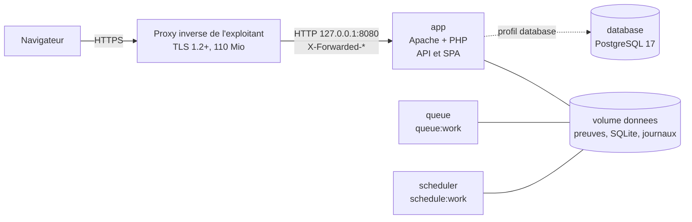

# 42.01 Installation avec Docker Compose

Installation recommandée ([[11.02 Socle technique]]). Les règles d'infrastructure viennent de [[13.06 Infrastructure, e-mail et sécurité HTTP]] ; l'installation sans Docker est décrite dans [[42.02 Installation manuelle]].

## Architecture



| **Service** | **Rôle** |
| --- | --- |
| `app` | API Laravel et SPA compilée, sur la même origine ; HTTP seul, publié sur `127.0.0.1:8080`. Applique les migrations au démarrage |
| `queue` | Worker de la file d'attente : `php artisan queue:work --tries=3 --backoff=10,60,300` (pilote `database`) |
| `scheduler` | Planificateur Laravel : `php artisan schedule:work` (purges) |
| `database` | PostgreSQL 17, **optionnelle** (profil `database`) ; sans elle, SQLite dans le volume des données |

Les trois premiers services partagent l'image construite depuis `docker/Dockerfile` et le volume `donnees` (`storage/` de Laravel : preuves chiffrées, base SQLite, journaux, sessions). Ils tournent sans les droits root. Aucun e-mail n'est envoyé en V1.

## Prérequis

- Docker Engine 24 ou plus, avec Compose v2.20 ou plus ;
- un proxy inverse qui termine le TLS (nginx, Caddy, Apache, Traefik…) et un certificat pour le nom de l'instance ;
- environ 2 Go de disque pour l'image, plus le volume des preuves.

## Installation pas à pas

Toutes les commandes partent de la racine du dépôt.

1. Récupérer le code :

   ```bash
   git clone https://github.com/ILPlais/SuiviTestIntrusion.git
   cd SuiviTestIntrusion
   ```

2. Créer la configuration et la protéger (elle contiendra la clé de l'application) :

   ```bash
   cp docker/.env.example docker/.env
   chmod 600 docker/.env
   ```

3. Construire l'image, puis générer la clé de l'application et la reporter dans `APP_KEY` :

   ```bash
   docker compose --file docker/compose.yaml build
   docker compose --file docker/compose.yaml run --rm --no-deps --entrypoint php app artisan key:generate --show
   ```

   La clé chiffre les sessions et les cookies : elle se conserve avec les sauvegardes. La changer déconnecte tous les utilisateurs.

4. Renseigner dans `docker/.env` :
   - `APP_URL` : l'adresse publique, en `https://` ;
   - `TRUSTED_PROXIES` : l'adresse d'où le proxy se connecte (voir « Proxy inverse ») ;
   - au besoin `DOCKER_SUBNET`, si `172.31.250.0/24` est déjà utilisé sur l'hôte, et `TRUSTED_PROXIES` en conséquence (passerelle en `.1`).

5. Choisir la base :
   - **SQLite** (par défaut) : rien à faire, la base est créée dans le volume ; adaptée à une petite équipe ;
   - **PostgreSQL intégrée** : remplacer le bloc SQLite de `docker/.env` par le bloc PostgreSQL commenté, choisir un mot de passe long (`openssl rand -hex 24`), et ajouter `--profile database` à toutes les commandes `docker compose` ;
   - **base externe** (MySQL 8, MariaDB 10.11+, PostgreSQL 15+) : mêmes variables, `DB_HOST` désignant le serveur.

6. Démarrer :

   ```bash
   docker compose --file docker/compose.yaml up --detach --wait
   ```

   `app` applique les migrations, puis `queue` et `scheduler` démarrent. Vérifier :

   ```bash
   docker compose --file docker/compose.yaml ps
   curl --fail http://127.0.0.1:8080/api/v1/health
   ```

7. Configurer le proxy inverse (section suivante), puis ouvrir l'adresse publique.

## Essayer l'application

Cette procédure déroule le parcours de la première version testable : organisation cliente, test, périmètre réseau, vulnérabilités cotées en CVSS v3.1 avec leur remédiation, risque global du test. Les preuves chiffrées, les exports et le suivi des tâches ne sont pas encore livrés.

Les commandes s'écrivent `dc exec app php artisan …` avec Docker Compose (`dc` : voir « Exploitation »), ou `php artisan …` depuis `backend/` en développement.

1. Créer le premier administrateur, puis ouvrir le lien d'activation affiché pour choisir son mot de passe (15 caractères au moins) :

   ```bash
   dc exec app php artisan suivi:create-admin admin@exemple.test --name="Administrateur"
   ```

2. Créer les données de démonstration (une seule fois par instance) :

   ```bash
   dc exec app php artisan suivi:demo
   ```

   La commande crée l'organisation fictive « Banque Exemple (démo) » et le test PT-DEMO-001 « Test externe du site vitrine », en cours. Le test contient un périmètre de quatre machines, dont une exclue, avec leurs services et deux comptes de test. Il contient aussi quatre vulnérabilités, de critique à mineure, avec leurs remédiations. La commande affiche un lien d'activation pour trois comptes rattachés à l'organisation : `chef.projet@demo.example.test` (chef de projet), `testeur@demo.example.test` (testeur) et `client@demo.example.test` (client final).

3. Dérouler le parcours avec l'administrateur, ou avec chacun des comptes pour voir ses droits :

   | **Étape**      | **Où**                     | **À vérifier**                                                                                                                         |
   | -------------- | -------------------------- | -------------------------------------------------------------------------------------------------------------------------------------- |
   | Fiche du test  | Tests › PT-DEMO-001        | Synthèse du risque : gravité « Critique 9,8 », score moyen pondéré, profil d'impact, compteurs                                         |
   | Périmètre      | « Périmètre du test »      | Machines et services, `srv-paiement` exclue avec son commentaire, plages interdites ; ajout d'une machine, d'un service, d'un compte    |
   | Vulnérabilités | « Vulnérabilités du test » | Liste V-001 à V-004 triée par référence ; création d'une fiche                                                                         |
   | Cotation       | Fiche d'une vulnérabilité  | Boutons des huit métriques, aperçu du score pendant la saisie, score recalculé à l'enregistrement                                      |
   | Remédiation    | Fiche d'une vulnérabilité  | Priorité suggérée depuis la cotation ; surcharge réservée au chef de projet ; « Vérifié » exige un résultat de retest                   |
   | Droits         | Comptes de démonstration   | Le testeur tient le périmètre et les vulnérabilités ; le client lit et peut seulement déclarer une correction ; une autre organisation reste invisible |

   Marquer une vulnérabilité « Vérifié » la retire des indicateurs : la synthèse du risque de la fiche du test se met à jour.

## Proxy inverse

En V1, le conteneur `app` ne parle qu'en HTTP et n'est publié que sur `127.0.0.1` : un proxy inverse fourni par l'exploitant termine le TLS. Le service web HTTPS intégré viendra en V2 (story socle-7).

Exigences (13.06) :

| **Exigence** | **Valeur** |
| --- | --- |
| Protocoles | TLS 1.2 au minimum, TLS 1.3 privilégié ; suites « intermediate » de Mozilla |
| HTTP | Redirection permanente vers HTTPS |
| En-têtes transmis | `X-Forwarded-For`, `X-Forwarded-Proto`, `X-Forwarded-Host` (et `X-Forwarded-Port`) |
| Taille de corps | 110 Mio au moins (fichier de 100 Mio chiffré, plus le reste de la requête) |
| HSTS | Inutile dans le proxy : envoyé par l'application (story socle-6) |

Exemples fournis, vérifiés par le test de fumée de la CI pour nginx :

- `docker/proxy/nginx.conf.example` : à copier dans `/etc/nginx/conf.d/`, en adaptant `server_name` et les chemins des certificats ;
- `docker/proxy/Caddyfile.example` : Caddy obtient le certificat lui-même.

**Proxys de confiance.** Laravel n'accepte les en-têtes `X-Forwarded-*` que de l'adresse déclarée dans `TRUSTED_PROXIES` (adresses ou réseaux CIDR séparés par des virgules). La valeur `*` est refusée et signalée dans le journal : n'importe quel client pourrait sinon se faire passer pour une connexion HTTPS ou usurper son adresse. Selon l'emplacement du proxy :

| **Proxy** | **TRUSTED_PROXIES** |
| --- | --- |
| Sur l'hôte Docker, vers `127.0.0.1:8080` | La passerelle du réseau interne : `172.31.250.1` par défaut |
| Conteneur relié au réseau `suivi-test-intrusion_interne` | L'adresse du conteneur du proxy, ou le sous-réseau |
| Sur une autre machine | L'adresse de cette machine ; publier alors le port sur l'interface voulue (`APP_BIND`) et filtrer l'accès au port 8080 |

Contrôle : derrière le proxy, `https://<instance>/api/v1/health` répond `{"status":"ok", …}`, et l'adresse du client lue par Laravel (journal d'audit, limites de débit) est celle du navigateur, pas celle du proxy. Le journal d'accès d'Apache, lui, montre toujours l'adresse du proxy.

Avec un proxy sur l'hôte, tout processus local qui contacte `127.0.0.1:8080` passe par la même passerelle et est donc cru : réserver l'hôte à l'exploitation. Sous Docker Desktop, la passerelle n'est pas l'adresse `.1` du sous-réseau ; relier alors le proxy au réseau `suivi-test-intrusion_interne` et déclarer son adresse.

## Exploitation

| **Action** | **Commande** (`dc` = `docker compose --file docker/compose.yaml`) |
| --- | --- |
| Journaux | `dc logs --follow app queue scheduler` |
| Arrêt / démarrage | `dc stop` / `dc up --detach --wait` |
| Commande Artisan | `dc exec app php artisan <commande>` |
| Jobs en échec | `dc exec app php artisan queue:failed`, puis `queue:retry <id>` |
| Mise à jour | `git pull`, puis `dc build` et `dc up --detach --wait` (migrations appliquées par `app`) |

Après une mise à jour du code, `queue` et `scheduler` sont recréés avec la nouvelle image par `up`. Pour désactiver les migrations automatiques (par exemple pour les lancer à la main pendant une fenêtre de maintenance), ajouter `RUN_MIGRATIONS=false` à `docker/.env`.

## Sauvegardes

À sauvegarder ensemble, pour un même instant :

- le volume `donnees` (preuves chiffrées et, avec SQLite, la base) : `docker run --rm --volume suivi-test-intrusion_donnees:/donnees:ro --volume "$PWD":/sauvegarde debian:bookworm-slim tar --create --gzip --file /sauvegarde/donnees.tar.gz --directory /donnees .` ;
- la base PostgreSQL, le cas échéant : `dc --profile database exec database pg_dump --username suivi suivi > base.sql` ;
- `docker/.env`, qui contient `APP_KEY`.

Pour une sauvegarde cohérente avec SQLite, arrêter d'abord `app`, `queue` et `scheduler` (`dc stop`). Les preuves étant chiffrées dans le navigateur, une sauvegarde volée ne révèle pas leur contenu ; elle révèle en revanche les métadonnées de la base.

## Vérification automatique

Le job `docker` de la CI exécute `docker/tests/smoke.sh` : construction de l'image, démarrage avec SQLite, SPA et API sur la même origine, réglages de PHP, proxy nginx d'exemple (TLS 1.2 et 1.3, refus de TLS 1.1, redirection, corps de 105 Mio), puis démarrage avec PostgreSQL. Le script peut aussi être lancé à la main sur un poste disposant de Docker, s'il n'y a pas de `docker/.env`.
